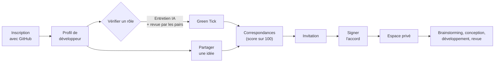
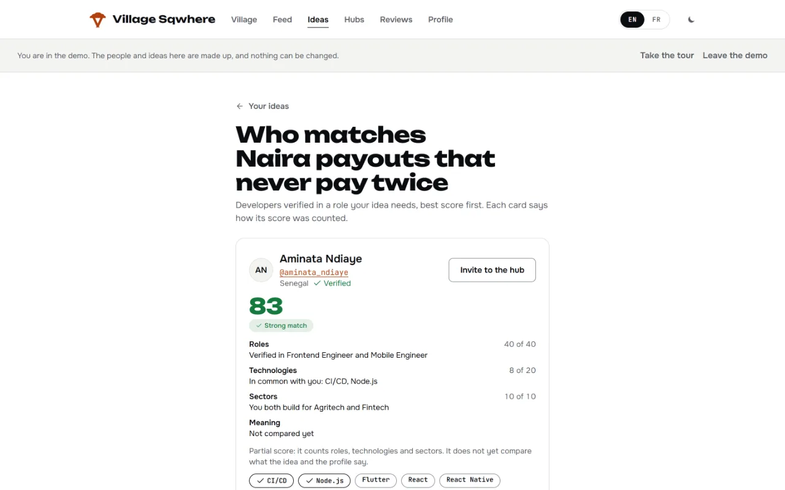
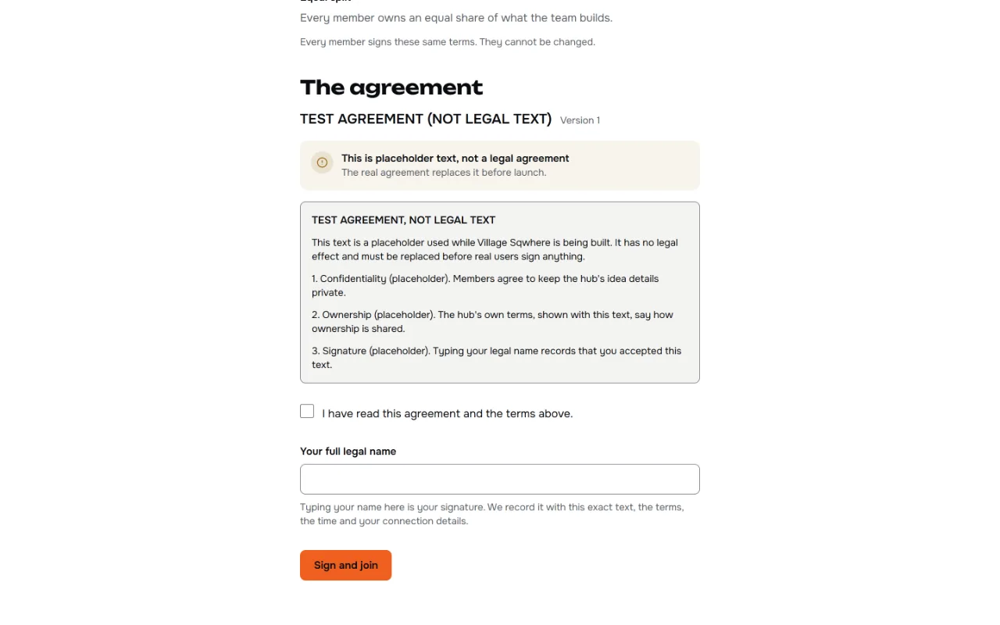
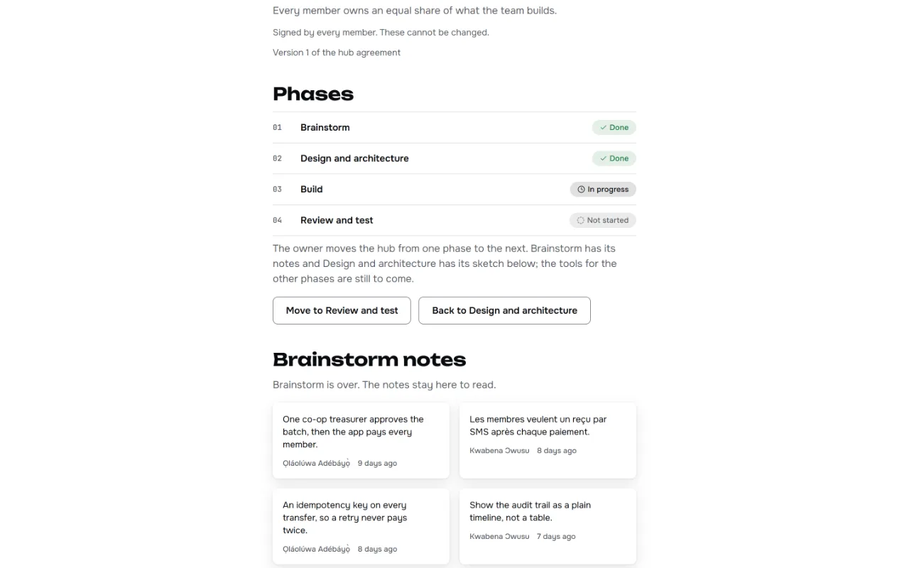
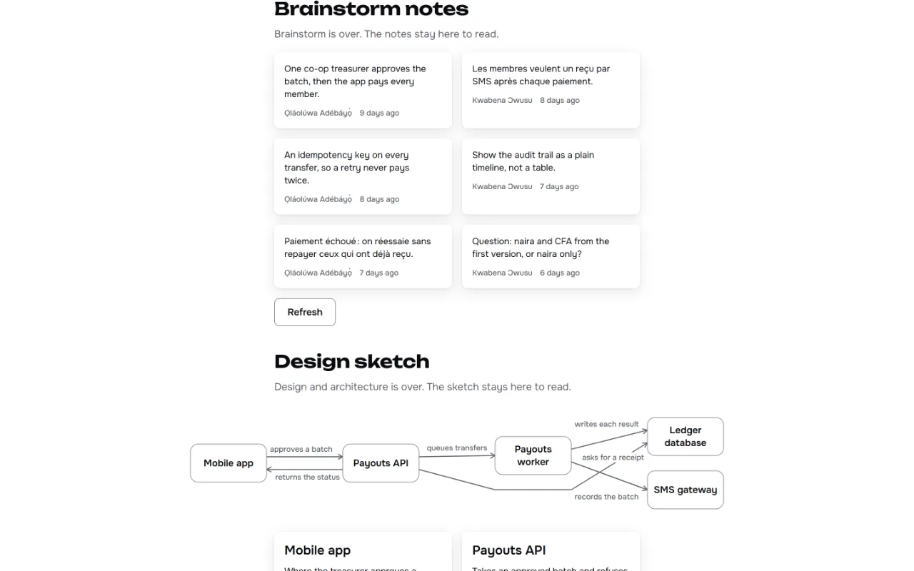
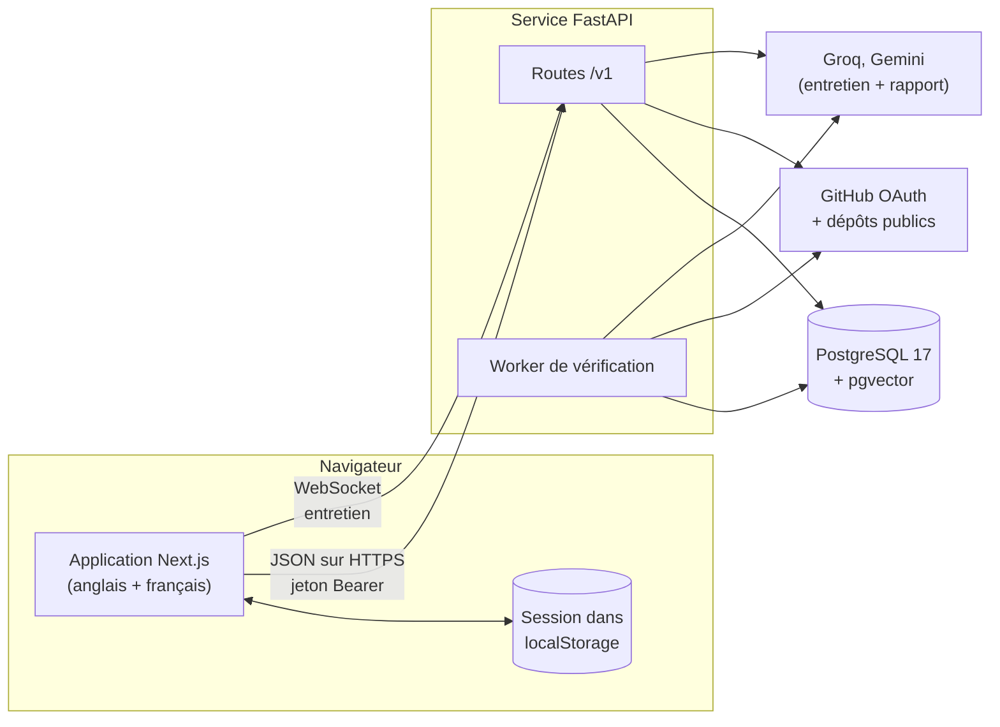
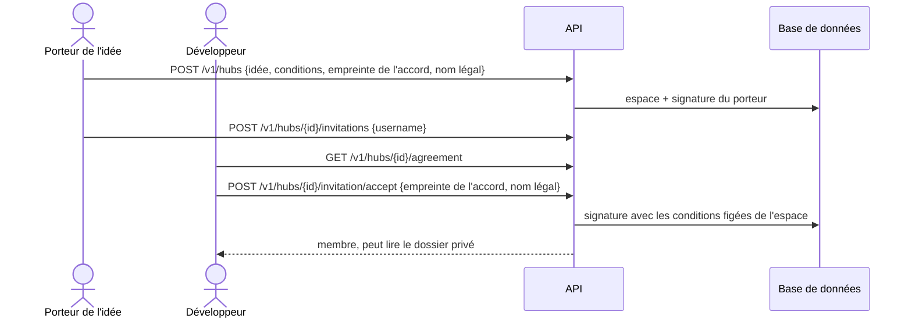

<div align="center">


# Village Sqwhere

### Construisez votre idée avec des développeurs de confiance.

La place du village des développeurs africains : apportez une idée, rencontrez des
développeurs vérifiés qui veulent la construire avec vous, mettez-vous d'accord une seule fois
sur les conditions, et construisez-la ensemble dans votre propre espace privé.

[English](README.md) · **Français**

[](https://systalink.com/en/africa-cup-of-developers-acodev)
[](#pensé-pour-les-développeurs-africains)
[](LICENSE)

[Pourquoi Village Sqwhere](#pourquoi-les-développeurs-choisissent-village-sqwhere) · [Comment ça marche](#comment-ça-marche) · [Aperçu](#aperçu) · [L'essayer](#lessayer) · [Pour les développeurs](#pour-les-développeurs)


</div>

---

## Le problème

L'Afrique ne manque pas de développeurs qui ont de bonnes idées. Ce qui manque, c'est un moyen
de transformer une idée en équipe :

- **Les bonnes personnes sont difficiles à trouver.** Les plateformes pour développeurs sont
  faites pour le recrutement : profils pour recruteurs, offres d'emploi, CV. Rien n'aide à
  trouver quelqu'un qui veut *construire* votre idée.
- **Les compétences sont difficiles à vérifier.** N'importe qui peut écrire « ingénieur
  senior » sur un profil.
- **Partager fait peur.** Beaucoup d'idées restent dans un carnet, parce que leur auteur craint
  de les perdre dès qu'il les explique.

## Pourquoi les développeurs choisissent Village Sqwhere

<table>
<tr>
<td width="50%" valign="top">

### Des partenaires, pas des employeurs
Village Sqwhere sert à construire ensemble. Vous apportez une idée et trouvez des personnes qui
veulent la construire avec vous, en équipe, avec des conditions de propriété partagées, et non
comme des salariés.

</td>
<td width="50%" valign="top">

### Des compétences vérifiées
Un rôle obtient le **Green Tick** seulement après la lecture des dépôts publics du développeur,
cinq questions d'un intervieweur IA sur son propre code, et la revue du rapport par un
développeur déjà vérifié dans ce rôle.

</td>
</tr>
<tr>
<td valign="top">

### Partager sans perdre son idée
Chaque idée a un **résumé public** et un **dossier privé**. Le dossier ne s'ouvre qu'aux
membres de l'équipe, et chacun signe d'abord le même accord et les mêmes conditions de
propriété. Le texte exact signé par chaque personne est enregistré.

</td>
<td valign="top">

### Des correspondances qui s'expliquent
Les développeurs vérifiés dans les rôles dont votre idée a besoin sont classés par un score sur
100, et chaque carte montre son calcul : rôles, technologies et secteurs en commun. Aucune
boîte noire.

</td>
</tr>
<tr>
<td valign="top">

### Un seul lieu, de la première note au lancement
Chaque équipe a son espace privé : le dossier, les conditions signées, une discussion d'équipe,
des notes de brainstorming, un schéma de conception partagé, et quatre phases, du
brainstorming à la conception, au développement et à la revue.

</td>
<td valign="top">

### Pensé pour les développeurs africains
Anglais et français partout, du premier écran à l'entretien avec l'IA. Les profils indiquent
l'un des 54 pays africains, et les idées s'organisent autour de secteurs comme la fintech,
l'agritech, la santé et l'éducation.

</td>
</tr>
</table>

## Pour qui

| Vous êtes | Village Sqwhere vous apporte |
|---|---|
| **Un développeur avec une idée** | Des personnes vérifiées dans les rôles qui vous manquent, classées et expliquées, et un moyen sûr de leur montrer tout le projet |
| **Un développeur qui veut construire quelque chose de réel** | Des idées qui ont besoin de vos compétences (« Pour vous »), et un Green Tick qui montre aux porteurs d'idées ce que vous savez faire |
| **Un développeur vérifié** | Votre mot à dire sur qui d'autre est vérifié dans votre rôle, grâce à la revue par les pairs |
| **Un membre de la communauté** | Un fil de publications, de questions et d'avancées de développeurs de tout le continent |

## Comment ça marche

| Étape | Ce qui se passe | Écran |
|---|---|---|
| 1. Inscription | Un clic avec GitHub. Aucun nouveau mot de passe. | [Connexion](docs/images/screens/1-sign-up.webp) |
| 2. Profil de développeur | Rôles, technologies, secteurs et pays. Vérifiez un rôle pour obtenir le Green Tick. | [Profil](docs/images/screens/2-developer-profile.webp) |
| 3. Partager une idée | Un résumé public pour tous, un dossier privé que seule l'équipe lira. | [Idée](docs/images/screens/3-submit-idea.webp) |
| 4. Trouver son équipe | Des développeurs vérifiés dans les rôles dont l'idée a besoin, classés par un score sur 100. | [Correspondances](docs/images/screens/4-ai-matches.webp) |
| 5. Accepter l'invitation | Le développeur invité lit les conditions, puis accepte ou refuse. | [Invitation](docs/images/screens/5-accept-match.webp) |
| 6. Signer l'accord | Saisir son nom légal vaut signature. Le texte exact, les conditions et l'heure sont enregistrés. | [Accord](docs/images/screens/6-sign-nda.webp) |
| 7. Entrer dans l'espace | Le dossier privé, l'équipe, les conditions signées et la discussion d'équipe au même endroit. | [Espace](docs/images/screens/7-collaboration-hub.webp) |
| 8. Construire ensemble | Brainstorming, conception et architecture, développement, revue et tests, avec des notes et un schéma de conception partagé. | [Notes](docs/images/screens/8-build-together.webp), [schéma](docs/images/screens/8b-build-together-design-sketch.webp) |



## Aperçu

<table>
<tr>
<td width="50%"><br /><b>Des correspondances qui montrent leur calcul.</b> Chaque point du score est expliqué.</td>
<td width="50%"><br /><b>Un seul accord, signé par tous.</b> Le dossier ne s'ouvre qu'après.</td>
</tr>
<tr>
<td><br /><b>Un espace qui avance par phases.</b> Brainstorming, conception, développement, revue.</td>
<td><br /><b>Concevoir ensemble.</b> Un schéma partagé du système que l'équipe va construire.</td>
</tr>
</table>

Toutes les personnes et idées de ces écrans sont inventées. Les captures montrent l'interface
en anglais.

## L'essayer

Le site en ligne arrive bientôt. En attendant, lancez-le sur votre ordinateur en quelques
minutes (voir [Lancer en local](#lancer-en-local)) et cliquez sur **Essayer la démo** : une
visite en lecture seule d'un village rempli de développeurs, d'idées et d'espaces inventés,
sans compte.

---

## Pour les développeurs

La suite de cette page s'adresse à celles et ceux qui veulent lire, lancer ou faire évoluer le
code.

### Ce qui est construit

| Domaine | Ce qu'un développeur peut faire | Principales routes de l'API |
|---|---|---|
| Connexion | Connexion GitHub avec PKCE, renouvellement du jeton, déconnexion ; un compte de démonstration en lecture seule | `/v1/auth/*` |
| Profil | Nom, bio, pays, rôles, technologies, secteurs ; le profil public d'un autre développeur ; suppression du compte | `/v1/me`, `/v1/users/{username}`, `/v1/me/deletion` |
| Vérification | Analyse des dépôts, entretien de cinq questions avec l'IA, rapport, puis revue par des développeurs vérifiés | `/v1/me/verifications/*`, `/v1/reviews/*` |
| Idées | Brouillon, publication, fermeture ou suppression ; parcourir les idées ouvertes ; « Pour vous » | `/v1/me/ideas/*`, `/v1/ideas`, `/v1/me/matches` |
| Correspondances | Les développeurs vérifiés dans les rôles d'une idée, notés sur les rôles, les technologies et les secteurs | `/v1/me/ideas/{id}/matches` |
| Espaces | Créer à partir d'une idée, inviter, demander à rejoindre, signer, quitter, retirer, archiver | `/v1/hubs/*` |
| Collaboration | Discussion d'équipe, quatre phases, notes de brainstorming, schéma de conception en blocs et liens | `/v1/hubs/{id}/messages`, `/phase`, `/notes`, `/design` |
| Fil communautaire | Publications, commentaires, réponses, j'aime, enregistrements, sujets | `/v1/feed`, `/v1/posts/*`, `/v1/comments/*` |

<p>
  
</p>

### Architecture



L'application web n'est qu'un client de l'API : elle n'a ni accès à la base de données ni
secret. Le worker de vérification exécute les étapes longues (lecture des dépôts du
développeur, rédaction du rapport) hors de la requête, et la page interroge la tentative au
lieu de l'attendre.



Les conditions d'un espace sont figées à sa création et copiées dans chaque signature : chaque
membre signe exactement le même accord. Plus de détails dans
[`docs/architecture.md`](docs/architecture.md) et les décisions de [`docs/decisions/`](docs/decisions/).

### Technologies

| Couche | Choix | Pourquoi |
|---|---|---|
| Web | Next.js 16 (App Router), React 19, TypeScript, modules CSS sur des tokens de design | Une seule base de code pour les deux langues, pages rendues côté serveur, aucun kit d'interface à contourner |
| API | Python 3.13, FastAPI, SQLAlchemy asynchrone, Pydantic | Requêtes et réponses typées, documentation OpenAPI sur `/docs` |
| Base de données | PostgreSQL 17 avec pgvector | Données relationnelles et vecteurs de similarité d'idées dans un seul stockage |
| IA | Groq et Gemini, l'un prenant le relais de l'autre | L'entretien de vérification, la transcription vocale et le rapport |
| Outils | pnpm, uv, Docker Compose, Vitest, pytest, Ruff, ESLint | Installations rapides et une commande par tâche |
| Hébergement | Vercel (web, API et worker dans un seul projet) | Un seul domaine pour l'application et son API ; voir [`infra/README.md`](infra/README.md#deployment-vercel) |

### Lancer en local

Il vous faut [Node.js](https://nodejs.org/) 22 ou plus récent (24 recommandé),
[uv](https://docs.astral.sh/uv/) pour Python, et [Docker](https://www.docker.com/) pour la base
de données.

```bash
git clone https://github.com/AI-UNIPOD/Village-Sqwhere-ACODEV.git
cd Village-Sqwhere-ACODEV
corepack enable        # fournit la version de pnpm épinglée
pnpm install
cp .env.example .env   # puis définissez JWT_SECRET_KEY dans .env (le fichier explique comment)
pnpm db:up             # Postgres + pgvector sur localhost:5432
pnpm dev:api           # API sur http://localhost:8000 (documentation sur /docs)
pnpm dev:web           # application web sur http://localhost:3000 (dans un second terminal)
```

Pour explorer sans application GitHub, activez la démo en lecture seule : mettez
`DEMO_ENABLED=true` dans `.env`, remplissez la base avec des personnes et des idées inventées,
redémarrez l'API, puis cliquez sur « Essayer la démo ».

```bash
uv run --directory apps/api python -m app.demo_seed
```

| Variable | Rôle |
|---|---|
| `JWT_SECRET_KEY` | Signe les jetons d'accès. Obligatoire, 32 caractères ou plus. |
| `DATABASE_URL`, `TEST_DATABASE_URL` | Les bases de développement et de test. |
| `GITHUB_CLIENT_ID`, `GITHUB_CLIENT_SECRET` | Votre propre application OAuth GitHub, pour une vraie connexion. |
| `GROQ_API_KEY`, `GEMINI_API_KEY` | L'entretien avec l'IA et le rapport. |
| `DEMO_ENABLED` | Active « Essayer la démo ». Désactivé par défaut. |
| `NEXT_PUBLIC_API_URL` | Où l'application web trouve l'API. |

La liste complète, avec les valeurs par défaut, est dans [`.env.example`](.env.example).

### Organisation du dépôt

```text
apps/
  web/          application Next.js : tous les écrans, en anglais et en français  (apps/web/README.md)
  api/          service FastAPI, worker de vérification, données de démo         (apps/api/README.md)
infra/          Postgres + pgvector dans Docker, scripts du schéma                (infra/README.md)
docs/           architecture, référence de l'API, décisions, design system        (docs/README.md)
.github/        workflow CI et modèle de pull request
CHANGELOG.md    ce qui a changé, du plus récent au plus ancien
```

### Contrôles qualité

```bash
pnpm lint:web && pnpm test:web && pnpm build:web   # ESLint, 1 313 tests Vitest, build de production
pnpm lint:api && pnpm test:api                     # Ruff, 839 tests pytest sur un vrai Postgres
```

Chaque pull request porte une seule fonctionnalité ou correction, avec des tests pour chaque
changement de comportement, un titre de commit conventionnel sur une ligne et une ligne de
changelog. Les tests web couvrent les états de chargement, vide, erreur et succès, les deux
langues et l'affichage sur téléphone à 360px.

### Sécurité

| Domaine | Ce que fait l'application | Où |
|---|---|---|
| Connexion | GitHub OAuth avec PKCE ; jetons d'accès de 15 minutes et jetons de renouvellement à rotation | `apps/api/app/api/v1/auth.py` |
| Dossiers privés | Seuls les membres actifs d'un espace, qui ont signé, lisent le dossier d'une idée | `apps/api/app/api/v1/hub_members.py` |
| Signatures | L'empreinte SHA-256 du texte, les conditions figées et l'heure sont enregistrées ; un modèle publié ne peut plus être modifié | `infra/db/init/002-schema.sql`, `003-hub-terms.sql` |
| Démo | Le compte de démonstration est en lecture seule, et son contenu n'atteint jamais les vrais développeurs | `apps/api/app/api/deps.py` |
| Suppression du compte | Confirmée en saisissant son nom d'utilisateur ; le compte est anonymisé et ses publications restent sous « Compte supprimé » | `apps/api/app/services/account_deletion.py` |
| Secrets | Aucun dans le dépôt ; les réglages viennent de l'environnement | `.env.example` |

### Contribuer

Lisez [CONTRIBUTING.md](CONTRIBUTING.md) pour l'installation et le parcours d'un changement
jusqu'à `main`, avec la règle des commits. Vous travaillez sur
l'interface ? Commencez par le [design system](docs/design-system/README.md).

## Licence

Village Sqwhere est publié sous [licence MIT](LICENSE).

## Remerciements

Village Sqwhere a été construit à l'**[AI UniPod de l'Université de Lagos](https://aiunipod.unilag.edu.ng/)**,
le pôle d'innovation et de résolution de problèmes par l'IA de l'université, pour
[ACODev 2026](https://systalink.com/en/africa-cup-of-developers-acodev), la Coupe d'Afrique des
Développeurs organisée par Systalink.

---

<div align="center">


**Village Sqwhere** · Construit à l'[AI UniPod de l'Université de Lagos](https://aiunipod.unilag.edu.ng/) pour [ACODev 2026](https://systalink.com/en/africa-cup-of-developers-acodev)

<sub>[Licence MIT](LICENSE) · [English](README.md) · **Français**</sub>

</div>
