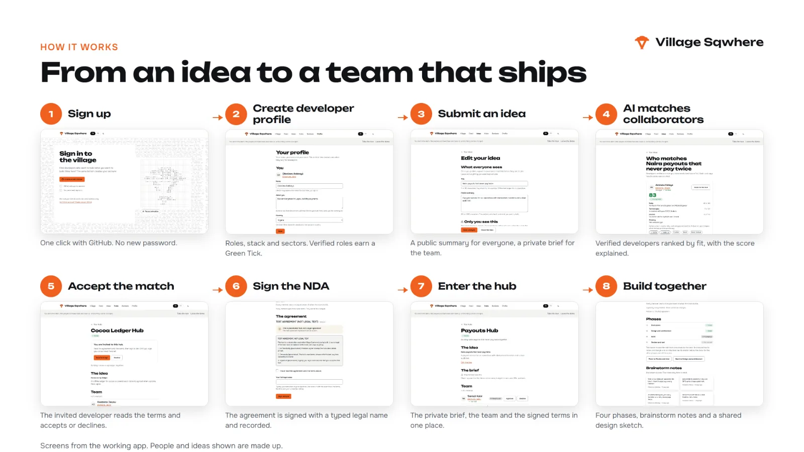
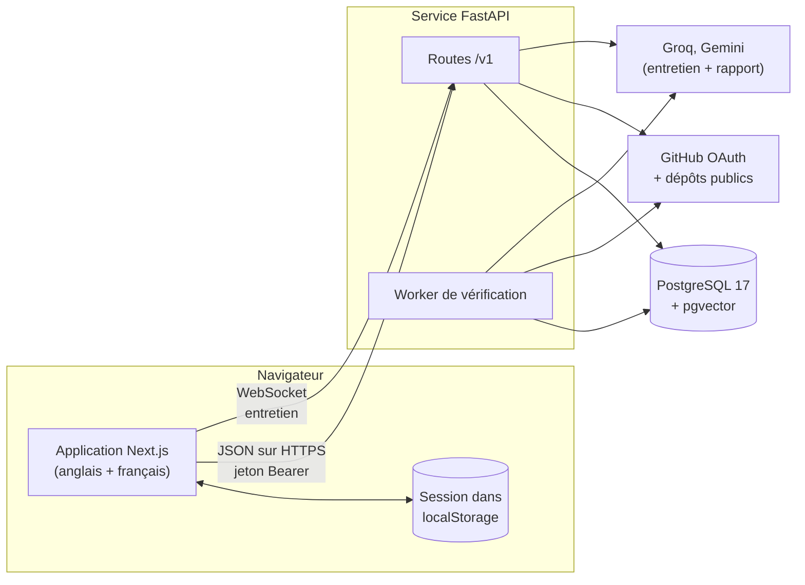
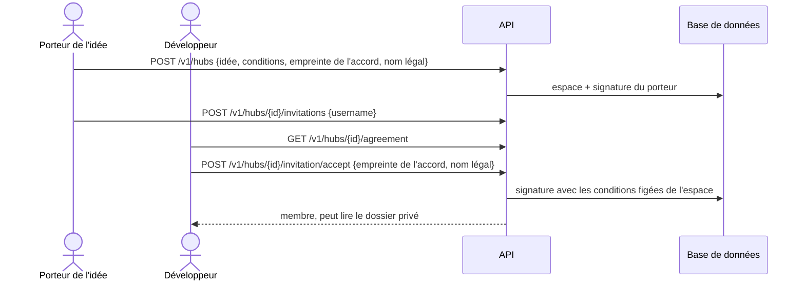

<div align="center">


# Village Sqwhere

**La place du village des développeurs africains.**<br />
Partagez une idée, trouvez des développeurs vérifiés qui veulent la construire avec vous, signez un seul accord, et construisez-la ensemble dans un espace privé.

[English](README.md) · **Français**

[](https://nextjs.org)
[](https://react.dev)
[](https://fastapi.tiangolo.com)
[](https://github.com/pgvector/pgvector)
[](https://systalink.com/en/africa-cup-of-developers-acodev)

[Comment ça marche](#comment-ça-marche) · [Ce qui est construit](#ce-qui-est-construit) · [Architecture](#architecture) · [Lancer en local](#lancer-en-local) · [Problèmes connus](#problèmes-connus)



</div>

> Conçu pour **ACODev 2026**, la Coupe d'Afrique des Développeurs : *« Construire la plateforme d'échange africaine, pour les devs, par les devs. »* Toutes les personnes et idées des captures sont inventées.

---

## Sommaire

- [Pourquoi Village Sqwhere](#pourquoi-village-sqwhere)
- [Comment ça marche](#comment-ça-marche)
- [Ce qui est construit](#ce-qui-est-construit)
- [Architecture](#architecture)
- [Technologies](#technologies)
- [Lancer en local](#lancer-en-local)
- [Organisation du dépôt](#organisation-du-dépôt)
- [Contrôles qualité](#contrôles-qualité)
- [Sécurité](#sécurité)
- [Problèmes connus](#problèmes-connus)
- [Contribuer](#contribuer)
- [Licence](#licence)

## Pourquoi Village Sqwhere

La plupart des plateformes pour développeurs sont pensées pour le recrutement : profils, offres
d'emploi, recruteurs. Beaucoup de bonnes idées ne voient jamais le jour, parce que leur auteur
ne trouve pas les bonnes personnes, ou craint de perdre son idée en la partageant.

Village Sqwhere est fait pour **construire ensemble**. La plateforme réunit autour d'une même
idée des développeurs aux compétences complémentaires et vérifiées, et chaque membre signe le
même accord avant de lire le dossier privé de l'idée.

## Comment ça marche

| Étape | Ce qui se passe | Écran |
|---|---|---|
| 1. Inscription | Un clic avec GitHub. Aucun nouveau mot de passe. | [Connexion](docs/images/screens/1-sign-up.webp) |
| 2. Profil de développeur | Rôles, technologies, secteurs et pays. Un rôle est vérifié par un entretien avec l'IA et une revue par les pairs, qui donnent le Green Tick. | [Profil](docs/images/screens/2-developer-profile.webp) |
| 3. Proposer une idée | Un résumé public pour tous, un dossier privé que seule l'équipe lira. | [Idée](docs/images/screens/3-submit-idea.webp) |
| 4. Trouver son équipe | Des développeurs vérifiés dans les rôles dont l'idée a besoin, classés par un score sur 100 qui montre son calcul. | [Correspondances](docs/images/screens/4-ai-matches.webp) |
| 5. Accepter l'invitation | Le développeur invité lit les conditions, puis accepte ou refuse. | [Invitation](docs/images/screens/5-accept-match.webp) |
| 6. Signer l'accord | Saisir son nom légal vaut signature. Le texte exact, son empreinte, les conditions et l'heure sont enregistrés. | [Accord](docs/images/screens/6-sign-nda.webp) |
| 7. Entrer dans l'espace | Le dossier privé, l'équipe, les conditions signées et la discussion d'équipe au même endroit. | [Espace](docs/images/screens/7-collaboration-hub.webp) |
| 8. Construire ensemble | Quatre phases (brainstorming, conception et architecture, développement, revue et tests), des notes de brainstorming et un schéma de conception partagé. | [Notes](docs/images/screens/8-build-together.webp), [schéma](docs/images/screens/8b-build-together-design-sketch.webp) |


Tout le produit fonctionne en **anglais et en français**, de la page d'accueil à l'entretien
avec l'IA.

## Ce qui est construit

| Domaine | Ce qu'un développeur peut faire | Principales routes de l'API |
|---|---|---|
| Connexion | Connexion GitHub avec PKCE, renouvellement du jeton, déconnexion ; un compte de démonstration en lecture seule | `/v1/auth/*` |
| Profil | Nom, bio, pays, rôles, technologies, secteurs ; le profil public d'un autre développeur ; suppression du compte | `/v1/me`, `/v1/users/{username}`, `/v1/me/deletion` |
| Vérification | Analyse des dépôts, entretien de cinq questions avec l'IA, rapport, puis revue par des développeurs vérifiés | `/v1/me/verifications/*`, `/v1/reviews/*` |
| Idées | Brouillon, publication, fermeture ou suppression ; parcourir les idées ouvertes ; « Pour vous » | `/v1/me/ideas/*`, `/v1/ideas`, `/v1/me/matches` |
| Correspondances | Les développeurs vérifiés dans les rôles d'une idée, notés sur les rôles, les technologies et les secteurs | `/v1/me/ideas/{id}/matches` |
| Espaces | Créer à partir d'une idée, inviter, demander à rejoindre, signer, quitter, retirer, archiver | `/v1/hubs/*` |
| Collaboration | Discussion d'équipe, quatre phases, notes de brainstorming, schéma de conception en blocs et liens | `/v1/hubs/{id}/messages`, `/phase`, `/notes`, `/design` |
| Fil communautaire | Publications, commentaires, réponses, j'aime, enregistrements, sujets | `/v1/feed`, `/v1/posts/*`, `/v1/comments/*` |

94 des 112 routes du suivi de l'équipe sont construites. Les principaux manques sont dans
[Problèmes connus](#problèmes-connus), et le plan dans [`docs/PROGRESS.md`](docs/PROGRESS.md).

## Architecture



L'application web n'est qu'un client de l'API : elle n'a ni accès à la base de données ni
secret. Le worker de vérification exécute les étapes longues (lecture des dépôts du
développeur, rédaction du rapport) hors de la requête, et la page interroge la tentative au
lieu de l'attendre.



Les conditions d'un espace sont figées à sa création et copiées dans chaque signature : chaque
membre signe exactement le même accord. Plus de détails dans
[`docs/architecture.md`](docs/architecture.md) et les décisions de [`docs/decisions/`](docs/decisions/).

## Technologies

<p>
  
</p>

| Couche | Choix | Pourquoi |
|---|---|---|
| Web | Next.js 16 (App Router), React 19, TypeScript, modules CSS sur des tokens de design | Une seule base de code pour les deux langues, pages rendues côté serveur, aucun kit d'interface à contourner |
| API | Python 3.13, FastAPI, SQLAlchemy asynchrone, Pydantic | Requêtes et réponses typées, documentation OpenAPI sur `/docs` |
| Base de données | PostgreSQL 17 avec pgvector | Données relationnelles et vecteurs de similarité d'idées dans un seul stockage |
| IA | Groq et Gemini, l'un prenant le relais de l'autre | L'entretien de vérification, la transcription vocale et le rapport |
| Outils | pnpm, uv, Docker Compose, Vitest, pytest, Ruff, ESLint | Installations rapides et une commande par tâche |
| Hébergement | Systalink | Exigé par ACODev 2026 |

## Lancer en local

Il vous faut [Node.js](https://nodejs.org/) 22 ou plus récent (24 recommandé),
[uv](https://docs.astral.sh/uv/) pour Python, et [Docker](https://www.docker.com/) pour la base
de données.

```bash
git clone https://github.com/AI-UNIPOD/Village-Sqwhere-ACODEV.git
cd Village-Sqwhere-ACODEV
corepack enable        # fournit la version de pnpm épinglée
pnpm install
cp .env.example .env   # puis définissez JWT_SECRET_KEY dans .env (le fichier explique comment)
pnpm db:up             # Postgres + pgvector sur localhost:5432
pnpm dev:api           # API sur http://localhost:8000 (documentation sur /docs)
pnpm dev:web           # application web sur http://localhost:3000 (dans un second terminal)
```

Pour explorer sans application GitHub, activez la démo en lecture seule : mettez
`DEMO_ENABLED=true` dans `.env`, remplissez la base avec des personnes et des idées inventées,
redémarrez l'API, puis cliquez sur « Essayer la démo ».

```bash
uv run --directory apps/api python -m app.demo_seed
```

| Variable | Rôle |
|---|---|
| `JWT_SECRET_KEY` | Signe les jetons d'accès. Obligatoire, 32 caractères ou plus. |
| `DATABASE_URL`, `TEST_DATABASE_URL` | Les bases de développement et de test. |
| `GITHUB_CLIENT_ID`, `GITHUB_CLIENT_SECRET` | Votre propre application OAuth GitHub, pour une vraie connexion. |
| `GROQ_API_KEY`, `GEMINI_API_KEY` | L'entretien avec l'IA et le rapport. |
| `DEMO_ENABLED` | Active « Essayer la démo ». Désactivé par défaut. |
| `NEXT_PUBLIC_API_URL` | Où l'application web trouve l'API. |

La liste complète, avec les valeurs par défaut, est dans [`.env.example`](.env.example).

## Organisation du dépôt

```text
apps/
  web/          application Next.js : tous les écrans, en anglais et en français  (apps/web/README.md)
  api/          service FastAPI, worker de vérification, données de démo         (apps/api/README.md)
infra/          Postgres + pgvector dans Docker, scripts du schéma                (infra/README.md)
docs/           architecture, référence de l'API, décisions, design system        (docs/README.md)
.github/        workflow CI et modèle de pull request
CHANGELOG.md    ce qui a changé, du plus récent au plus ancien
```

## Contrôles qualité

```bash
pnpm lint:web && pnpm test:web && pnpm build:web   # ESLint, 1 313 tests Vitest, build de production
pnpm lint:api && pnpm test:api                     # Ruff, 839 tests pytest sur un vrai Postgres
```

Chaque pull request porte une seule fonctionnalité ou correction, avec des tests pour chaque
changement de comportement, un titre de commit conventionnel sur une ligne et une ligne de
changelog. Les tests web couvrent les états de chargement, vide, erreur et succès, les deux
langues et l'affichage sur téléphone à 360px.

## Sécurité

| Domaine | Ce que fait l'application | Où |
|---|---|---|
| Connexion | GitHub OAuth avec PKCE ; jetons d'accès de 15 minutes et jetons de renouvellement à rotation | `apps/api/app/api/v1/auth.py` |
| Dossiers privés | Seuls les membres actifs d'un espace, qui ont signé, lisent le dossier d'une idée | `apps/api/app/api/v1/hub_members.py` |
| Signatures | L'empreinte SHA-256 du texte, les conditions figées et l'heure sont enregistrées ; un modèle publié ne peut plus être modifié | `infra/db/init/002-schema.sql`, `003-hub-terms.sql` |
| Démo | Le compte de démonstration est en lecture seule, et son contenu n'atteint jamais les vrais développeurs | `apps/api/app/api/deps.py` |
| Suppression du compte | Confirmée en saisissant son nom d'utilisateur ; le compte est anonymisé et ses publications restent sous « Compte supprimé » | `apps/api/app/services/account_deletion.py` |
| Secrets | Aucun dans le dépôt ; les réglages viennent de l'environnement | `.env.example` |

## Problèmes connus

| # | Problème | Conséquence | Plan |
|---|---|---|---|
| 1 | La partie « sens » du score (30 points sur 100) n'est pas construite ; les cartes affichent « Sens : pas encore comparé » | Les correspondances se classent sur les rôles, les technologies et les secteurs | Écrire les vecteurs des idées et des profils dans `idea_embeddings` (pgvector) |
| 2 | Chaque espace signe un accord provisoire intitulé « TEST AGREEMENT (NOT LEGAL TEXT) » | Il n'a aucune valeur juridique | Le vrai texte arrive en version 2 avant le lancement |
| 3 | Les phases de développement et de revue n'ont pas encore d'outils | Les équipes utilisent la discussion pendant ces phases | Une vue du dépôt et des commits pour le développement, une liste de contrôle pour la revue |
| 4 | Aucune limite de débit | Un déploiement public peut être saturé | Des limites par client, plus strictes sur la connexion, la démo et les appels à l'IA |
| 5 | L'état de connexion est gardé en mémoire dans l'API | Un seul processus d'API ; un redémarrage oublie les déconnexions | Une table `refresh_tokens` |
| 6 | La connexion Bitbucket répond 503 | GitHub seulement pour l'instant | Prévue après GitHub |

## Contribuer

Lisez [CONTRIBUTING.md](CONTRIBUTING.md) pour l'installation et le parcours d'un changement
jusqu'à `main`, et [AGENTS.md](AGENTS.md) pour les règles de l'équipe. Vous travaillez sur
l'interface ? Commencez par le [design system](docs/design-system/README.md).

## Licence

Pas encore de licence : tous droits réservés jusqu'à la soumission à ACODev 2026. Nous prévoyons
de publier le code sous licence MIT ensuite.

## Remerciements

Construit à l'AI UniPod de l'Université de Lagos, pour ACODev 2026, organisé par Systalink.
