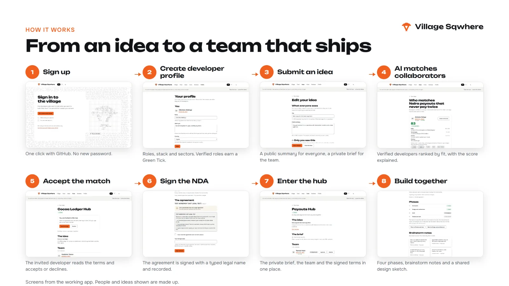
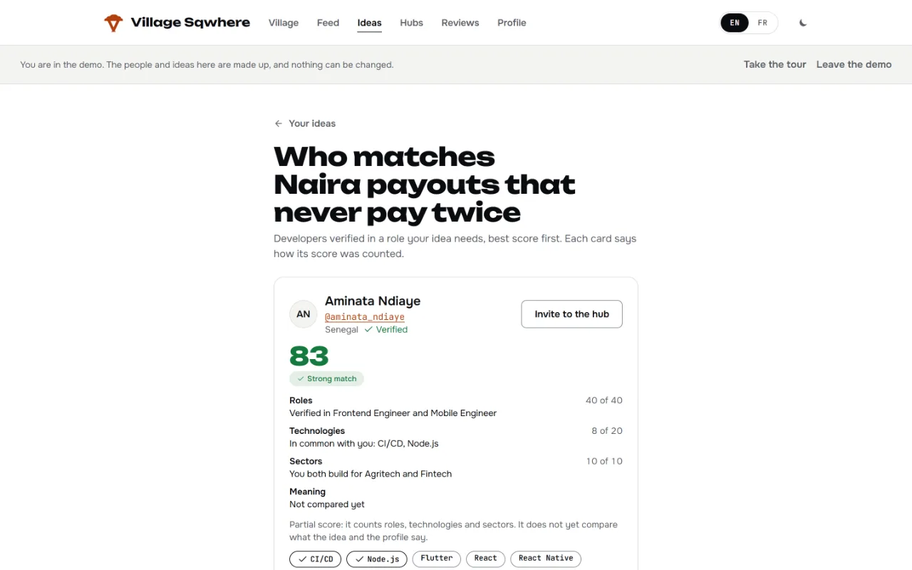
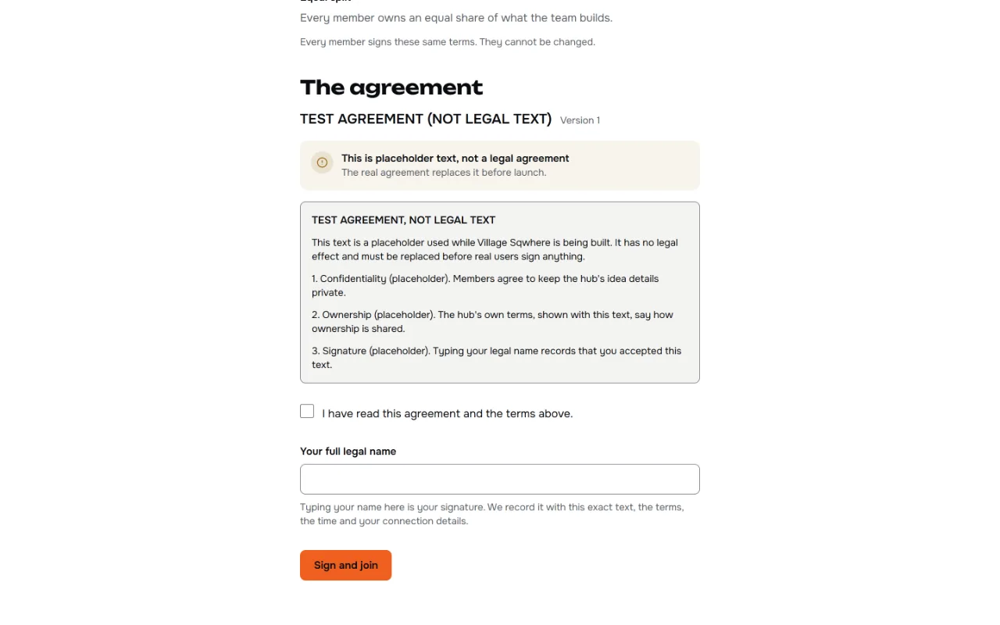
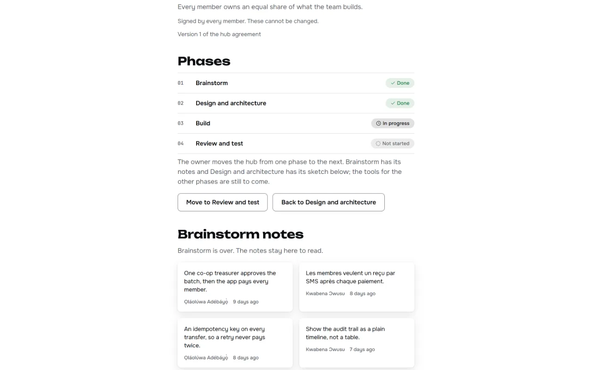
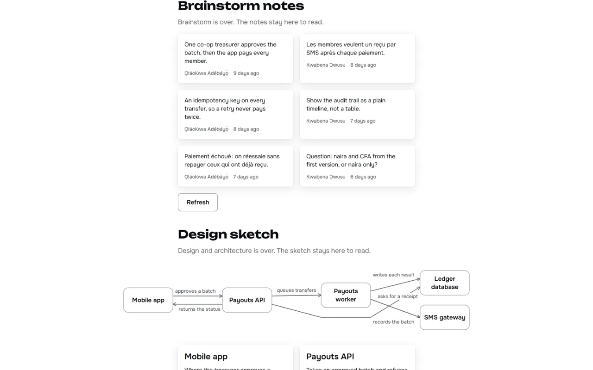
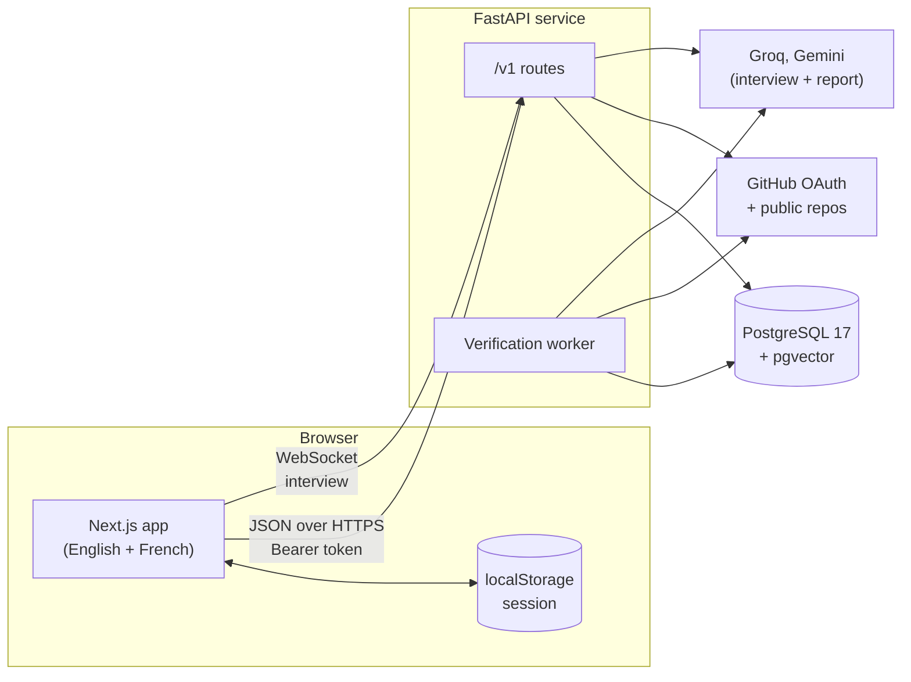
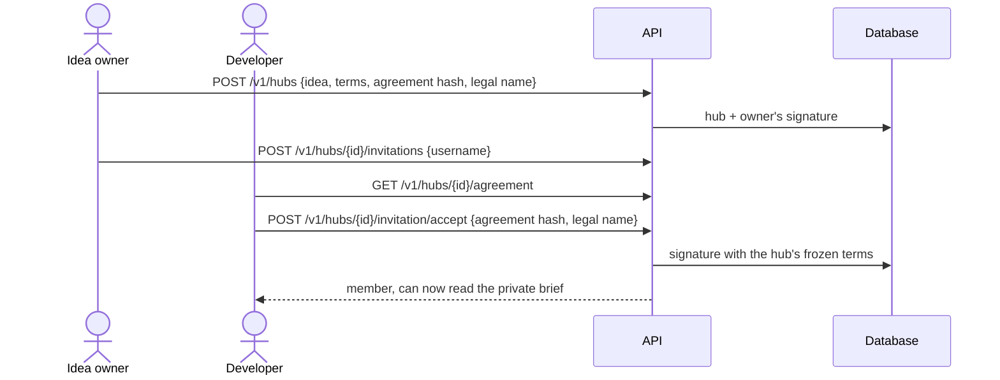

<div align="center">


# Village Sqwhere

### Build your idea with developers you can trust.

The village square for African developers: bring an idea, meet verified developers who want to
build it with you, agree on the terms once, and build it together in your own private hub.

**English** · [Français](README.fr.md)

[](https://systalink.com/en/africa-cup-of-developers-acodev)
[](#made-for-african-developers)
[](LICENSE)

[Why Village Sqwhere](#why-developers-choose-village-sqwhere) · [How it works](#how-it-works) · [See it](#see-it) · [Try it](#try-it) · [For developers](#for-developers)



</div>

---

## The problem

Africa has no shortage of developers with good ideas. What is missing is a way to turn an idea
into a team:

- **The right people are hard to find.** Developer platforms are built for hiring: profiles for
  recruiters, job boards, CVs. Nothing helps you find someone who wants to *build* your idea.
- **Skills are hard to trust.** Anyone can write "senior engineer" on a profile.
- **Sharing feels risky.** Many ideas stay in a notebook because their author fears losing them
  the moment they explain them.

## Why developers choose Village Sqwhere

<table>
<tr>
<td width="50%" valign="top">

### Co-builders, not employers
Village Sqwhere is about building together. You bring an idea and find people who want to
build it with you, as a team with shared ownership terms, not as staff.

</td>
<td width="50%" valign="top">

### Skills you can trust
A role earns a **Green Tick** only after the developer's public repositories are read, they
answer five questions from an AI interviewer about their own code, and a developer already
verified in that role reviews the report.

</td>
</tr>
<tr>
<td valign="top">

### Share without losing your idea
Every idea has a **public summary** and a **private brief**. The brief opens only to people
who joined the team, and everyone in a hub signs the same agreement and the same ownership
terms first. The exact text each person signed is recorded.

</td>
<td valign="top">

### Matches that explain themselves
Developers verified in the roles your idea needs are ranked by a score out of 100, and every
card shows how the score was counted: roles, shared technologies, shared sectors. No black box.

</td>
</tr>
<tr>
<td valign="top">

### One place from first note to launch
Each team gets a private hub: the brief, the signed terms, a team chat, brainstorm notes, a
shared design sketch, and four phases from brainstorm to design, build and review.

</td>
<td valign="top">

### Made for African developers
English and French everywhere, from the first screen to the AI interview. Profiles name one of
the 54 African countries, and ideas are built around sectors such as fintech, agritech,
health and education.

</td>
</tr>
</table>

## Who it is for

| You are | Village Sqwhere gives you |
|---|---|
| **A developer with an idea** | Verified people with the roles you are missing, ranked and explained, and a safe way to show them the full plan |
| **A developer who wants to build something real** | Ideas that need your skills ("For you"), and a Green Tick that shows idea owners what you can do |
| **A verified developer** | A say in who else gets verified in your role, through peer review |
| **A community member** | A feed of posts, questions and progress from developers across the continent |

## How it works

| Step | What happens | Screen |
|---|---|---|
| 1. Sign up | One click with GitHub. No new password. | [Sign in](docs/images/screens/1-sign-up.webp) |
| 2. Create a developer profile | Roles, stack, sectors and country. Verify a role to earn the Green Tick. | [Profile](docs/images/screens/2-developer-profile.webp) |
| 3. Share an idea | A public summary for everyone, a private brief only the team will read. | [Idea](docs/images/screens/3-submit-idea.webp) |
| 4. Get matched | Developers verified in the roles the idea needs, ranked by a score out of 100. | [Matches](docs/images/screens/4-ai-matches.webp) |
| 5. Accept the match | The invited developer reads the terms and accepts or declines. | [Invitation](docs/images/screens/5-accept-match.webp) |
| 6. Sign the agreement | Typing a legal name signs it. The exact text, the terms and the time are recorded. | [Agreement](docs/images/screens/6-sign-nda.webp) |
| 7. Enter the hub | The private brief, the team, the signed terms and the team chat in one place. | [Hub](docs/images/screens/7-collaboration-hub.webp) |
| 8. Build together | Brainstorm, design and architecture, build, review and test, with notes and a shared design sketch. | [Notes](docs/images/screens/8-build-together.webp), [sketch](docs/images/screens/8b-build-together-design-sketch.webp) |


## See it

<table>
<tr>
<td width="50%"><br /><b>Matches that show their working.</b> Every point of the score is explained.</td>
<td width="50%"><br /><b>One agreement, signed by everyone.</b> The brief opens only after it.</td>
</tr>
<tr>
<td><br /><b>A hub that moves in phases.</b> Brainstorm, design, build, review.</td>
<td><br /><b>Design together.</b> A shared sketch of the system the team will build.</td>
</tr>
</table>

Every person and idea in these screens is made up.

## Try it

The live site is at [www.villagesqwhere.online](https://www.villagesqwhere.online). You can
also run it on your computer in a few minutes (see [Run it locally](#run-it-locally)) and
press **Try the demo**: a read-only tour of a village filled with made-up developers, ideas
and hubs, no account needed.

---

## For developers

The rest of this page is for people who want to read, run or contribute to the code.

### What is built

| Area | What a developer can do | Main API routes |
|---|---|---|
| Sign-in | GitHub sign-in with PKCE, token refresh, sign out; a read-only demo account | `/v1/auth/*` |
| Profile | Name, bio, country, roles, stack, sectors; another developer's public profile; delete the account | `/v1/me`, `/v1/users/{username}`, `/v1/me/deletion` |
| Verification | Repository analysis, a five-question AI interview, a report, then peer review by verified developers | `/v1/me/verifications/*`, `/v1/reviews/*` |
| Ideas | Draft, publish, close or delete an idea; browse open ideas; "For you" | `/v1/me/ideas/*`, `/v1/ideas`, `/v1/me/matches` |
| Matching | Developers verified in the roles an idea needs, scored on roles, technologies and sectors | `/v1/me/ideas/{id}/matches` |
| Hubs | Create from an idea, invite, ask to join, sign, leave, remove, archive | `/v1/hubs/*` |
| Collaboration | Team chat, four phases, brainstorm notes, a design sketch of pieces and links | `/v1/hubs/{id}/messages`, `/phase`, `/notes`, `/design` |
| Community feed | Posts, comments, replies, likes, saves, topics | `/v1/feed`, `/v1/posts/*`, `/v1/comments/*` |


<p>
  
</p>

### Architecture



The web app is only a client of the API: it holds no database access and no secrets. The
verification worker runs the slow steps (reading a developer's repositories, writing the
report) outside the request, so the page polls the attempt instead of waiting on it.



A hub's terms are frozen when it is created and copied into every signature, so every member
signs exactly the same deal. More in [`docs/architecture.md`](docs/architecture.md) and the
decision records in [`docs/decisions/`](docs/decisions/).

### Tech stack

| Layer | Choice | Why |
|---|---|---|
| Web | Next.js 16 (App Router), React 19, TypeScript, CSS modules on design tokens | One codebase for both languages, server-rendered pages, no UI kit to fight |
| API | Python 3.13, FastAPI, async SQLAlchemy, Pydantic | Typed requests and responses, OpenAPI docs at `/docs` |
| Database | PostgreSQL 17 with pgvector | Relational data and vectors for idea similarity in one store |
| AI | Groq and Gemini, one falling back to the other | The verification interview, speech to text and the report |
| Tooling | pnpm, uv, Docker Compose, Vitest, pytest, Ruff, ESLint | Fast installs and one command per task |
| Hosting | Vercel (web, API and worker as one project) | One domain for the app and its API; see [`infra/README.md`](infra/README.md#deployment-vercel) |

### Run it locally

You need [Node.js](https://nodejs.org/) 22 or newer (24 recommended),
[uv](https://docs.astral.sh/uv/) for Python, and [Docker](https://www.docker.com/) for the
database.

```bash
git clone https://github.com/AI-UNIPOD/Village-Sqwhere-ACODEV.git
cd Village-Sqwhere-ACODEV
corepack enable        # provides the pinned pnpm version
pnpm install
cp .env.example .env   # then set JWT_SECRET_KEY in .env (the file says how)
pnpm db:up             # Postgres + pgvector on localhost:5432
pnpm dev:api           # API on http://localhost:8000 (docs at /docs)
pnpm dev:web           # web app on http://localhost:3000 (in a second terminal)
```

To look around without a GitHub app, turn on the read-only demo: set `DEMO_ENABLED=true` in
`.env`, fill the database with made-up people and ideas, restart the API, then press
"Try the demo".

```bash
uv run --directory apps/api python -m app.demo_seed
```

| Variable | What it does |
|---|---|
| `JWT_SECRET_KEY` | Signs access tokens. Required, 32 characters or more. |
| `DATABASE_URL`, `TEST_DATABASE_URL` | The development and test databases. |
| `GITHUB_CLIENT_ID`, `GITHUB_CLIENT_SECRET` | Your own GitHub OAuth app, for real sign-in. |
| `GROQ_API_KEY`, `GEMINI_API_KEY` | The AI interview and report. |
| `DEMO_ENABLED` | Turns on "Try the demo". Off by default. |
| `NEXT_PUBLIC_API_URL` | Where the web app finds the API. |

The full list, with defaults, is in [`.env.example`](.env.example).

### Repository structure

```text
apps/
  web/          Next.js app: every screen, in English and French      (apps/web/README.md)
  api/          FastAPI service, verification worker, demo seed        (apps/api/README.md)
infra/          Postgres + pgvector in Docker, the schema scripts      (infra/README.md)
docs/           architecture, API reference, decisions, design system  (docs/README.md)
.github/        CI workflow and pull request template
CHANGELOG.md    what changed, newest first
```

### Quality checks

```bash
pnpm lint:web && pnpm test:web && pnpm build:web   # ESLint, 1,313 Vitest tests, production build
pnpm lint:api && pnpm test:api                     # Ruff, 839 pytest tests against a real Postgres
```

Every pull request is one feature or fix, with tests for each change in behaviour, a one-line
conventional commit title and a changelog line. Web tests cover loading, empty, error and
success states, both languages and 360px phone layouts.

### Security

| Area | What the app does | Where |
|---|---|---|
| Sign-in | GitHub OAuth with PKCE; 15-minute access tokens and rotating refresh tokens | `apps/api/app/api/v1/auth.py` |
| Private briefs | Only active hub members, who have signed, can read an idea's brief | `apps/api/app/api/v1/hub_members.py` |
| Signatures | The agreement text's SHA-256, the frozen terms and the time are stored; published templates cannot be edited | `infra/db/init/002-schema.sql`, `003-hub-terms.sql` |
| Demo | The demo account is read-only, and demo content never reaches real developers | `apps/api/app/api/deps.py` |
| Account deletion | Confirmed by typing the username; the account is anonymised and its posts stay under "Deleted account" | `apps/api/app/services/account_deletion.py` |
| Secrets | None in the repository; settings come from the environment | `.env.example` |


### Contributing

Read [CONTRIBUTING.md](CONTRIBUTING.md) for setup, the commit rule and how a change reaches
`main`. Building UI? Start with the
[design system](docs/design-system/README.md).

## License

Village Sqwhere is released under the [MIT License](LICENSE).

## Acknowledgements

Village Sqwhere was built at the **[AI UniPod, University of Lagos](https://aiunipod.unilag.edu.ng/)**,
the university's hub for innovation and AI-driven problem-solving, for
[ACODev 2026](https://systalink.com/en/africa-cup-of-developers-acodev), the Africa Cup of
Developers organised by Systalink.

---

<div align="center">


**Village Sqwhere** · Built at [AI UniPod, University of Lagos](https://aiunipod.unilag.edu.ng/) for [ACODev 2026](https://systalink.com/en/africa-cup-of-developers-acodev)

<sub>[MIT License](LICENSE) · **English** · [Français](README.fr.md)</sub>

</div>
