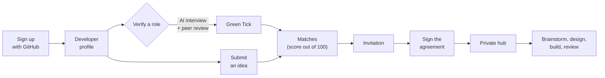
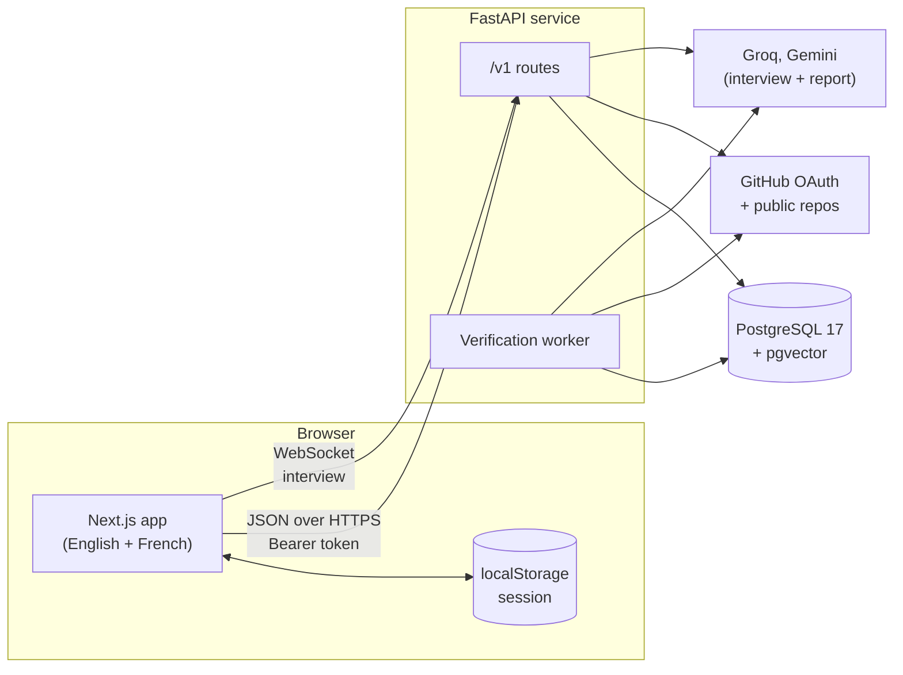
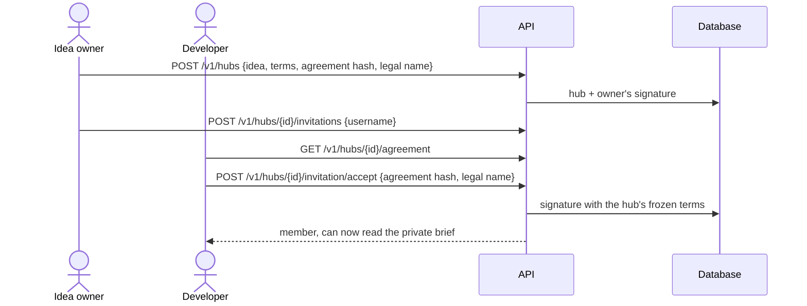

<div align="center">


# Village Sqwhere

**The village square for African developers.**<br />
Share an idea, find verified developers who want to build it with you, sign one agreement, and build it together in a private hub.

**English** · [Français](README.fr.md)

[](https://nextjs.org)
[](https://react.dev)
[](https://fastapi.tiangolo.com)
[](https://github.com/pgvector/pgvector)
[](https://systalink.com/en/africa-cup-of-developers-acodev)

[How it works](#how-it-works) · [What is built](#what-is-built) · [Architecture](#architecture) · [Run it locally](#run-it-locally) · [Known issues](#known-issues)


</div>

> Built for **ACODev 2026**, the Africa Cup of Developers: *"Build the African exchange platform, for devs, by devs."* Every person and idea in the screenshots is made up.

---

## Contents

- [Why Village Sqwhere](#why-village-sqwhere)
- [How it works](#how-it-works)
- [What is built](#what-is-built)
- [Architecture](#architecture)
- [Tech stack](#tech-stack)
- [Run it locally](#run-it-locally)
- [Repository structure](#repository-structure)
- [Quality checks](#quality-checks)
- [Security](#security)
- [Known issues](#known-issues)
- [Contributing](#contributing)
- [License](#license)

## Why Village Sqwhere

Most developer platforms are built around hiring: profiles, job boards, recruiters. Many good
ideas never start because their author cannot find the right people, or worries that sharing
the idea means losing it.

Village Sqwhere is about **building together**. It brings developers with complementary,
verified skills to the same idea, and every member signs the same agreement before they read
the idea's private brief.

## How it works

| Step | What happens | Screen |
|---|---|---|
| 1. Sign up | One click with GitHub. No new password. | [Sign in](docs/images/screens/1-sign-up.webp) |
| 2. Create a developer profile | Roles, stack, sectors and country. A role is verified by an AI interview and peer review, which earns a Green Tick. | [Profile](docs/images/screens/2-developer-profile.webp) |
| 3. Submit an idea | A public summary for everyone, a private brief only the team will read. | [Idea](docs/images/screens/3-submit-idea.webp) |
| 4. Get matched | Developers verified in the roles the idea needs, ranked by a score out of 100 that shows how it was counted. | [Matches](docs/images/screens/4-ai-matches.webp) |
| 5. Accept the match | The invited developer reads the terms and accepts or declines. | [Invitation](docs/images/screens/5-accept-match.webp) |
| 6. Sign the agreement | Typing a legal name signs it. The exact text, its hash, the terms and the time are recorded. | [Agreement](docs/images/screens/6-sign-nda.webp) |
| 7. Enter the hub | The private brief, the team, the signed terms and the team chat in one place. | [Hub](docs/images/screens/7-collaboration-hub.webp) |
| 8. Build together | Four phases (brainstorm, design and architecture, build, review and test), brainstorm notes and a shared design sketch. | [Notes](docs/images/screens/8-build-together.webp), [sketch](docs/images/screens/8b-build-together-design-sketch.webp) |



The whole product works in **English and French**, from the landing page to the AI interview.

## What is built

| Area | What a developer can do | Main API routes |
|---|---|---|
| Sign-in | GitHub sign-in with PKCE, token refresh, sign out; a read-only demo account | `/v1/auth/*` |
| Profile | Name, bio, country, roles, stack, sectors; another developer's public profile; delete the account | `/v1/me`, `/v1/users/{username}`, `/v1/me/deletion` |
| Verification | Repository analysis, a five-question AI interview, a report, then peer review by verified developers | `/v1/me/verifications/*`, `/v1/reviews/*` |
| Ideas | Draft, publish, close or delete an idea; browse open ideas; "For you" | `/v1/me/ideas/*`, `/v1/ideas`, `/v1/me/matches` |
| Matching | Developers verified in the roles an idea needs, scored on roles, technologies and sectors | `/v1/me/ideas/{id}/matches` |
| Hubs | Create from an idea, invite, ask to join, sign, leave, remove, archive | `/v1/hubs/*` |
| Collaboration | Team chat, four phases, brainstorm notes, a design sketch of pieces and links | `/v1/hubs/{id}/messages`, `/phase`, `/notes`, `/design` |
| Community feed | Posts, comments, replies, likes, saves, topics | `/v1/feed`, `/v1/posts/*`, `/v1/comments/*` |

94 of the 112 endpoints on the team's tracker are built. The main gaps are under
[Known issues](#known-issues), and the plan is in [`docs/PROGRESS.md`](docs/PROGRESS.md).

## Architecture



The web app is only a client of the API: it holds no database access and no secrets. The
verification worker runs the slow steps (reading a developer's repositories, writing the
report) outside the request, so the page polls the attempt instead of waiting on it.



A hub's terms are frozen when it is created and copied into every signature, so every member
signs exactly the same deal. More in [`docs/architecture.md`](docs/architecture.md) and the
decision records in [`docs/decisions/`](docs/decisions/).

## Tech stack

<p>
  
</p>

| Layer | Choice | Why |
|---|---|---|
| Web | Next.js 16 (App Router), React 19, TypeScript, CSS modules on design tokens | One codebase for both languages, server-rendered pages, no UI kit to fight |
| API | Python 3.13, FastAPI, async SQLAlchemy, Pydantic | Typed requests and responses, OpenAPI docs at `/docs` |
| Database | PostgreSQL 17 with pgvector | Relational data and vectors for idea similarity in one store |
| AI | Groq and Gemini, one falling back to the other | The verification interview, speech to text and the report |
| Tooling | pnpm, uv, Docker Compose, Vitest, pytest, Ruff, ESLint | Fast installs and one command per task |
| Hosting | Systalink | Required by ACODev 2026 |

## Run it locally

You need [Node.js](https://nodejs.org/) 22 or newer (24 recommended),
[uv](https://docs.astral.sh/uv/) for Python, and [Docker](https://www.docker.com/) for the
database.

```bash
git clone https://github.com/AI-UNIPOD/Village-Sqwhere-ACODEV.git
cd Village-Sqwhere-ACODEV
corepack enable        # provides the pinned pnpm version
pnpm install
cp .env.example .env   # then set JWT_SECRET_KEY in .env (the file says how)
pnpm db:up             # Postgres + pgvector on localhost:5432
pnpm dev:api           # API on http://localhost:8000 (docs at /docs)
pnpm dev:web           # web app on http://localhost:3000 (in a second terminal)
```

To look around without a GitHub app, turn on the read-only demo: set `DEMO_ENABLED=true` in
`.env`, fill the database with made-up people and ideas, restart the API, then press
"Try the demo".

```bash
uv run --directory apps/api python -m app.demo_seed
```

| Variable | What it does |
|---|---|
| `JWT_SECRET_KEY` | Signs access tokens. Required, 32 characters or more. |
| `DATABASE_URL`, `TEST_DATABASE_URL` | The development and test databases. |
| `GITHUB_CLIENT_ID`, `GITHUB_CLIENT_SECRET` | Your own GitHub OAuth app, for real sign-in. |
| `GROQ_API_KEY`, `GEMINI_API_KEY` | The AI interview and report. |
| `DEMO_ENABLED` | Turns on "Try the demo". Off by default. |
| `NEXT_PUBLIC_API_URL` | Where the web app finds the API. |

The full list, with defaults, is in [`.env.example`](.env.example).

## Repository structure

```text
apps/
  web/          Next.js app: every screen, in English and French      (apps/web/README.md)
  api/          FastAPI service, verification worker, demo seed        (apps/api/README.md)
infra/          Postgres + pgvector in Docker, the schema scripts      (infra/README.md)
docs/           architecture, API reference, decisions, design system  (docs/README.md)
.github/        CI workflow and pull request template
CHANGELOG.md    what changed, newest first
```

## Quality checks

```bash
pnpm lint:web && pnpm test:web && pnpm build:web   # ESLint, 1,313 Vitest tests, production build
pnpm lint:api && pnpm test:api                     # Ruff, 839 pytest tests against a real Postgres
```

Every pull request is one feature or fix, with tests for each change in behaviour, a one-line
conventional commit title and a changelog line. Web tests cover loading, empty, error and
success states, both languages and 360px phone layouts.

## Security

| Area | What the app does | Where |
|---|---|---|
| Sign-in | GitHub OAuth with PKCE; 15-minute access tokens and rotating refresh tokens | `apps/api/app/api/v1/auth.py` |
| Private briefs | Only active hub members, who have signed, can read an idea's brief | `apps/api/app/api/v1/hub_members.py` |
| Signatures | The agreement text's SHA-256, the frozen terms and the time are stored; published templates cannot be edited | `infra/db/init/002-schema.sql`, `003-hub-terms.sql` |
| Demo | The demo account is read-only, and demo content never reaches real developers | `apps/api/app/api/deps.py` |
| Account deletion | Confirmed by typing the username; the account is anonymised and its posts stay under "Deleted account" | `apps/api/app/services/account_deletion.py` |
| Secrets | None in the repository; settings come from the environment | `.env.example` |

## Known issues

| # | Issue | Impact | Plan |
|---|---|---|---|
| 1 | The match score's meaning part (30 of 100 points) is not built; cards say "Meaning: not compared yet" | Matching ranks on roles, technologies and sectors only | Write idea and profile embeddings to `idea_embeddings` (pgvector) |
| 2 | Every hub signs a placeholder agreement titled "TEST AGREEMENT (NOT LEGAL TEXT)" | It has no legal effect | The real text goes in as version 2 before launch |
| 3 | The build and review phases have no tools yet | Teams use the chat in those phases | A repository and commits view for build, a checklist for review |
| 4 | No rate limiting | A public deployment can be flooded | Per-client limits, strictest on sign-in, the demo and AI calls |
| 5 | Sign-in state is kept in API memory | Run one API process; a restart forgets sign-outs | A `refresh_tokens` table |
| 6 | Bitbucket sign-in answers 503 | GitHub only for now | Planned after GitHub |

## Contributing

Read [CONTRIBUTING.md](CONTRIBUTING.md) for setup and how a change reaches `main`, and
[AGENTS.md](AGENTS.md) for the team's rules. Building UI? Start with the
[design system](docs/design-system/README.md).

## License

Not licensed yet: all rights reserved until the ACODev 2026 submission. We plan to release the
code under the MIT License after that.

## Acknowledgements

Built at the AI UniPod, University of Lagos, for ACODev 2026, organised by Systalink.
