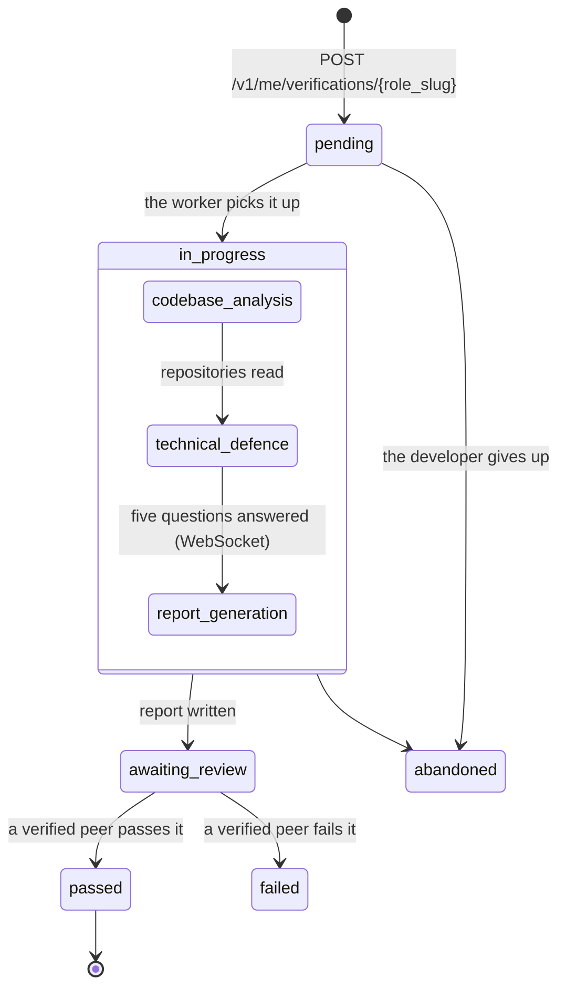
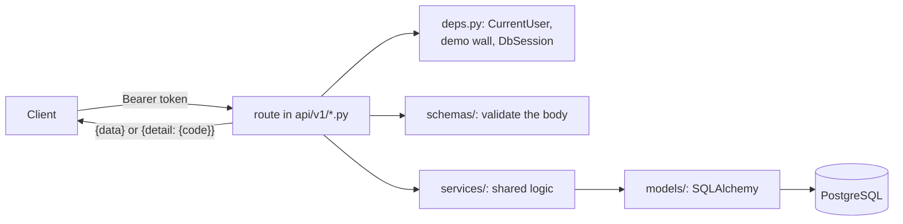

# apps/api

The Village Sqwhere API: Python 3.13, FastAPI and async SQLAlchemy on PostgreSQL with
pgvector, managed with [uv](https://docs.astral.sh/uv/). Every route is under `/v1`, and the
interactive OpenAPI docs are at `http://localhost:8000/docs`.

```bash
pnpm db:up        # Postgres + pgvector (see infra/)
pnpm dev:api      # http://localhost:8000, docs at /docs
pnpm test:api     # 839 pytest tests against a real Postgres
pnpm lint:api     # Ruff
```

## Try it

Real answers from a local API:

```console
$ curl localhost:8000/v1/health
{"status":"ok","version":"1.0.0"}

$ curl localhost:8000/v1/sectors
{"data":[{"slug":"fintech","name":"Fintech"},{"slug":"agritech","name":"Agritech"}, ...]}

$ curl localhost:8000/v1/me
{"detail":{"code":"UNAUTHENTICATED","message":"Missing bearer token"}}
```

Every answer has the same shape: `{"data": ...}` on success, and `{"detail": {"code", "message"}}`
on a refusal, so a client switches on `code` (`HUB_ARCHIVED`, `IDEA_HAS_HUB`, ...) and never
parses the English message. A request with a bad field answers `422` with the field's name.

One match card for an idea, as the owner sees it (`GET /v1/me/ideas/{id}/matches`, trimmed):

```json
{
  "score": 83,
  "partial": true,
  "breakdown": {
    "roles":        { "points": 40, "max": 40 },
    "technologies": { "points": 8,  "max": 20 },
    "sectors":      { "points": 10, "max": 10 },
    "meaning":      { "points": null, "max": 30 }
  },
  "username": "aminata_ndiaye",
  "matched_roles": [{ "slug": "frontend-engineer" }, { "slug": "mobile-engineer" }],
  "shared_technologies": [{ "slug": "ci-cd" }, { "slug": "nodejs" }]
}
```

`meaning` is `null` until idea embeddings are written, so `partial` is `true` and the score is
out of the 70 points that are counted, scaled to 100.

## Where things are

```text
app/
  main.py              the FastAPI app, CORS, the /v1 router
  config.py            every setting, read from the environment or the root .env
  api/
    deps.py            CurrentUser, DbSession, the demo wall
    v1/
      router.py        mounts every router below under /v1
      auth.py          GitHub OAuth with PKCE, tokens, demo sign-in
      me.py            my profile, roles, stack, sectors, account deletion
      ideas.py         ideas, drafts, publishing          matches.py   scores
      hubs.py          hubs        hub_members.py   invitations, joining, leaving
      hub_chat.py      chat        hub_notes.py     brainstorm   hub_design.py  sketch
      verifications.py role checks interviews.py    the interview WebSocket
      posts.py         feed        comments.py      comments and replies
  models/              SQLAlchemy tables (users, ideas, hubs, posts, lookups)
  schemas/             Pydantic request and response bodies
  services/            the logic routes share: match_score.py, account_deletion.py,
                       interview.py, groq*.py and gemini*.py with a fallback between them
  workers/             the verification worker (python -m app.workers.runner)
  demo_seed.py         the made-up world behind "Try the demo"
  demo_review_case.py  the evidence, interview and report of the demo's one review case
tests/                 one file per area, against a real database
```

## A role verification, end to end



The worker does the slow parts (reading public repositories, writing the report) outside any
request, retrying a failed analysis up to `VERIFICATION_MAX_ANALYSIS_ATTEMPTS`. The interview
and the report use Groq, with Gemini as the fallback, in the language the attempt started in.

## A request, layer by layer



## Setup notes

Or run it from this folder: `uv sync`, then `uv run fastapi dev app/main.py`.

Settings come from environment variables or a root `.env` file (see the root `.env.example`).
`JWT_SECRET_KEY` is required: the API will not start without it. GitHub sign-in also needs
`GITHUB_CLIENT_ID` and `GITHUB_CLIENT_SECRET`.
Code lives in `app/`, tests in `tests/`.

Tests need `TEST_DATABASE_URL`: the address of a separate database, `village_sqwhere_test`, so
they never touch your development data. Without it they stop at start-up and say so. Create it
once, from the repository root, with the database running (`pnpm db:up`):

```bash
docker compose -f infra/docker-compose.yml exec db psql -U village -d postgres -c "CREATE DATABASE village_sqwhere_test OWNER village;"
docker compose -f infra/docker-compose.yml exec db sh -c 'for f in /docker-entrypoint-initdb.d/*.sql; do psql -v ON_ERROR_STOP=1 -U village -d village_sqwhere_test -f "$f" || exit 1; done'
```

Then set `TEST_DATABASE_URL` in your root `.env` (the value is in `.env.example`). The second
command applies every script in `infra/db/init/`. When a new script lands there, drop the test
database (`DROP DATABASE village_sqwhere_test;`) and run both commands again. CI uses its own
database and needs no setting.

## The demo

"Try the demo" signs visitors in to a shared, read-only account
(`docs/decisions/2026-11-13-read-only-demo.md`). Where the demo should be on, set
`DEMO_ENABLED=true` and fill the database with made-up content, from the repository root:

```bash
uv run --directory apps/api python -m app.demo_seed
```

It writes to `DATABASE_URL`, and only when `DEMO_ENABLED=true` is set in the same environment:
otherwise it stops with an error and writes nothing, so running it by mistake against a server
without the demo leaves that server alone. Everything it makes is demo content, which real
developers never see. Its times count back from when it runs, so the feed reads "2 hours ago". Run it again, for
example on the morning of a demo, to rewrite the posts and comments with fresh times; the
people, ideas and hubs stay as they are, each person gets their bio and country again, the
roles, technologies, sectors, people and open ideas that are missing are added, and the
visitor's own hub is put in the build phase if it has none yet, gets its six brainstorm notes
if it has no notes, and gets a design sketch of five pieces and six links if it has no pieces.
The same hub also gets, each only if it is missing, claims on four of its five pieces and a
repository address that cannot belong to a real repository (`naira_payouts` has an underscore,
which a GitHub owner name never has). Its eight commits and the time they were checked are
written again on every run, the way a refresh replaces them, so the build tab never reads
"Checked 3 days ago". A claim made after its holder's first commit gets a new time.

The world reads like the real product in real use: the demo bar is the only place that says it
is made up (`docs/decisions/2026-11-15-demo-world-reads-as-real.md`). Each hub has its own
description, in its owner's language, and the Payouts and Tontine teams have talked in their
chat for ten days. The one review case has what an attempt that reached peer review has: three
repositories, the interview and the AI's report, in English (`app/demo_review_case.py`). A rerun
also gives a world seeded earlier:

- the description of a hub that still holds the old template ("Building ... together.");
- the two brainstorm notes it wrote in French, in English, found by their text;
- a chat to a hub whose chat is empty, never to one that has a message;
- the evidence, interview and report of a review case that is empty and still awaiting review.

A signature cannot be rewritten, so a rerun cannot date it. The seed signs a new member's
agreement the moment they join, and `infra/db/init/026-demo-signature-dates.sql` does the same
for demo signatures made earlier. It never touches a real person's signature.
The visitor's own idea shows a Strong, a Possible and a Weak match, and "For you" holds two
open ideas with different scores.
