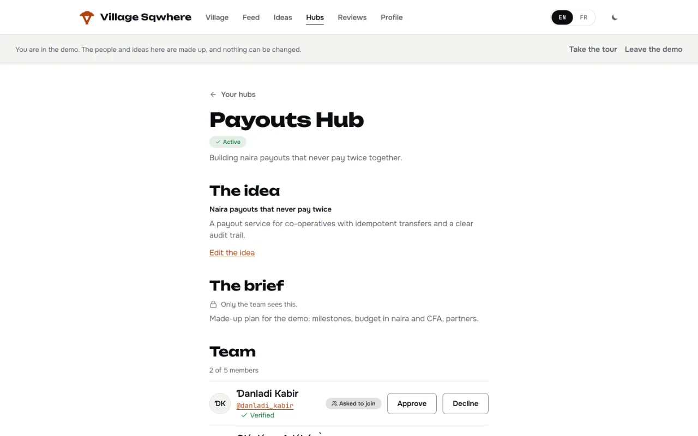
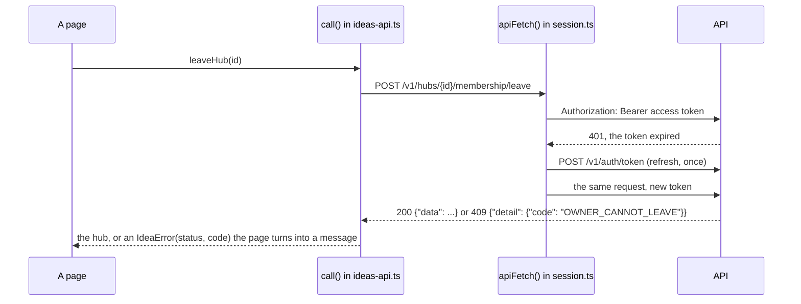

# apps/web

The Village Sqwhere web app: Next.js 16 (App Router), React 19 and TypeScript, in English and
French. It is only a client of the API in `apps/api`: no database, no secrets.



```bash
pnpm dev:web      # http://localhost:3000 (the API must run on :8000)
pnpm test:web     # 1,313 Vitest + Testing Library tests, next to the code they test
pnpm lint:web
pnpm build:web
```

## Every address, and the folder behind it

Each page is served in both languages: `/en/...` and `/fr/...`. `proxy.ts` sends an address
without a language to the visitor's.

| Address | Folder | What it shows |
|---|---|---|
| `/en` | `app/landing/` | The landing page and "Try the demo" |
| `/en/sign-in`, `/en/auth/callback` | `app/sign-in/`, `app/auth-callback/` | [GitHub sign-in](../../docs/images/screens/1-sign-up.webp) |
| `/en/onboarding` | `app/onboarding/` | Role, stack, sectors, country |
| `/en/village` | `app/village/` | Home: who you are and your next step |
| `/en/profile`, `/en/people/view?username=` | `app/profile/`, `app/people/` | [Your profile](../../docs/images/screens/2-developer-profile.webp), someone else's |
| `/en/verification`, `/en/verification/interview` | `app/verification/`, `app/verification-interview/` | Start a role check, the AI interview |
| `/en/reviews`, `/en/reviews/case?id=` | `app/reviews/` | Peer review of other developers' attempts |
| `/en/ideas`, `/for-you`, `/mine`, `/compose`, `/view`, `/matches` | `app/ideas/` | [Write an idea](../../docs/images/screens/3-submit-idea.webp), [who matches it](../../docs/images/screens/4-ai-matches.webp) |
| `/en/hubs`, `/new`, `/join`, `/view?id=` | `app/hubs/` | [Invitation](../../docs/images/screens/5-accept-match.webp), [signing](../../docs/images/screens/6-sign-nda.webp), [the hub](../../docs/images/screens/8-build-together.webp) |
| `/en/feed`, `/en/posts/...` | `app/feed/` | Posts, comments, likes, saves |
| `/en/goodbye` | `app/[lang]/goodbye/` | After deleting an account |

## One feature folder, file by file

Every feature folder has the same shape. Here is `app/hubs/`, trimmed:

```text
app/hubs/
  hubs-api.ts          every call to /v1/hubs, typed: loadHub, leaveHub, sendMessage ...
  copy.ts              every word on the hub screens, English and French side by side
  hubs.module.css      styles, built only from the design tokens
  hub-page.tsx         the page: loads the hub, then places the sections below
  chat.tsx             team chat          chat.test.tsx
  notes.tsx            brainstorm notes   notes.test.tsx
  design.tsx           design sketch      design.test.tsx
  build.tsx            build tab          build.test.tsx
  review.tsx           review checklist   review.test.tsx
  team.tsx             members, invite, remove, leave
  test-support.ts      made-up API answers shared by the tests
```

The route file in `app/[lang]/` stays small and only checks the language:

```tsx
// app/[lang]/hubs/view/page.tsx
export default async function HubViewPage({ params }: PageProps<"/[lang]/hubs/view">) {
  const { lang } = await params;
  if (!hasLocale(lang)) notFound();
  return (
    <Suspense fallback={<HubsLoading lang={lang} />}>
      <HubPage lang={lang} />
    </Suspense>
  );
}
```

An API call is one typed line, and the copy keeps both languages in one place:

```ts
// app/hubs/hubs-api.ts
export const leaveHub = async (id: string) => (await call<{ data: Hub }>(`${hubPath(id)}/membership/leave`, "POST")).data;

// app/hubs/copy.ts
leave: { button: "Leave this hub", cancel: "Stay", ... }       // en
leave: { button: "Quitter l'espace", cancel: "Rester", ... }   // fr
```

## What happens on every request



Every screen has a loading, empty, error and success state, works at 360px and speaks both
languages, and the tests check exactly that: each one renders a page with made-up API answers
and reads what a person would see.

```tsx
// the shape of every test (app/hubs/leave-remove.test.tsx)
api({ "GET /v1/hubs/hub-1": { data: hub(asMember) }, "POST /v1/hubs/hub-1/membership/leave": { data: hub(left) } });
render(<HubPage lang="en" />);
fireEvent.click(await screen.findByRole("button", { name: "Leave this hub" }));
```

## Feature notes

What each screen relies on, kept up to date by every pull request.

Copy `.env.example` from the repo root to `apps/web/.env.local` if you need to override the API URL.
The site is bilingual by address: pages live in `app/[lang]/` and are served at `/en` and `/fr`.
`proxy.ts` sends the bare `/`, and any address typed without a language, to the visitor's
language, `app/locales.ts` lists the languages,
and each page's text lives in English and French together (see `app/landing/copy.ts`). The
landing page is `app/landing/`: the hero (its headline is edited into shape once by a layer over
the real text: `hero-headline.tsx`, words in `hero-headline-copy.ts`), then one file per section in
`app/landing/sections/` (each with its own copy, styles and tests), and the onboarding page shown after the first sign-in is
`app/onboarding/` (at `/en/onboarding`). Its last screen saves the main role, the stack, the
technologies the feed should show and the sectors (`POST /v1/me/roles`,
`PUT /v1/me/technologies`, `PUT /v1/me/feed-topics`, `PUT /v1/me/sectors`) and, when the
developer chose a country, the country (`PATCH /v1/me` with `country_code`). The answer is kept
under the three-letter code of `landing/gather.ts` and sent as the API's two-letter code
(`ALPHA2` in `app/onboarding/options.ts`, checked against `apps/api/app/countries.py` by a test).
The stack step says what is sent to Google's Gemini to match by meaning, tied to the chips as
their help text (the same sentence as the profile's bio field).

A signed-in developer's home is the village, `app/village/` (at `/en/village`): who they are,
from `GET /v1/me` (`useMe()` in `app/session/me.ts`), and where they stand on the way to a
team. Onboarding's last screen leads there, and the bare onboarding address sends a developer
who already has a role there too. The steps are marked from what the developer has done: the
third is done with an idea that is not a draft (`GET /v1/me/ideas`) or a hub they are in, the
fourth with a hub they are in (`GET /v1/me/hubs`, archived ones too). The steps show as a
skeleton until those reads and the invitations settle (or six seconds pass, so one stalled read
cannot hide the village) and again each time the village is shown. A read that fails or does not
answer leaves its step as it was. Screens for signed-in people share one frame, `AppFrame` in
`app/app-frame.tsx`: pass it the screen's address so the language link opens the same screen.
The frame also holds the places (village, feed, ideas, hubs, reviews for a verified developer,
profile): a bar at the bottom of a phone, links in the header from 768px. A new place is one
line in `PLACES` and one word in `app/app-frame-copy.ts`. The profile is kept for the visit, so
a screen opened later shows at once; a screen that changes it calls `loadMe()` or `keepMe()`.
The frame asks for the profile itself when no screen has, sharing one request with the screen.
Screens crossfade with React's `<ViewTransition>` (`globals.css`), and a sticky row at the
bottom of a screen uses `var(--app-bottom)` to sit above the bar.

Role verification is `app/verification/` (at `/en/verification`), for the developer's main role:
a start form (public GitHub repositories and a consent box), then the attempt's three stages
(repositories check, interview, peer review) read from `/v1/me/verifications`. It asks the API
again every 5 seconds only while the AI is working, and never shows the API's English error text.
Starting sends `language`, the language of the page, and the form says so before the button: the
interview and the AI's report use it and it never changes for that attempt. An active attempt in
a different language from the page says so in one line.

The interview is `app/verification-interview/` (at `/en/verification/interview?id=`): a chat with
the AI interviewer over the attempt's WebSocket. The socket opens only when the developer presses
"Begin the interview", because the API ends the attempt for good if it closes early. While it is
live the header shows no links (`AppFrame`'s `locked`), and the token for the socket's address
comes from `accessToken()` in `app/session/session.ts`. The interview is written by the API in
the attempt's language, so the screen's own text follows the page and the questions follow the attempt.

Peer review is `app/reviews/`: the queue at `/en/reviews` (attempts awaiting review in roles the
developer is verified in, never their own, with no AI score shown) and one case at
`/en/reviews/case?id=`. A case shows the evidence first (repositories, the interview, the
repositories check), then the AI's report marked as a suggestion, then the decision form: notes
are required, and pass or fail confirms in a dialog. Everything from `ai_result` is plain text.
Each queue row names the attempt's language, and so does each case's AI report, so a reviewer who
cannot read it can choose another case.

Ideas are `app/ideas/`: your own at `/en/ideas/mine`, and the composer at `/en/ideas/compose`
(new) or `/en/ideas/compose?id=` (existing). The form keeps what everyone sees (title, summary)
apart from the private brief, says by the summary what is sent to Google's Gemini to compare
ideas by meaning (the title and the summary, never the brief), saves only the fields that
changed, and asks before publishing or closing (`ConfirmDialog` in `app/confirm-dialog.tsx`, for anything that cannot be undone). The
app keeps pages in memory between visits, so a form is keyed by the id in its address.
"Delete the idea" at the end of a saved idea's form (`app/ideas/delete-idea.tsx`,
`DELETE /v1/me/ideas/{id}`) asks first, then returns to Your ideas with a line saying it went.
An idea with a hub is refused (`IDEA_HAS_HUB`, its members signed an agreement about it), and
the page says to close it instead.
Open ideas are at `/en/ideas`, and one idea's public page at `/en/ideas/view?id=`: the public
part only, a "Needs your role" line when a role slug matches, and "Ask to join" when the idea
has a hub (`hubs/ask-to-join.tsx`, `POST /v1/hubs/{id}/join-requests`). The page reads the
hub's card to know whether the viewer already asked, is invited or is a member. The owner
answers in the hub's team list with Approve or Decline; approving makes it an invitation, signed
on the join page. "Your hubs" lists a developer's own requests under "Waiting for the owner".
A developer can take a waiting request back on the idea's page or the hub's page
(`hubs/withdraw-request.tsx`, `POST /v1/hubs/{id}/join-request/withdraw`).
After a decline the developer waits before asking again: the date the wait ends replaces the
button, read from the hub's card (`viewer.can_ask_again_at`) or from a press that was too soon
(409 `REQUEST_COOLING_DOWN`).
Under the idea, "Ideas that read close to this one" lists up to five other open ideas as links
with their summaries (`app/ideas/similar-ideas.tsx`, `GET /v1/ideas/{id}/similar`). It is an
extra: it shows nothing when the list is empty or the read fails, it is only asked for after the
idea has been read, and it carries no number.

"For you" at `/en/ideas/for-you` is the third ideas tab: the open ideas that need a role the
developer is verified in (`GET /v1/me/matches`), best score first. Each card shows the match
score (`app/ideas/match-score.tsx`: the number, its step as a pill, one sentence for a screen
reader) and the parts that earned it, each with its raw points: the roles that matched, the
technologies and sectors shared with the idea's author, and the meaning part. A match whose
idea and developer were both compared has points for meaning, no "Partial score" line and a
line saying what the part is; one not compared yet says so and keeps the line. One list can
hold both. An idea close to one of the developer's own adds "Close to your idea: ..." with a
link to it (`similar_idea`). Matching goes by verified roles, so a developer without one is
sent to verify, and
the page does not call the API for them.

The owner's side is `/en/ideas/matches?id=`: developers verified in a role the idea needs
(`GET /v1/me/ideas/{id}/matches`), best score first, each with the same score and parts, and
their country (named in the page's language, nothing when they gave none, directly under the
name). The technologies shared with the owner come first in the tags, marked with a tick and, for
a screen reader, "in common". A response without score fields shows the parts without a score.
A developer with an open idea that reads close to the owner's adds "Has an idea close to yours:
..." with a link to that idea.
With a hub, "Invite to the hub" sends the invitation from the row
(`inviteMember`, the same call and refusal sentences as the hub's invite form); without one the
page says a hub comes first. "See who matches" on Your ideas and a link under the hub's invite
form lead here.

Hubs are `app/hubs/`: create one from an open idea at `/en/hubs/new?idea=` (name, terms, the
agreement as the server sends it, a typed legal name, then a confirm dialog), one hub at
`/en/hubs/view?id=`, and your hubs at `/en/hubs`. The request carries the agreement's id and hash
that were shown; if the API says the agreement changed, the page shows the new text and asks
again. The agreement's Markdown is rendered by `agreement-text.tsx` as headings, lists and
paragraphs only, never as markup.

The hub page shows a member the team (`GET /v1/hubs/{id}/members`) and the private brief
(`GET /v1/hubs/{id}/idea`). The owner invites by GitHub username, withdraws an invitation and
invites again after a decline (`team.tsx`); an invited developer sees the invitation, not the
team's brief. The owner of an active hub edits its name and description in place under the title
(`PATCH /v1/hubs/{id}`; an emptied description is sent as `null`) and archives it at the end of the
page behind a confirm dialog (`POST /v1/hubs/{id}/archive`, `hubs/manage.tsx`). Archiving cannot be
undone; the page then shows the hub as archived, read only, and the owner's tools go. In an active
hub the owner removes an active member behind a confirm dialog
(`POST /v1/hubs/{id}/members/{user_id}/remove`), and a member who is not the owner leaves the same
way (`POST /v1/hubs/{id}/membership/leave`); the page then shows the hub as someone who left, or
was removed, with a line that says so. Your hubs lists waiting invitations first (`GET /v1/me/hubs?status=invited`).
The village and Your hubs keep that list for the visit (`app/hubs/invitations.ts`): the village
makes a waiting invitation its next step, and the places bar marks Hubs with a dot. Signing or
declining takes the invitation off the list. A page that needs the hub of an idea reads every
page of the developer's hubs (`loadHubsByIdea`), because the API cannot look one up by idea.

Under the hub's terms, "Your signature" (`hubs/my-signature.tsx`, `GET /v1/hubs/{id}/membership`)
tells a member, or someone who left or was removed, which version they signed, the name they typed
and the day. "Read the agreement you signed" loads the hub's agreement and compares its hash with
the one in the signature, so the page says whether it is the exact text signed.

The hub card carries `phase`, `team_confirmed_at` and `phases` (each phase with its state). The
page lists the four phases with their real state for everyone who sees the hub and marks the one
in progress (`hubs/phases.tsx`). The owner of an active hub confirms the team
(`POST /v1/hubs/{id}/team/confirm`, which opens brainstorm at any team size) and moves the hub one
phase forward or back (`POST /v1/hubs/{id}/phase`), each behind a confirm dialog, and the page
shows the card the API answers with. When the API says the hub changed elsewhere, or the action is
no longer open, the page loads the hub again and says so.

Under the phases, an active member of a hub whose team is confirmed sees its brainstorm notes
(`hubs/notes.tsx`, `id="brainstorm"`): sticky-note cards read from `GET /v1/hubs/{id}/notes` (every
page, oldest first). While the hub is active and in brainstorm, the form adds a note of 1 to 280
characters (`POST /v1/hubs/{id}/notes`), and the author or the hub's owner can delete one behind a
confirm dialog (`DELETE /v1/hubs/{id}/notes/{note_id}`). After brainstorm, or in an archived hub, the
notes are for reading only. There are no live updates: a Refresh button reads the list again. When
the API says the hub moved on, the page loads the hub again and says so.

Under the notes, from the design phase on, an active member sees the design sketch
(`hubs/design.tsx`, `id="design"`), read from `GET /v1/hubs/{id}/design`: the pieces of the system and the
labelled links between them. The content is a list of cards, one for each piece, with its summary and
its links in words ("To Payouts API: approves a batch", "From Mobile app: returns the status"). From
768px wide the same pieces and links are also drawn as boxes and arrows in one SVG, hidden from
assistive technology. The page lays the drawing out itself from the links (`hubs/design-layout.ts`, a
pure function): columns from the direction of the links, boxes stacked in each column, text cut by the
estimated width of its letters so it stays in its box, each arrow label put beside its own arrow and
clear of the others where there is room, no saved positions, no drawing library. The drawing is wider
than the text column (up to 64rem, never past the page margins) so its writing stays readable. There
are no live updates: a Refresh button reads the sketch again. While the hub is active and in design,
the forms under the sketch (`hubs/design-forms.tsx`) let a member add a piece (`POST /v1/hubs/{id}/pieces`,
name 1 to 60 characters, summary up to 280), correct one in place with Edit (`PATCH`, only the fields that
changed are sent), add a link between two pieces (`POST /v1/hubs/{id}/links`, label 1 to 60) and delete a
link (its outgoing line has the one delete button) or a piece (`DELETE`, for its creator or the hub's owner,
behind a confirm dialog; the sketch is then read again). The API's refusals become sentences in the page's
language: a taken name is a field error, a vanished piece or link reloads the sketch, and when the hub moved
on (`PHASE_CLOSED`, `PHASE_NOT_STARTED`, `TEAM_NOT_CONFIRMED`, `HUB_ARCHIVED`, `NOT_HUB_MEMBER`) the page
loads the hub again and the section follows it. In build, review and an archived hub the sketch is for
reading only.

Under the sketch, an active member of a hub in build or review sees the build tab (`hubs/build.tsx`,
`id="build"`), read from `GET /v1/hubs/{id}/build`: who builds which piece, the team's repository and its
latest commits. Each piece is a card that says who builds it ("Kwabena is building this", "You are building
this" or "Nobody yet"). Its buttons come from the API's flags (`can_claim`, `can_release`): I'll build this
(`POST /v1/hubs/{id}/pieces/{piece_id}/claim`) and Free this piece (`DELETE` on the same address, no dialog).
The repository is a public GitHub address that the hub's owner pastes while the hub is in build
(`PUT /v1/hubs/{id}/repository`, checked in the page first; removing it asks first). Its latest commits are one
table (`hubs/build-commits.tsx`): from 768px wide the columns show, below it each row stacks, and the header
stays for assistive technology. Commit messages and author names come from GitHub and are plain text. Any
member can press Refresh commits (`POST /v1/hubs/{id}/commits/refresh`, once a minute), in build and in review,
and the answer replaces the whole tab. The address and the shas are links to github.com that open in a new
tab, except for the demo account, whose repository does not exist on GitHub. The API's refusals become
sentences in the page's language: a piece taken first or gone, or a repository changed, reads the tab again,
and when the hub moved on the page loads the hub again and the section follows it.

Under the build tab, an active member of a hub in review sees the review checklist (`hubs/review.tsx`,
`id="review"`), read from `GET /v1/hubs/{id}/review`: one block for each piece, with who built it and its
checks. A check is plain text of 1 to 200 characters, and it says who added it and either "Ticked by ..." or
"Not ticked yet", in words and an icon. Its buttons come from the API's flags: Tick and Untick
(`POST` and `DELETE /v1/hubs/{id}/checks/{check_id}/tick`, no dialog; nobody ticks a check on a piece they
built) and Delete (`DELETE /v1/hubs/{id}/checks/{check_id}`, behind a confirm dialog). When `can_add` is set,
a field under each piece adds a check (`POST /v1/hubs/{id}/pieces/{piece_id}/checks`, at most 10 on a piece,
checked in the page first). A line at the top counts the ticked checks. When `can_finish` is set, the owner's
Finish the hub (`POST /v1/hubs/{id}/finish`, behind a confirm dialog) closes the checklist, and the hub page
shows the phase as Finished and offers no way back. While a check is open the owner reads why there is no
button. The checklist is read when the section shows and after each change, so the flags follow the other
checks. The API's refusals become sentences in the page's language: a check ticked or gone elsewhere reads
the checklist again, and when the hub moved on or was finished the page loads the hub again and the
section follows it.

At the end of the page, every active member sees the team chat (`hubs/chat.tsx`, `id="chat"`), in any
phase and before the team is confirmed. The API sends the newest 50 messages first
(`GET /v1/hubs/{id}/messages`); the page shows them oldest first, and Show earlier messages reads the
next page. A member sends 1 to 10,000 characters (`POST`), and Reply quotes one message (`reply_to_id`).
A quote of a deleted message says so. The author edits a message in place (`PATCH`, marked edited), and
the author or the hub's owner deletes one behind a confirm dialog (`DELETE`); quotes of it follow both. In
an archived hub the chat is for reading only. There are no live updates: a Refresh button reads the
newest page again. When the API says the hub changed (`HUB_ARCHIVED`, `HUB_CHANGED`, `NOT_HUB_MEMBER`),
the page loads the hub again and says so.

An invited developer joins at `/en/hubs/join?id=`: the hub's terms, the hub's own agreement
(`GET /v1/hubs/{id}/agreement`), the read box, a typed legal name and a confirm dialog. It shares
the agreement block and the signature checks with the create-hub page (`agreement-block.tsx`),
and sends the id and hash of the text that was shown.

The Developer Exchange is `app/feed/`. The feed is a place in the navigation, at `/en/feed`,
with three tabs: For you (`GET /v1/feed`), Saved (`GET /v1/me/saved-posts`) and Yours
(`GET /v1/posts?author=`). A post's body is shown as plain text, never as markup. Like and Save
change the screen at once and send the request after; a failure puts the button back and says
so (`feed-api.ts`, `post-card.tsx`).

One post is at `/en/posts/view?id=`, and the navigation marks Feed there (`AppFrame` treats
`posts` as part of the feed). Its author can delete it, after a confirm dialog, and lands on
Yours with "Post deleted". A post that is gone, or an id that is not one, gets its own screen.

A post is written at `/en/posts/compose` and edited at `/en/posts/compose?id=` (its author
only), in `post-composer.tsx`: the kind of post, a title (required for an RFC), the text, a
link and up to five topics. The kind and the topics cannot change after posting, because the
API's `PATCH` takes only the title, the text and the link; an edit sends only what changed. It
shares its field and its leave warning with the idea composer.

The For you tab says what it shows and lets the developer change it in place
(`feed-topics.tsx`): the chosen technologies are saved with `PUT /v1/me/feed-topics` (the
request key is `technologies`), kept in the profile, and the feed loads again. None chosen
means every post. Onboarding's topics step is not saved here: it asks about sectors, which the
API does not know.

Comments are a section of the post page (`comments.tsx`, `comment.tsx`, `comment-form.tsx`),
loaded after the post, at `#comments`. The list gives each top-level comment its first two
replies; "Show all N replies" loads the rest, and a reply's own replies open the same way, one
level at a time (`GET /v1/comments/{id}/replies`). Indent stops at the third level. Below it, a
reply's replies open as "Continue this thread": that reply and five levels under it, on their
own in place of all the comments, with "Back to all comments" (`GET /v1/comments/{id}/thread`).
A deleted
comment that still has replies is drawn as a placeholder with its replies under it. Comments
are plain text. A comment is liked like a post: the screen changes at once and the request
follows (`PUT` and `DELETE /v1/comments/{id}/like`).

The profile is `app/profile/`, at `/en/profile`: the name, bio and country (`PATCH /v1/me`; the
country is a native list with "No country" first, saved as its code or `null`, and the form says
other signed-in developers can see it; a second help line under the bio says what is sent to
Google's Gemini to match by meaning, and that the name, username and email never are), the roles
(add, make main, remove; the page loads the profile again after each) and the stack
(`PUT /v1/me/technologies`), then the language and sign out. A developer with no role is sent to
onboarding first. The village's "Edit my profile" link opens it.

"Delete your account" ends the profile (`profile/delete-account.tsx`, `POST /v1/me/deletion`).
It cannot be undone, so it opens a dialog that lists what goes and what stays, and its delete
button does nothing until the person ticks that they understand and types their username (any
capital letters). Closing the dialog clears both. On success the session is forgotten and the
page is `/en/goodbye`. An owner of a hub others are still in is refused (`OWNS_HUB_WITH_TEAM`)
and pointed to Your hubs.

Another developer's profile is `app/people/`, at `/en/people/view?username=...`
(`GET /v1/users/{username}`): the name, country, bio, verified roles, stack and sectors, and a
link to their GitHub. Names on team lists, match cards, posts and an idea's author lead there.
An unknown or deleted account says the developer can't be found. Opened on yourself, it offers
"Edit your profile".

"Try the demo" on the landing page (`landing/demo-button.tsx`, `session/demo.ts`) signs in as the
shared demo account with `POST /v1/auth/demo` and opens the village. The account can change
nothing: the API answers every change with 403 `DEMO_READ_ONLY`. `apiFetch` notices that
answer for every screen, and `AppFrame` shows the demo account a line under the header that
says what the demo is, says so when a change was refused, and offers the way out.

The guided tour starts from the demo line's "Take the tour" (`app/tour/`): a start on the
village, then the feed, one question with its comments, and four on the demo account's own open
idea and hub (the composer, the matches, the hub's team with the phases below it; the demo's hub
is seeded in Build): six steps, each counted. `AppFrame` shows the tour's
panel under the demo line; it sticks to the top of the screen, shrinks to one line on a screen
that is not the step, and keeps its step in `sessionStorage` (`tour/tour.ts`). A step can name a part of a screen with a hash:
the hub page scrolls to `#team` once the hub has loaded (`app/scroll.ts`).

Sign-in starts at `/{lang}/sign-in` (`app/sign-in/`) and finishes at `/{lang}/auth/callback`
(`app/auth-callback/`), which keeps the tokens and opens onboarding in the language sign-in
started in. `app/session/` holds the rest: `useSession()` tells a page whether someone is
signed in, `apiFetch()` calls the API with the access token and refreshes it when it expires,
`signOut()` forgets the session and revokes it, and `RequireSession` sends signed-out visitors
to sign-in. Only the tokens are stored; pages read the profile from `GET /v1/me`. Style pages only with the design system tokens, imported in
`app/globals.css` from [`docs/design-system/`](../../docs/design-system/README.md), and use
`Logo` from `app/logo.tsx` for the logo and `Tooltip` from `app/tooltip.tsx` for icon buttons. See the root [CONTRIBUTING.md](../../CONTRIBUTING.md) for the team workflow.

An address that matches no page gets `app/global-not-found.tsx`: real HTML with a 404 status
(`experimental.globalNotFound` in `next.config.ts`). Next builds that document once for every
address, so it holds the page in each language, and a script that runs before first paint
reads the language from the address; `globals.css` shows the matching one. An address typed
without a language, like `/ideas`, is first sent to the visitor's language by `proxy.ts`
(`/en/ideas` or `/fr/ideas`), so it reaches the real page, or this document if there is none.
`app/[lang]/not-found.tsx` draws the same page for anything that still calls `notFound()`.
Both use `app/page-not-found/`: the
message, the address asked for, the ways back (`ways-out.tsx`) and the small scene
(`gathering.tsx`). Why: `docs/decisions/2026-11-13-not-found-page.md`.
