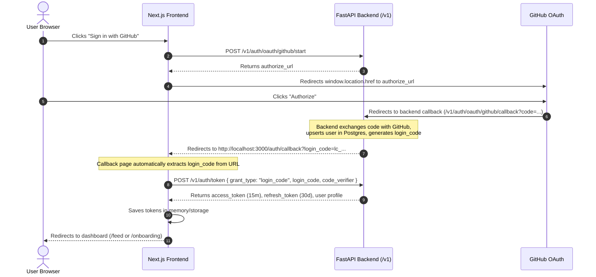

# Village Sqwhere: Backend API Documentation for Frontend

This document is the dedicated guide for the frontend team (`apps/web`) to interact with the FastAPI backend (`apps/api`). It is updated with every new feature and change.

---

## 1. Quick Reference

* **Local API Base URL:** `http://localhost:8000/v1`
* **Interactive Swagger UI (Try endpoints live):** `http://localhost:8000/docs`
* **Alternative ReDoc UI:** `http://localhost:8000/redoc`

---

## 2. Global Conventions

### The Response Envelope
All successful responses are wrapped in a top-level `data` key:

* **Single Item:**
  ```json
  {
    "data": {
      "id": "0193f2a0-0c1e-7b2a-9f10-0000000000a1",
      "username": "ada-obi"
    }
  }
  ```
* **Lists:**
  ```json
  {
    "data": [
      { "slug": "backend-engineer", "name": "Backend & Systems Engineer" }
    ]
  }
  ```

### Authentication Header
Endpoints requiring authentication expect standard HTTP Bearer authentication:
```http
Authorization: Bearer <access_token>
```
If the token is missing, invalid, or expired, the API returns HTTP `401 Unauthorized`.

---

## 3. Currently Implemented Endpoints

### 🩺 System

#### `GET /v1/health`
Health check endpoint to verify backend service liveness.

* **Authentication:** None
* **Success Response (200 OK):**
  ```json
  {
    "status": "ok",
    "version": "1.0.0"
  }
  ```

---

### 🔍 Lookups & Vocabularies

### The Concept of Slugs in Village Sqwhere

Throughout Village Sqwhere, lookups (roles, technologies, topics) are identified by **slugs** rather than raw numeric IDs or display names.

* **What is a slug?** A lowercase, URL-safe, hyphen-separated string (for example: `backend-engineer`, `react-native`, `vector-databases`). Slugs conform to the regex `^[a-z0-9]+(-[a-z0-9]+)*$`.
* **Why use slugs instead of database IDs?**
  * **Environment Independence:** Integer IDs can change between local, staging, and production depending on migration order. Slugs remain permanent and immutable across all databases.
  * **Readability and Clean URLs:** Slugs can be placed directly into frontend routes (e.g., `/roles/frontend-engineer`) and API path parameters (`/v1/me/roles/{role_slug}`) without exposing database internals.
* **Why use slugs instead of display names?**
  * Display names contain spaces, slashes, and symbols (e.g., `AI / ML Engineer`, `Node.js`, `CI/CD`). Slugs avoid URL encoding and whitespace bugs.
  * Display names can be rebranded or localized in the UI without breaking backend API contracts or database foreign keys.
* **The Golden Rule for Frontend Developers & Agents:**
  * **Displaying in UI:** Always show `name` to human users (e.g., "DevOps & Cloud Engineer").
  * **Sending to API:** Always send `slug` in request payloads, path parameters, and query parameters (e.g., `"devops-cloud-engineer"`).
* **Single Taxonomy Notice:** The `technologies` lookup table is the platform's single source of truth for developer skills, project requirements, and feed topic tags. That is why both `PUT /v1/me/technologies` and `PUT /v1/me/feed-topics` accept lists of technology slugs.

---

#### `GET /v1/roles`
Fetches all active platform engineering roles (e.g. for registration, role pickers, or idea collaborator requirements).

* **Authentication:** None
* **Complete List of Seeded Roles (9 total):**

| Slug | Display Name |
| :--- | :--- |
| `ai-ml-engineer` | AI / ML Engineer |
| `backend-engineer` | Backend & Systems Engineer |
| `devops-cloud-engineer` | DevOps & Cloud Engineer |
| `embedded-iot-engineer` | Embedded Systems & IoT Engineer |
| `frontend-engineer` | Frontend Engineer |
| `mlops-data-engineer` | MLOps & Data Engineer |
| `mobile-engineer` | Mobile Engineer |
| `security-engineer` | Cybersecurity & Smart Contract Auditor |
| `ui-ux-engineer` | UI/UX Engineer & Product Architect |

* **Success Response (200 OK):**
  ```json
  {
    "data": [
      {
        "slug": "frontend-engineer",
        "name": "Frontend Engineer"
      },
      {
        "slug": "backend-engineer",
        "name": "Backend & Systems Engineer"
      }
    ]
  }
  ```
* **Frontend Note:** Use `slug` when sending requests to the API, and use `name` when displaying to users.

#### `GET /v1/technologies`
Search or browse active technologies, frameworks, and tools.

* **Authentication:** None
* **Query Parameters:**
  * `q` *(optional, string, 1 to 40 chars)*: Case-insensitive prefix search (e.g., `?q=py` returns Python, PyTorch).
  * `limit` *(optional, integer, 1 to 50, default: 20)*: Maximum number of results to return.
* **Complete List of Seeded Technologies (19 total):**

| Slug | Display Name |
| :--- | :--- |
| `ci-cd` | CI/CD |
| `computer-vision` | Computer Vision |
| `docker` | Docker |
| `flutter` | Flutter |
| `go` | Go |
| `java` | Java |
| `kubernetes` | Kubernetes |
| `llms` | LLMs |
| `nodejs` | Node.js |
| `postgresql` | PostgreSQL |
| `python` | Python |
| `pytorch` | PyTorch |
| `react` | React |
| `react-native` | React Native |
| `rust` | Rust |
| `tensorflow` | TensorFlow |
| `terraform` | Terraform |
| `vector-databases` | Vector Databases |
| `vue` | Vue |

* **Success Response (200 OK):**
  ```json
  {
    "data": [
      {
        "slug": "python",
        "name": "Python"
      },
      {
        "slug": "pytorch",
        "name": "PyTorch"
      }
    ]
  }
  ```

---

### 🔐 Authentication

#### `POST /v1/auth/oauth/{provider}/start`
Starts the OAuth + PKCE sign-in flow. Only GitHub works today.

* **Authentication:** None
* **Path Parameters:**
  * `provider`: `github` (`bitbucket` is planned, and returns `503` until it is built)
* **Request Body:**
  ```json
  {
    "intent": "login",
    "redirect_uri": "http://localhost:8000/v1/auth/oauth/github/callback",
    "code_challenge": "E9Melhoa2OwvFrEMTJguCHaoeK1t8URWbuGJSstw-cM",
    "code_challenge_method": "S256"
  }
  ```
  `redirect_uri` is the API's callback URL, the same one registered on the GitHub OAuth app.
* **Success Response (200 OK):**
  ```json
  {
    "data": {
      "authorize_url": "https://github.com/login/oauth/authorize?client_id=...&redirect_uri=...&state=...",
      "expires_at": "2026-11-06T18:30:00Z"
    }
  }
  ```
* **Error Response (503):** `PROVIDER_NOT_CONFIGURED` when the provider is not set up on this server (for GitHub: `GITHUB_CLIENT_ID` and `GITHUB_CLIENT_SECRET` are missing).
* **Frontend Flow:** Redirect the user's browser to `authorize_url` within 10 minutes. The `state` in it works once.

#### `GET /v1/auth/oauth/{provider}/callback`
Handles the redirect back from GitHub.

* **Authentication:** None
* **Query Parameters:**
  * `code`: One-time authorization code from GitHub. GitHub leaves it out, and sends `error=access_denied` instead, when the person clicks Cancel.
  * `state`: The state from `start`. It must have been issued by this server, for this provider, in the last 10 minutes, and not used before.
* **Behavior:** exchanges `code` with GitHub, creates or updates the user in Postgres, then redirects the browser with HTTP `302 Found`:
  * On success: `http://localhost:3000/auth/callback?login_code=lc_...` (the code is random, works once, and expires after 5 minutes).
  * On failure: `http://localhost:3000/auth/callback?error=CODE`, where `CODE` is `INVALID_STATE` (start again), `ACCESS_DENIED` (the person cancelled on GitHub, or GitHub refused the code) or `OAUTH_EXCHANGE_FAILED` (GitHub or the database could not be reached).

#### `POST /v1/auth/token`
Exchanges a `login_code` (from the OAuth redirect) OR a `refresh_token` (to renew an expired session) for an active JWT `access_token` and rotated `refresh_token`.

* **Authentication:** None
* **Request Body Variant 1: Initial Login:**
  ```json
  {
    "grant_type": "login_code",
    "login_code": "lc_your_received_login_code",
    "code_verifier": "dBjftJeZ4CVP-mB92K27uhbUJU1p1r_wW1gFWFOEjXk",
    "device_name": "Chrome on macOS"
  }
  ```
  `code_verifier` must be the PKCE verifier whose challenge was sent to `start`.
* **Request Body Variant 2: Refreshing an Expired Access Token:**
  ```json
  {
    "grant_type": "refresh_token",
    "refresh_token": "rt_your_current_refresh_token"
  }
  ```
* **Success Response (200 OK):**
  ```json
  {
    "data": {
      "access_token": "eyJhbGciOi...",
      "token_type": "Bearer",
      "expires_in": 900,
      "refresh_token": "rt_...",
      "refresh_expires_at": "2026-12-06T18:00:00Z",
      "is_new_user": false,
      "user": {
        "id": "0193f2a0-0c1e-7b2a-9f10-0000000000a1",
        "username": "ada-obi",
        "display_name": "Ada Obi",
        "avatar_url": "https://avatars.githubusercontent.com/u/1001",
        "bio": "Backend engineer",
        "is_verified": false,
        "platform_role": "member",
        "roles": [],
        "technologies": [],
        "identities": [
          {
            "provider": "github",
            "provider_username": "ada-obi",
            "linked_at": "2026-11-06T18:00:00Z"
          }
        ],
        "created_at": "2026-11-06T18:00:00Z"
      }
    }
  }
  ```

#### `POST /v1/auth/logout`
Revokes the refresh token and signs out the session.

* **Authentication:** None
* **Request Body:**
  ```json
  {
    "refresh_token": "rt_..."
  }
  ```
* **Success Response (204 No Content):** Empty body.

---

### 👤 Current User (`/v1/me`)

#### `GET /v1/me`
Fetches the full profile of the currently signed-in user.

* **Authentication:** Bearer token required (`Authorization: Bearer <access_token>`)
* **Success Response (200 OK):**
  ```json
  {
    "data": {
      "id": "0193f2a0-0c1e-7b2a-9f10-0000000000a1",
      "username": "ada-obi",
      "display_name": "Ada Obi",
      "first_name": "Ada",
      "last_name": "Obi",
      "email": "ada@example.com",
      "email_verified": true,
      "avatar_url": "https://avatars.githubusercontent.com/u/1001",
      "bio": "Backend engineer in Lagos",
      "is_verified": true,
      "verified_at": "2026-11-06T18:00:00Z",
      "platform_role": "member",
      "roles": [
        {
          "slug": "backend-engineer",
          "name": "Backend & Systems Engineer",
          "is_primary": true,
          "verified_at": "2026-11-06T18:00:00Z",
          "verification": {
            "attempts_used": 1,
            "attempts_remaining": 2,
            "latest_status": "passed"
          }
        }
      ],
      "technologies": [
        { "slug": "python", "name": "Python" },
        { "slug": "postgresql", "name": "PostgreSQL" }
      ],
      "feed_topics": [],
      "identities": [
        {
          "provider": "github",
          "provider_username": "ada-obi",
          "linked_at": "2026-11-06T18:00:00Z"
        }
      ],
      "created_at": "2026-11-06T18:00:00Z"
    }
  }
  ```

#### `PATCH /v1/me`
Updates editable fields on the user's profile.

* **Authentication:** Bearer token required (`Authorization: Bearer <access_token>`)
* **Request Body:** *(All fields are optional; send only fields to update)*
  ```json
  {
    "display_name": "Ada O.",
    "bio": "Updated bio description",
    "first_name": "Ada",
    "last_name": "Obi",
    "email": "new-email@example.com"
  }
  ```
* **Limits:** `display_name` 1 to 80 characters, `first_name` and `last_name` 1 to 100, after spaces at the start and end are removed. `bio` up to 1000 characters. `email` must look like `name@example.com`. A new email is saved as not verified.
* **Success Response (200 OK):** Returns the full updated user profile wrapped in `{"data": { ... }}`.
* **Error Responses:** `422` when a field breaks a limit (the error names the field). `409` `EMAIL_TAKEN` when another account already uses the email, in any mix of upper and lower case.

#### `POST /v1/me/roles`
Claims a developer role for the authenticated user (e.g. during onboarding or profile editing).

* **Authentication:** Bearer token required (`Authorization: Bearer <access_token>`)
* **Request Body:**
  ```json
  {
    "role": "backend-engineer",
    "is_primary": false
  }
  ```
  * `role` *(required, string)*: Role slug from `GET /v1/roles`.
  * `is_primary` *(optional, boolean, default: false)*: Set to `true` to make this the primary role (unsets primary on any other claimed role).
* **Success Response (201 Created):**
  ```json
  {
    "data": {
      "slug": "backend-engineer",
      "name": "Backend & Systems Engineer",
      "is_primary": false,
      "verified_at": null,
      "verification": {
        "attempts_used": 0,
        "attempts_remaining": 3,
        "latest_status": null
      }
    }
  }
  ```
* **Error Responses:**
  * `409 Conflict`: `{"detail": {"code": "ROLE_ALREADY_CLAIMED", "message": "You already have this role."}}`
  * `422 Unprocessable Content`: `{"detail": {"code": "UNKNOWN_SLUG", "message": "Unknown role slug: '...'"}}`

#### `PATCH /v1/me/roles/{role_slug}`
Designates an already-claimed role as the user's primary discipline. Automatically demotes any other currently primary role.

* **Authentication:** Bearer token required (`Authorization: Bearer <access_token>`)
* **Request Body:**
  ```json
  {
    "is_primary": true
  }
  ```
* **Success Response (200 OK):** Returns the updated `UserRole` object wrapped in `{"data": { ... }}` with `is_primary: true`.
* **Error Responses:**
  * `404 Not Found`: `{"detail": {"code": "NOT_FOUND", "message": "Role '...' is not claimed."}}`
  * `422 Unprocessable Content`: `{"detail": {"code": "VALIDATION_FAILED", "message": "is_primary must be true"}}`

#### `DELETE /v1/me/roles/{role_slug}`
Removes a claimed role from the user's profile.

* **Authentication:** Bearer token required (`Authorization: Bearer <access_token>`)
* **Success Response (204 No Content):** Empty body.
* **Important Business Rule / Errors:**
  * If the user has started or completed any verification attempt for this role, deletion is refused to preserve the 3-attempt audit trail:
    `409 Conflict`: `{"detail": {"code": "ROLE_HAS_VERIFICATION_HISTORY", "message": "A role with verification attempts can't be removed (it would reset the 3-attempt limit)."}}`
  * `404 Not Found`: `{"detail": {"code": "NOT_FOUND", "message": "Role '...' is not claimed."}}`

### Experience verification

Verification attempts are tied to a claimed role. A developer has up to three attempts for
each role. The start endpoint records GitHub repository evidence and creates a `pending`
session. Analysis can update the session later; the API does not claim that analysis is done
when the session is created.

The response includes `current_phase` while AI work is active. It is `codebase_analysis` when
the session is waiting for or receiving repository analysis, `technical_defence` when the
analysis is complete and the interview can begin, and `report_generation` while the final
review brief is being prepared. It is `null` for terminal states and `awaiting_review`.

The codebase analysis service reads public GitHub repository metadata, languages, a bounded file
tree, test paths and recent commits. `GITHUB_API_TOKEN` is optional. Without it, public
repositories use GitHub's unauthenticated rate limit. Repository code is never executed.

The Groq codebase adapter is configured with `GROQ_API_KEY` and `GROQ_CODEBASE_MODEL`. It sends
the bounded snapshot to the configured model, requests JSON, and validates the response before
storing it. The adapter is not called directly by an HTTP endpoint.

The worker claims one pending codebase analysis with a row lock. It keeps that transaction open
while the external analysis runs, preventing two workers from processing the same session. A
successful run stores the result and advances `current_phase` to `technical_defence`.

`analysis_attempts` and `last_error` are returned to the applicant for progress reporting. A
failed run returns to `pending` and can be claimed again until
`VERIFICATION_MAX_ANALYSIS_ATTEMPTS` is reached. The primary Groq analyzer falls back to the
configured Gemini analyzer after a Groq configuration or API error.

#### `WS /v1/me/verifications/{session_id}/interview`

The applicant opens this WebSocket after the session reaches `technical_defence`. The access
token is supplied as the `token` query parameter during the connection handshake. The server
sends `question`, `answer_saved`, `audio_buffered`, `error`, and `interview_complete` events.
Text answers use `{"type":"answer","text":"..."}`. Audio is sent as binary frames and is
closed with `{"type":"answer_end"}`. With `GROQ_API_KEY` configured, the server sends the
audio to `GROQ_STT_MODEL`, checks the transcript with `GROQ_GUARD_MODEL`, and gets the next
question from `GROQ_INTERVIEW_MODEL`. If interview models are absent, text answers still work
with deterministic questions and audio reports `TRANSCRIPTION_UNAVAILABLE`.

Completing the interview sets `current_phase` to `report_generation`. It does not pass the role
or move the session into peer review until the combined report is generated.

The report worker combines the codebase result and persisted interview turns, validates the
structured evaluator output, stores it under `ai_result.final_report`, and then changes the
session to `awaiting_review`. The human peer-review endpoints remain the only path to `passed`
or `failed`.

#### `POST /v1/me/verifications/{role_slug}`

Starts a verification attempt for one of the signed-in developer's claimed roles.

* **Authentication:** Bearer token required
* **Request Body:**
  ```json
  {
    "repositories": ["https://github.com/example/project"]
  }
  ```
* **Success Response (201 Created):** Returns the new verification session in `data`.
* **Errors:** `404 ROLE_NOT_CLAIMED`, `409 VERIFICATION_IN_PROGRESS`,
  `409 ROLE_ALREADY_VERIFIED` or `409 VERIFICATION_ATTEMPTS_EXHAUSTED`.

#### `GET /v1/me/verifications`

Lists the signed-in developer's attempts. Optional query parameters are `role_slug`,
`status`, `offset` and `limit`. The response includes `next_offset` when more results exist.

#### `GET /v1/me/verifications/{session_id}`

Returns one attempt for its applicant. The frontend can poll this endpoint while analysis is
running.

#### `POST /v1/me/verifications/{session_id}/abandon`

Moves an active attempt to `abandoned`. A passed, failed or already abandoned attempt cannot
be changed.

#### `GET /v1/reviews/verifications`

Lists attempts in `awaiting_review` for roles in which the signed-in user is verified. An
applicant's own attempt never appears in their queue.

#### `GET /v1/reviews/verifications/{session_id}`

Returns a review case when the signed-in user is an eligible reviewer for that role.

#### `POST /v1/reviews/verifications/{session_id}/decision`

Records a peer review decision:

```json
{
  "decision": "passed",
  "notes": "Evidence reviewed."
}
```

Only `passed` and `failed` are accepted. A reviewer must be verified in the applicant's role,
cannot review their own attempt, and cannot decide a case that is no longer awaiting review.

#### `PUT /v1/me/technologies`
Full replacement of the developer's tech stack (skills and tools).

* **Authentication:** Bearer token required (`Authorization: Bearer <access_token>`)
* **Request Body:**
  ```json
  {
    "technologies": [
      "python",
      "postgresql",
      "go"
    ]
  }
  ```
  * `technologies` *(required, array of strings, 0 to 30 items)*: Slugs from `GET /v1/technologies`. No duplicates.
* **Success Response (200 OK):**
  ```json
  {
    "data": [
      { "slug": "python", "name": "Python" },
      { "slug": "postgresql", "name": "PostgreSQL" },
      { "slug": "go", "name": "Go" }
    ]
  }
  ```
* **Error Responses:**
  * `422 Unprocessable Content`: `{"detail": {"code": "UNKNOWN_SLUG", "message": "Unknown technology slugs: ..."}}`
  * `422 Unprocessable Content`: `{"detail": {"code": "VALIDATION_FAILED", "message": "Duplicate technologies are not allowed."}}`

#### `PUT /v1/me/feed-topics`
Full replacement of feed preference topics. An empty array `[]` means "show everything".

* **Authentication:** Bearer token required (`Authorization: Bearer <access_token>`)
* **Important Schema Rule for Frontend:**
  The request JSON key MUST be named `"technologies"` (NOT `"topics"`), because feed topics reference the platform's canonical `technologies` lookup table.
* **Request Body:**
  ```json
  {
    "technologies": [
      "react",
      "flutter"
    ]
  }
  ```
  * `technologies` *(required, array of strings, 0 to 50 items)*: Valid slugs from `GET /v1/technologies`. No duplicates.
  * To clear all feed topics and show everything on the feed, pass an empty array: `{"technologies": []}`.
* **Success Response (200 OK):** Returns the list of saved topic `TechnologyRef` objects wrapped in `{"data": [ ... ]}`.
* **Error Responses:**
  * `422 Unprocessable Content`: `{"detail": {"code": "UNKNOWN_SLUG", "message": "Unknown technology slugs: ..."}}` (Returned if any slug is not in the `technologies` lookup table).
  * `422 Unprocessable Content`: `{"detail": {"code": "VALIDATION_FAILED", "message": "Duplicate topics are not allowed."}}`
  * `422 Unprocessable Content`: `{"detail": [{"loc": ["body", "technologies"], "msg": "Field required"}]}` (Returned if the JSON key was named `"topics"` instead of `"technologies"`).

---

## 4. Frontend Integration Guide: Authentication

### How the Sign-In Flow Works for End Users (100% Automated)
In production and regular use, **the user never touches or sees a `login_code`**. The frontend coordinates the handshake automatically:



### Signing in during local development
There is no sign-in bypass: every sign-in goes through GitHub, so a made-up `login_code` is always refused. To sign in locally, create a GitHub OAuth app for yourself (see `.env.example`) and put its client ID and secret in your `.env`. Tests fake GitHub's side of the exchange instead (see `apps/api/tests/conftest.py`).

### How the Frontend Signs In

#### Steps
1. Generate PKCE pair (`code_verifier` and `code_challenge`). Store `code_verifier` in `sessionStorage`.
2. Frontend calls `POST /v1/auth/oauth/github/start` passing `code_challenge`.
3. Redirects browser to `authorize_url`.
4. User authorises on GitHub.
5. Browser lands back on `/auth/callback?login_code=lc_...`.
6. Frontend retrieves `code_verifier` from `sessionStorage` and calls `POST /v1/auth/token` with `{ grant_type: "login_code", login_code, code_verifier }`.

#### Ready-to-use PKCE Helper for Frontend (`apps/web`):
The frontend can drop this standard helper directly into its codebase (uses native Web Crypto API, 0 external packages required):

```typescript
// pkce.ts
export async function generatePKCE() {
  // 1. Generate random code_verifier (43-128 chars)
  const array = new Uint8Array(32);
  window.crypto.getRandomValues(array);
  const code_verifier = btoa(String.fromCharCode(...array))
    .replace(/\+/g, "-")
    .replace(/\//g, "_")
    .replace(/=+$/, "");

  // 2. Hash it with SHA-256 to create code_challenge
  const encoder = new TextEncoder();
  const data = encoder.encode(code_verifier);
  const digest = await window.crypto.subtle.digest("SHA-256", data);
  const code_challenge = btoa(String.fromCharCode(...new Uint8Array(digest)))
    .replace(/\+/g, "-")
    .replace(/\//g, "_")
    .replace(/=+$/, "");

  // Save verifier in sessionStorage to verify during token exchange
  sessionStorage.setItem("pkce_verifier", code_verifier);

  return { code_challenge, code_verifier };
}
```

---

### Silent Token Refreshing (Staying Logged In)
* Access tokens expire every **15 minutes** (`900 seconds`).
* Refresh tokens remain valid for **30 days**.
* The frontend HTTP client (e.g., Axios interceptor or custom `fetch` wrapper) should intercept HTTP `401 Unauthorized` responses and silently call:
  ```http
  POST /v1/auth/token
  Content-Type: application/json

  {
    "grant_type": "refresh_token",
    "refresh_token": "<stored_refresh_token>"
  }
  ```
* Save the new `access_token` and the new rotated `refresh_token`, then retry the original failed request. The user experiences zero interruption.
* Refresh tokens, login codes and OAuth states are kept in the API's memory for now. A restart cancels sign-ins in progress and forgets logouts (a logged-out refresh token works again until it expires), so run a single API process. See `docs/decisions/2026-11-07-sign-in-without-dev-login.md`.
