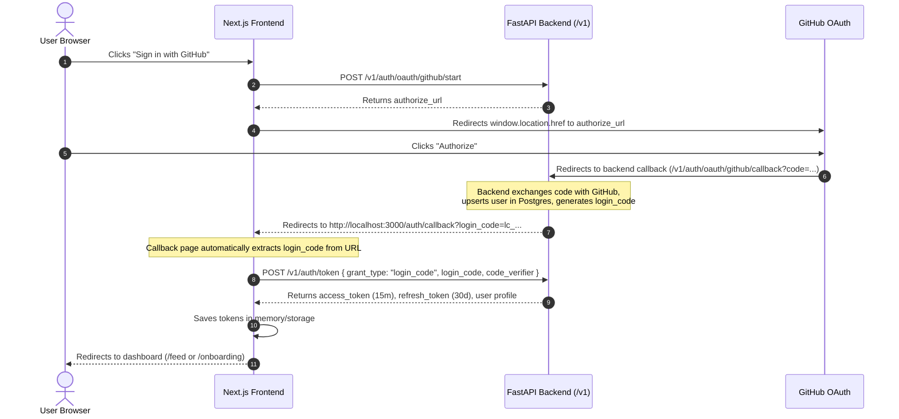

# Village Sqwhere: Backend API Documentation for Frontend

This document is the dedicated guide for the frontend team (`apps/web`) to interact with the FastAPI backend (`apps/api`). It is updated with every new feature and change.

---

## 1. Quick Reference

* **Local API Base URL:** `http://localhost:8000/v1`
* **Interactive Swagger UI (Try endpoints live):** `http://localhost:8000/docs`
* **Alternative ReDoc UI:** `http://localhost:8000/redoc`

---

## 2. Global Conventions

### The Response Envelope
All successful responses are wrapped in a top-level `data` key:

* **Single Item:**
  ```json
  {
    "data": {
      "id": "0193f2a0-0c1e-7b2a-9f10-0000000000a1",
      "username": "ada-obi"
    }
  }
  ```
* **Lists:**
  ```json
  {
    "data": [
      { "slug": "backend-engineer", "name": "Backend & Systems Engineer" }
    ]
  }
  ```

### Authentication Header
Endpoints requiring authentication expect standard HTTP Bearer authentication:
```http
Authorization: Bearer <access_token>
```
If the token is missing, invalid, or expired, the API returns HTTP `401 Unauthorized`.

### Validation Errors
A request that breaks a field rule gets `422` with FastAPI's list in `detail`: each item has
`type`, `loc`, `msg` and the `input` it refused. This body is escaped to ASCII (`"Santé"`),
which every JSON parser reads as the same text. That way an input UTF-8 cannot hold, such as a
lone `\ud800`, still gets its `422` instead of failing with a `500`.

---

## 3. Currently Implemented Endpoints

### System

#### `GET /v1/health`
Health check endpoint to verify backend service liveness.

* **Authentication:** None
* **Success Response (200 OK):**
  ```json
  {
    "status": "ok",
    "version": "1.0.0"
  }
  ```

---

### Lookups & Vocabularies

### The Concept of Slugs in Village Sqwhere

Throughout Village Sqwhere, lookups (roles, technologies, topics) are identified by **slugs** rather than raw numeric IDs or display names.

* **What is a slug?** A lowercase, URL-safe, hyphen-separated string (for example: `backend-engineer`, `react-native`, `vector-databases`). Slugs conform to the regex `^[a-z0-9]+(-[a-z0-9]+)*$`.
* **Why use slugs instead of database IDs?**
  * **Environment Independence:** Integer IDs can change between local, staging, and production depending on migration order. Slugs remain permanent and immutable across all databases.
  * **Readability and Clean URLs:** Slugs can be placed directly into frontend routes (e.g., `/roles/frontend-engineer`) and API path parameters (`/v1/me/roles/{role_slug}`) without exposing database internals.
* **Why use slugs instead of display names?**
  * Display names contain spaces, slashes, and symbols (e.g., `AI / ML Engineer`, `Node.js`, `CI/CD`). Slugs avoid URL encoding and whitespace bugs.
  * Display names can be rebranded or localized in the UI without breaking backend API contracts or database foreign keys.
* **The Golden Rule for Frontend Developers & Agents:**
  * **Displaying in UI:** Always show `name` to human users (e.g., "DevOps & Cloud Engineer").
  * **Sending to API:** Always send `slug` in request payloads, path parameters, and query parameters (e.g., `"devops-cloud-engineer"`).
* **Single Taxonomy Notice:** The `technologies` lookup table is the platform's single source of truth for developer skills, project requirements, and feed topic tags. That is why both `PUT /v1/me/technologies` and `PUT /v1/me/feed-topics` accept lists of technology slugs.

---

#### `GET /v1/roles`
Fetches all active platform engineering roles (e.g. for registration, role pickers, or idea collaborator requirements).

* **Authentication:** None
* **Complete List of Seeded Roles (9 total):**

| Slug | Display Name |
| :--- | :--- |
| `ai-ml-engineer` | AI / ML Engineer |
| `backend-engineer` | Backend & Systems Engineer |
| `devops-cloud-engineer` | DevOps & Cloud Engineer |
| `embedded-iot-engineer` | Embedded Systems & IoT Engineer |
| `frontend-engineer` | Frontend Engineer |
| `mlops-data-engineer` | MLOps & Data Engineer |
| `mobile-engineer` | Mobile Engineer |
| `security-engineer` | Cybersecurity & Smart Contract Auditor |
| `ui-ux-engineer` | UI/UX Engineer & Product Architect |

* **Success Response (200 OK):**
  ```json
  {
    "data": [
      {
        "slug": "frontend-engineer",
        "name": "Frontend Engineer"
      },
      {
        "slug": "backend-engineer",
        "name": "Backend & Systems Engineer"
      }
    ]
  }
  ```
* **Frontend Note:** Use `slug` when sending requests to the API, and use `name` when displaying to users.

#### `GET /v1/sectors`
The sectors a developer can say they want to build for, in the onboarding list's order. Onboarding
asks for them next to the stack.

* **Authentication:** None
* **Success Response (200 OK):**
  ```json
  { "data": [ { "slug": "fintech", "name": "Fintech" }, { "slug": "agritech", "name": "Agritech" } ] }
  ```
  The ten slugs: `fintech`, `agritech`, `health`, `education`, `climate-energy`,
  `mobility-logistics`, `commerce`, `civic`, `media-culture`, `developer-tools`. Names are English;
  the web app shows its own French name by slug and falls back to `name` for a slug it does not know.
* Why: `docs/decisions/2026-11-13-onboarding-sectors.md`.

#### `GET /v1/technologies`
Search or browse active technologies, frameworks, and tools.

* **Authentication:** None
* **Query Parameters:**
  * `q` *(optional, string, 1 to 40 chars)*: Case-insensitive prefix search (e.g., `?q=py` returns Python, PyTorch).
  * `limit` *(optional, integer, 1 to 50, default: 20)*: Maximum number of results to return.
* **Complete List of Seeded Technologies (19 total):**

| Slug | Display Name |
| :--- | :--- |
| `ci-cd` | CI/CD |
| `computer-vision` | Computer Vision |
| `docker` | Docker |
| `flutter` | Flutter |
| `go` | Go |
| `java` | Java |
| `kubernetes` | Kubernetes |
| `llms` | LLMs |
| `nodejs` | Node.js |
| `postgresql` | PostgreSQL |
| `python` | Python |
| `pytorch` | PyTorch |
| `react` | React |
| `react-native` | React Native |
| `rust` | Rust |
| `tensorflow` | TensorFlow |
| `terraform` | Terraform |
| `vector-databases` | Vector Databases |
| `vue` | Vue |

* **Success Response (200 OK):**
  ```json
  {
    "data": [
      {
        "slug": "python",
        "name": "Python"
      },
      {
        "slug": "pytorch",
        "name": "PyTorch"
      }
    ]
  }
  ```

---

### Authentication

#### `POST /v1/auth/oauth/{provider}/start`
Starts the OAuth + PKCE sign-in flow. Only GitHub works today.

* **Authentication:** None
* **Path Parameters:**
  * `provider`: `github` (`bitbucket` is planned, and returns `503` until it is built)
* **Request Body:**
  ```json
  {
    "intent": "login",
    "redirect_uri": "http://localhost:8000/v1/auth/oauth/github/callback",
    "code_challenge": "E9Melhoa2OwvFrEMTJguCHaoeK1t8URWbuGJSstw-cM",
    "code_challenge_method": "S256"
  }
  ```
  `redirect_uri` is the API's callback URL, the same one registered on the GitHub OAuth app.
* **Success Response (200 OK):**
  ```json
  {
    "data": {
      "authorize_url": "https://github.com/login/oauth/authorize?client_id=...&redirect_uri=...&state=...",
      "expires_at": "2026-11-06T18:30:00Z"
    }
  }
  ```
* **Error Response (503):** `PROVIDER_NOT_CONFIGURED` when the provider is not set up on this server (for GitHub: `GITHUB_CLIENT_ID` and `GITHUB_CLIENT_SECRET` are missing).
* **Frontend Flow:** Redirect the user's browser to `authorize_url` within 10 minutes. The `state` in it works once.

#### `GET /v1/auth/oauth/{provider}/callback`
Handles the redirect back from GitHub.

* **Authentication:** None
* **Query Parameters:**
  * `code`: One-time authorization code from GitHub. GitHub leaves it out, and sends `error=access_denied` instead, when the person clicks Cancel.
  * `state`: The state from `start`. It must have been issued by this server, for this provider, in the last 10 minutes, and not used before.
* **Behavior:** exchanges `code` with GitHub, creates or updates the user in Postgres, then redirects the browser with HTTP `302 Found`:
  * On success: `http://localhost:3000/auth/callback?login_code=lc_...` (the code is random, works once, and expires after 5 minutes).
  * On failure: `http://localhost:3000/auth/callback?error=CODE`, where `CODE` is `INVALID_STATE` (start again), `ACCESS_DENIED` (the person cancelled on GitHub, or GitHub refused the code) or `OAUTH_EXCHANGE_FAILED` (GitHub or the database could not be reached).
* **Email at sign-up:** a new account gets an email only when GitHub vouches for it. The API asks GitHub for the person's addresses (`GET /user/emails`, which the `user:email` scope allows) and saves the verified primary one, or else another verified one. GitHub noreply addresses are skipped. A saved email is marked verified (`email_verified` is `true` in `GET /v1/me`). The email on the public GitHub profile is never used by itself. The account is created with no email, and sign-in still works, when no address qualifies, when another account already has the address (capital letters do not matter), or when GitHub cannot be asked. Accounts that already exist are not changed.

#### `POST /v1/auth/token`
Exchanges a `login_code` (from the OAuth redirect) OR a `refresh_token` (to renew an expired session) for an active JWT `access_token` and rotated `refresh_token`.

* **Authentication:** None
* **Request Body Variant 1: Initial Login:**
  ```json
  {
    "grant_type": "login_code",
    "login_code": "lc_your_received_login_code",
    "code_verifier": "dBjftJeZ4CVP-mB92K27uhbUJU1p1r_wW1gFWFOEjXk",
    "device_name": "Chrome on macOS"
  }
  ```
  `code_verifier` must be the PKCE verifier whose challenge was sent to `start`.
* **Request Body Variant 2: Refreshing an Expired Access Token:**
  ```json
  {
    "grant_type": "refresh_token",
    "refresh_token": "rt_your_current_refresh_token"
  }
  ```
* **Success Response (200 OK):**
  ```json
  {
    "data": {
      "access_token": "eyJhbGciOi...",
      "token_type": "Bearer",
      "expires_in": 900,
      "refresh_token": "rt_...",
      "refresh_expires_at": "2026-12-06T18:00:00Z",
      "is_new_user": false,
      "user": {
        "id": "0193f2a0-0c1e-7b2a-9f10-0000000000a1",
        "username": "ada-obi",
        "display_name": "Ada Obi",
        "avatar_url": "https://avatars.githubusercontent.com/u/1001",
        "bio": "Backend engineer",
        "is_verified": false,
        "platform_role": "member",
        "is_demo": false,
        "roles": [],
        "technologies": [],
        "identities": [
          {
            "provider": "github",
            "provider_username": "ada-obi",
            "linked_at": "2026-11-06T18:00:00Z"
          }
        ],
        "created_at": "2026-11-06T18:00:00Z"
      }
    }
  }
  ```

#### `POST /v1/auth/logout`
Revokes the refresh token and signs out the session.

* **Authentication:** None
* **Request Body:**
  ```json
  {
    "refresh_token": "rt_..."
  }
  ```
* **Success Response (204 No Content):** Empty body.

#### `POST /v1/auth/demo`
Signs in as the shared demo account, for "Try the demo". No GitHub, no body.

* **Authentication:** None
* **Success Response (200 OK):** the same body as `POST /v1/auth/token`, with `user.is_demo` true.
  Refreshing with `POST /v1/auth/token` and signing out with `POST /v1/auth/logout` work as for
  any account.
* **Error Response:** `404 DEMO_UNAVAILABLE` when the API runs without `DEMO_ENABLED=true`, or
  the database has no demo account (the seed script creates it, with a fixed id).
* **Read-only:** the demo account can call every `GET`, but any other method on a signed-in route
  answers `403 DEMO_READ_ONLY`, and the verification interview socket closes with code `1008`.
  The check sits in the dependency every signed-in route uses, so a new write route is covered
  without a check of its own. `tests/test_demo.py` tries every write route with a demo token.
* **Switched off:** once `DEMO_ENABLED` is not `true`, tokens the demo already handed out answer
  `401 DEMO_UNAVAILABLE`, refresh included.
* **Kept apart:** demo accounts (`users.is_demo`) see only demo content, and nobody else ever
  sees it. Posts, comments, the feed, saved posts, open ideas, matching, hubs and the review
  queue all filter by it, and a single read of the other side answers `404`. An owner cannot
  invite a demo account (`404 USER_NOT_FOUND`), and a real developer cannot ask to join a demo
  hub. The rule is `same_world` in `apps/api/app/api/deps.py`; a new list of shared content
  must use it too.
* **Content:** `uv run --directory apps/api python -m app.demo_seed` fills a database with
  made-up developers, posts, comments, ideas, hubs and a review case. It also creates the demo
  account itself, so `POST /v1/auth/demo` answers `404` until it has run. Running it again
  rewrites the posts and comments with fresh times.
* Why: `docs/decisions/2026-11-13-read-only-demo.md`.

---

### Current User (`/v1/me`)

#### `GET /v1/me`
Fetches the full profile of the currently signed-in user.

* **Authentication:** Bearer token required (`Authorization: Bearer <access_token>`)
* **Success Response (200 OK):**
  ```json
  {
    "data": {
      "id": "0193f2a0-0c1e-7b2a-9f10-0000000000a1",
      "username": "ada-obi",
      "display_name": "Ada Obi",
      "first_name": "Ada",
      "last_name": "Obi",
      "email": "ada@example.com",
      "email_verified": true,
      "avatar_url": "https://avatars.githubusercontent.com/u/1001",
      "bio": "Backend engineer in Lagos",
      "country_code": "NG",
      "is_verified": true,
      "verified_at": "2026-11-06T18:00:00Z",
      "platform_role": "member",
      "is_demo": false,
      "roles": [
        {
          "slug": "backend-engineer",
          "name": "Backend & Systems Engineer",
          "is_primary": true,
          "verified_at": "2026-11-06T18:00:00Z",
          "verification": {
            "attempts_used": 1,
            "attempts_remaining": 2,
            "latest_status": "passed"
          }
        }
      ],
      "technologies": [
        { "slug": "python", "name": "Python" },
        { "slug": "postgresql", "name": "PostgreSQL" }
      ],
      "feed_topics": [],
      "sectors": [{ "slug": "fintech", "name": "Fintech" }],
      "identities": [
        {
          "provider": "github",
          "provider_username": "ada-obi",
          "linked_at": "2026-11-06T18:00:00Z"
        }
      ],
      "created_at": "2026-11-06T18:00:00Z"
    }
  }
  ```

#### `PATCH /v1/me`
Updates editable fields on the user's profile.

* **Authentication:** Bearer token required (`Authorization: Bearer <access_token>`)
* **Request Body:** *(All fields are optional; send only fields to update)*
  ```json
  {
    "display_name": "Ada O.",
    "bio": "Updated bio description",
    "first_name": "Ada",
    "last_name": "Obi",
    "email": "new-email@example.com",
    "country_code": "NG"
  }
  ```
* **Country:** `country_code` is optional and has no city beside it. It is a two-letter ISO code (capital letters) of one of the 54 African countries, such as `NG`, `SN` or `KE`; the list is `AFRICAN_COUNTRY_CODES` in `apps/api/app/countries.py`. It is `null` until a developer sets it. Send a code to set or change it, send `"country_code": null` to clear it, and leave the key out to keep it as it is. Any other value (a code from outside Africa, lowercase, three letters) gets a `422` that names `country_code`. It shows to other signed-in developers on the match cards of `GET /v1/me/ideas/{idea_id}/matches`.
* **Limits:** `display_name` 1 to 80 characters, `first_name` and `last_name` 1 to 100, after spaces at the start and end are removed. `bio` up to 1000 characters. `email` must look like `name@example.com`. A new email is saved as not verified.
* **Success Response (200 OK):** Returns the full updated user profile wrapped in `{"data": { ... }}`.
* **Error Responses:** `422` when a field breaks a limit (the error names the field). `409` `EMAIL_TAKEN` when another account already uses the email, in any mix of upper and lower case.

#### `POST /v1/me/roles`
Claims a developer role for the authenticated user (e.g. during onboarding or profile editing).

* **Authentication:** Bearer token required (`Authorization: Bearer <access_token>`)
* **Request Body:**
  ```json
  {
    "role": "backend-engineer",
    "is_primary": false
  }
  ```
  * `role` *(required, string)*: Role slug from `GET /v1/roles`.
  * `is_primary` *(optional, boolean, default: false)*: Set to `true` to make this the primary role (unsets primary on any other claimed role).
* **Success Response (201 Created):**
  ```json
  {
    "data": {
      "slug": "backend-engineer",
      "name": "Backend & Systems Engineer",
      "is_primary": false,
      "verified_at": null,
      "verification": {
        "attempts_used": 0,
        "attempts_remaining": 3,
        "latest_status": null
      }
    }
  }
  ```
* **Error Responses:**
  * `409 Conflict`: `{"detail": {"code": "ROLE_ALREADY_CLAIMED", "message": "You already have this role."}}`
  * `422 Unprocessable Content`: `{"detail": {"code": "UNKNOWN_SLUG", "message": "Unknown role slug: '...'"}}`

#### `PATCH /v1/me/roles/{role_slug}`
Designates an already-claimed role as the user's primary discipline. Automatically demotes any other currently primary role.

* **Authentication:** Bearer token required (`Authorization: Bearer <access_token>`)
* **Request Body:**
  ```json
  {
    "is_primary": true
  }
  ```
* **Success Response (200 OK):** Returns the updated `UserRole` object wrapped in `{"data": { ... }}` with `is_primary: true`.
* **Error Responses:**
  * `404 Not Found`: `{"detail": {"code": "NOT_FOUND", "message": "Role '...' is not claimed."}}`
  * `422 Unprocessable Content`: `{"detail": {"code": "VALIDATION_FAILED", "message": "is_primary must be true"}}`

#### `DELETE /v1/me/roles/{role_slug}`
Removes a claimed role from the user's profile.

* **Authentication:** Bearer token required (`Authorization: Bearer <access_token>`)
* **Success Response (204 No Content):** Empty body.
* **Important Business Rule / Errors:**
  * If the user has started or completed any verification attempt for this role, deletion is refused to preserve the 3-attempt audit trail:
    `409 Conflict`: `{"detail": {"code": "ROLE_HAS_VERIFICATION_HISTORY", "message": "A role with verification attempts can't be removed (it would reset the 3-attempt limit)."}}`
  * `404 Not Found`: `{"detail": {"code": "NOT_FOUND", "message": "Role '...' is not claimed."}}`

#### `PUT /v1/me/technologies`
Full replacement of the developer's tech stack (skills and tools).

* **Authentication:** Bearer token required (`Authorization: Bearer <access_token>`)
* **Request Body:**
  ```json
  {
    "technologies": [
      "python",
      "postgresql",
      "go"
    ]
  }
  ```
  * `technologies` *(required, array of strings, 0 to 30 items)*: Slugs from `GET /v1/technologies`. No duplicates.
* **Success Response (200 OK):**
  ```json
  {
    "data": [
      { "slug": "python", "name": "Python" },
      { "slug": "postgresql", "name": "PostgreSQL" },
      { "slug": "go", "name": "Go" }
    ]
  }
  ```
* **Error Responses:**
  * `422 Unprocessable Content`: `{"detail": {"code": "UNKNOWN_SLUG", "message": "Unknown technology slugs: ..."}}`
  * `422 Unprocessable Content`: `{"detail": {"code": "VALIDATION_FAILED", "message": "Duplicate technologies are not allowed."}}`

#### `PUT /v1/me/feed-topics`
Full replacement of feed preference topics. An empty array `[]` means "show everything".

* **Authentication:** Bearer token required (`Authorization: Bearer <access_token>`)
* **Important Schema Rule for Frontend:**
  The request JSON key MUST be named `"technologies"` (NOT `"topics"`), because feed topics reference the platform's canonical `technologies` lookup table.
* **Request Body:**
  ```json
  {
    "technologies": [
      "react",
      "flutter"
    ]
  }
  ```
  * `technologies` *(required, array of strings, 0 to 50 items)*: Valid slugs from `GET /v1/technologies`. No duplicates.
  * To clear all feed topics and show everything on the feed, pass an empty array: `{"technologies": []}`.
* **Success Response (200 OK):** Returns the list of saved topic `TechnologyRef` objects wrapped in `{"data": [ ... ]}`.
* **Error Responses:**
  * `422 Unprocessable Content`: `{"detail": {"code": "UNKNOWN_SLUG", "message": "Unknown technology slugs: ..."}}` (Returned if any slug is not in the `technologies` lookup table).
  * `422 Unprocessable Content`: `{"detail": {"code": "VALIDATION_FAILED", "message": "Duplicate topics are not allowed."}}`

#### `PUT /v1/me/sectors`
Replaces the developer's whole set of sectors. Sending the same set again is safe, and `[]` clears it.

* **Authentication:** Bearer token required
* **Request Body:** `{"sectors": ["health", "fintech"]}`: 0 to 20 slugs from `GET /v1/sectors`, no
  duplicates.
* **Success Response (200 OK):** the saved sectors in the order sent, `{"data": [{"slug": "health",
  "name": "Health"}, ...]}`. `GET /v1/me` lists them under `sectors` in the sector list's order.
* **Error Responses:**
  * `422 UNKNOWN_SLUG`: a slug is not an active sector. The message names it, for example
    `Unknown sector slugs: space-mining`.
  * `422 VALIDATION_FAILED`: the same slug twice.
  * `422` (FastAPI's list): a slug that is not lowercase letters, digits and hyphens, or a body
    without `sectors`.
  * `422 Unprocessable Content`: `{"detail": [{"loc": ["body", "technologies"], "msg": "Field required"}]}` (Returned if the JSON key was named `"topics"` instead of `"technologies"`).

### Experience verification

Verification attempts are tied to a claimed role. A developer has up to three attempts for
each role. The start endpoint records GitHub repository evidence and creates a `pending`
session. Analysis can update the session later; the API does not claim that analysis is done
when the session is created.

The response includes `current_phase` while AI work is active. It is `codebase_analysis` when
the session is waiting for or receiving repository analysis, `technical_defence` when the
analysis is complete and the interview can begin, and `report_generation` while the final
review brief is being prepared. It is `null` for terminal states and `awaiting_review`.

Each attempt has a `language`, `en` or `fr`, chosen when it starts and never changed. The
repositories check writes its summary, strengths, concerns and criterion rationales in it, the AI
interviewer asks its questions in it, and the final report is written in it, so a reviewer who
reads only English can be given a French report. The applicant's attempt and the reviewer's queue
and case all carry `language`. The instruction that sets the language comes from a fixed list in
the code, keyed by the stored value, and never from anything the applicant typed. When no AI
provider answers, the built-in interviewer speaks the same language.

The codebase analysis service reads public GitHub repository metadata, languages, a bounded file
tree, test paths and recent commits. `GITHUB_API_TOKEN` is optional. Without it, public
repositories use GitHub's unauthenticated rate limit. Repository code is never executed.

The Groq codebase adapter is configured with `GROQ_API_KEY` and `GROQ_CODEBASE_MODEL`. It sends
the bounded snapshot to the configured model, requests JSON, and validates the response before
storing it. The JSON keys, criterion names, numbers and `model` do not change with the language.
The adapter is not called directly by an HTTP endpoint.

The worker claims one pending codebase analysis with a row lock. It keeps that transaction open
while the external analysis runs, preventing two workers from processing the same session. A
successful run stores the result and advances `current_phase` to `technical_defence`.

`analysis_attempts` and `last_error` are returned to the applicant for progress reporting. A
failed run returns to `pending` and can be claimed again until
`VERIFICATION_MAX_ANALYSIS_ATTEMPTS` is reached. The primary Groq analyzer falls back to the
configured Gemini analyzer after a Groq configuration or API error.

#### `WS /v1/me/verifications/{session_id}/interview`

The applicant opens this WebSocket after the session reaches `technical_defence`. The access
token is supplied as the `token` query parameter during the connection handshake. The server
sends `assistant_message`, `question`, `answer_saved`, `audio_buffered`, `error`,
`interview_complete`, and `interview_incomplete` events. An `assistant_message` has a `kind` of
`welcome`, `acknowledgement`, or `closing`, plus its text. The welcome explains the interview
before question one. Each saved answer receives a neutral acknowledgement before the next
question. The closing signs the applicant off after answer five.
Text answers use `{"type":"answer","text":"..."}`. Audio is sent as binary frames and is
closed with `{"type":"answer_end"}`. With `GROQ_API_KEY` configured, the server sends the
audio to `GROQ_STT_MODEL`, checks the transcript with `GROQ_GUARD_MODEL`, and gets the next
question from `GROQ_INTERVIEW_MODEL`. If Groq is unavailable or returns invalid structured output,
the conversation falls back to `GEMINI_INTERVIEW_MODEL`. Audio transcription also falls back to
Gemini multimodal input when Groq Whisper is unavailable. If neither provider is available,
deterministic conversation keeps text interviews usable. Questions one to three cover architecture
and ownership, role fundamentals, and testing and reliability. Questions four and five use the
codebase analysis and prior answers for adaptive depth, trade-offs, and problem solving. Audio
reports `TRANSCRIPTION_UNAVAILABLE` when transcription is not configured.
Groq interview requests use a conservative 115,000-token input budget, below the 131,072-token
GPT-OSS context window. Requests over that budget go directly to the Gemini interview fallback.

An audio answer can name its type with the optional `audio_content_type` query parameter,
which defaults to `audio/webm`. The value must be one of `audio/webm`, `audio/webm;codecs=opus`,
`audio/ogg`, `audio/ogg;codecs=opus`, `audio/mp4`, `audio/mpeg`, `audio/wav`, `audio/x-wav` or
`audio/flac`, in any letter case. Anything else gets an `AUDIO_TYPE_NOT_ALLOWED` error and the
buffered audio is dropped, and only a value from this list is ever sent to the speech provider.

Each answer is checked with `GROQ_GUARD_MODEL`. When `GROQ_API_KEY` or `GROQ_GUARD_MODEL` is not
set nothing is checked, so every answer is flagged `guard_not_configured`. A flag is saved with
the answer, sent to the client as `{"type":"security_signal","severity":"warning","code":"..."}`
and passed to the report generator, so peer reviewers can see that nothing was screened.

The interview allows `VERIFICATION_INTERVIEW_MAX_TURNS` answered turns, which defaults to five.
The applicant cannot complete the interview manually. After the final answer is saved, the
server sends `interview_complete` and sets `current_phase` to `report_generation`. Sending a
client `complete` event is not supported. If the applicant sends `abandon`, or the WebSocket
disconnects before the limit, the interview is marked `incomplete` and the verification session
is abandoned. An incomplete interview does not enter report generation or peer review.

Welcome, acknowledgement, question, answer, security flag, and closing text are persisted. The
report worker stores this under `ai_result.interview_transcript`, combines the codebase result and
interview turns, validates the structured evaluator output, and stores the report under
`ai_result.final_report`. It then changes the session to `awaiting_review`. The human peer-review
endpoints remain the only path to `passed` or `failed`.

Run the worker loop with:

```bash
uv run --directory apps/api python -m app.workers.runner
```

It polls both queues every `VERIFICATION_WORKER_INTERVAL_SECONDS` seconds. Each job is claimed
with a database row lock, and a failed job is logged while the loop continues.

Final report evaluation uses `GROQ_EVALUATION_MODEL` first and falls back to
`GEMINI_EVALUATION_MODEL`. Both providers must return the same validated report shape. The
summary, findings and concerns are written in the attempt's `language`. The JSON keys,
`security_flags` codes, `model` and numbers do not change.

#### `POST /v1/me/verifications/{role_slug}`

Starts a verification attempt for one of the signed-in developer's claimed roles.

* **Authentication:** Bearer token required
* **Request Body:**
  ```json
  {
    "repositories": ["https://github.com/example/project"],
    "language": "fr"
  }
  ```
  `language` is optional: `en` (the default) or `fr`. Anything else is a `422` that names the
  field.
* **Success Response (201 Created):** Returns the new verification session in `data`.
* **Errors:** `404 ROLE_NOT_CLAIMED`, `409 VERIFICATION_IN_PROGRESS`,
  `409 ROLE_ALREADY_VERIFIED` or `409 VERIFICATION_ATTEMPTS_EXHAUSTED`.

#### `GET /v1/me/verifications`

Lists the signed-in developer's attempts. Optional query parameters are `role_slug`,
`status`, `offset` and `limit`. The response includes `next_offset` when more results exist.

#### `GET /v1/me/verifications/{session_id}`

Returns one attempt for its applicant. The frontend can poll this endpoint while analysis is
running.

#### `POST /v1/me/verifications/{session_id}/abandon`

Moves an active attempt to `abandoned`. A passed, failed or already abandoned attempt cannot
be changed.

#### `GET /v1/reviews/verifications`

Lists attempts in `awaiting_review` for roles in which the signed-in user is verified. An
applicant's own attempt never appears in their queue.

#### `GET /v1/reviews/verifications/{session_id}`

Returns a review case when the signed-in user is an eligible reviewer for that role.

#### `POST /v1/reviews/verifications/{session_id}/decision`

Records a peer review decision:

```json
{
  "decision": "passed",
  "notes": "Evidence reviewed."
}
```

Only `passed` and `failed` are accepted. A reviewer must be verified in the applicant's role,
cannot review their own attempt, and cannot decide a case that is no longer awaiting review. A
passed decision marks the applicant's role and profile as verified through the database trigger.

### Ideas

An idea starts as an owner-only draft. Its `summary` is the safe public abstract for discovery.
Its optional `details` field is a confidential brief, so the API never returns it outside the
owner-only endpoints. Required roles are the platform role slugs a collaborator must have.

**Idea error codes.** Errors use `{"detail": {"code": "...", "message": "..."}}`. Branch
on `code`, never on `message`.

| Status | Code | When |
| --- | --- | --- |
| `401` | `UNAUTHENTICATED` / `TOKEN_EXPIRED` | Not signed in, or the token is invalid or expired. |
| `404` | `NOT_FOUND` | The idea does not exist, is deleted, is not yours on a `/me` route, or is not open on a discovery route. |
| `409` | `IDEA_NOT_DRAFT` | Trying to publish an idea that is already open or closed. |
| `409` | `IDEA_NOT_OPEN` | Trying to close a draft or a closed idea. |
| `422` | `UNKNOWN_ROLE` | A role slug does not exist or is inactive. |
| `422` | (FastAPI's list) | A field is invalid, duplicate, unknown or missing. `detail` is a list. |

#### `POST /v1/me/ideas`

Creates a private draft. The server takes the author from the access token. It does not accept
an owner or a status from the client.

* **Authentication:** Bearer token required.
* **Request Body:**
  ```json
  {
    "title": "Offline farm ledger for co-operatives",
    "summary": "A shared ledger that works offline for farming co-operatives in Kano.",
    "details": "Private plan for onboarding the first co-operatives.",
    "stage": "concept",
    "roles_needed": ["backend-engineer", "ui-ux-engineer"]
  }
  ```
  `title` is 5 to 150 characters, `summary` is 20 to 1000, and `details` is optional and up
  to 20,000. `stage` is `concept`, `prototype` or `building`. `roles_needed` has zero to nine
  distinct active role slugs. Unknown fields are refused.
* **Success Response (201 Created):** Returns the full owner-only idea, including `details`,
  with `status: "draft"` and `published_at: null`.

#### `GET /v1/me/ideas` and `GET /v1/me/ideas/{idea_id}`

Lists the signed-in developer's active ideas, or returns one full owner-only idea. List results
omit `details` to keep a page light. Both accept or return the usual `offset`, `limit` and
`next_offset` pagination values, where applicable.

#### `PATCH /v1/me/ideas/{idea_id}`

Changes any supplied idea field. Send `details: null` to remove the confidential brief. Send
`roles_needed: []` to clear the role requirements. Leaving a field out keeps it unchanged.
Changing title or summary invalidates its vector in the database, so matching can re-embed the
new public text.

#### `POST /v1/me/ideas/{idea_id}/publish`

Moves a draft to `open` and records the publication time. An open idea can be discovered by
signed-in developers and can be used to create a hub. A closed idea cannot be published again
in this first version.

#### `POST /v1/me/ideas/{idea_id}/close`

Moves an open idea to `closed`. The owner retains the full record, but it no longer appears in
discovery or matching candidates.

#### `GET /v1/ideas` and `GET /v1/ideas/{idea_id}`

Returns only open idea cards to signed-in developers. A card contains title, summary, stage,
roles needed, author, `hub_id` (the idea's hub, or `null` before it has one) and timestamps. It
never contains the confidential `details` field. A developer asks to join through `hub_id`.
`GET /v1/ideas` accepts `offset` and `limit`, with `next_offset` when another page exists.

### Matching

Matching pairs open ideas with developers through the roles an idea needs and the roles a
developer has passed verification in. Self-claimed and inactive roles never match. It is
deterministic: no AI model is called and an idea's `details` are never read. Both routes take
`offset` (0 or more) and `limit` (1 to 50, default 20) and return `next_offset` when another
page exists. Why: `docs/decisions/2026-11-13-role-based-idea-matching.md`.

**The score.** Every match has a score out of 100 and both lists are ordered by it. Why:
`docs/decisions/2026-11-14-match-score.md`. It is counted from stored facts, in four parts:

| Part | Points | How it is counted |
| --- | --- | --- |
| Roles | 40 | 30 for one needed role the developer is verified in, 40 for two or more |
| Technologies | 20 | 4 for each technology shared with the idea's author, at most 5 counted |
| Sectors | 10 | 5 for each sector shared with the idea's author, at most 2 counted |
| Meaning | 30 | Not built yet |

Version 1 has no meaning part, so the 70 points that exist are scaled to 100 and rounded to a
whole number, half up: `(raw * 100 + 35) // 70`. Raw 30 gives 43, 42 gives 60, 57 gives 81 and
70 gives 100. Both lists add these fields to each item:

* `score`: a whole number from 0 to 100.
* `score_version`: `1`.
* `partial`: `true` while the meaning part is missing.
* `breakdown`: `roles`, `technologies`, `sectors` and `meaning`, each `{"points", "max"}` with
  `max` 40, 20, 10 and 30. `points` are the raw points before scaling, so a card can say
  "30 of 40". `meaning.points` is `null` in version 1.
* `shared_sectors`: the sectors both people have, sorted by name like `shared_technologies`
  (`[]` when none). On the developer list it is the developer's sectors that the idea's author
  also has; on the idea list, the caller's sectors that the idea's author also has.

The order is the raw points, highest first. Ties are broken by the earlier rules: for
developers the earliest verification, then the user id; for ideas the newest publication, then
the idea id (highest first). The order is computed in SQL, so `offset` and `limit` page through
it correctly.

People asking to join an idea's hub, invited to it or in it are not suggested for that idea,
and that idea is left out of their own matches. After a decline, a withdrawn request, leaving
or a removal, both can be suggested again. Why:
`docs/decisions/2026-11-14-suggest-again-after-a-no.md`.

#### `GET /v1/me/ideas/{idea_id}/matches`

Developers who fit one of the caller's open ideas, ordered by score (see above), then
earliest verification, then user id. The author and deleted accounts never appear, nor does
anyone who is asking to join the idea's hub, invited to it or in it. After a decline, a
withdrawn request, leaving or a removal, the person can be suggested again. An idea with no
roles needed returns an empty list, so the page should prompt the owner to add roles.

* **Authentication:** Bearer token required. Only the idea's author.
* **Success Response (200 OK):**
  ```json
  {
    "data": [
      {
        "id": "8d1c5d3e-1b7a-4f55-9a8e-2f9e0c6b7a11",
        "username": "kwame-dev",
        "display_name": "Kwame Mensah",
        "avatar_url": null,
        "is_verified": true,
        "matched_roles": [{ "slug": "backend-engineer", "name": "Backend & Systems Engineer" }],
        "technologies": [{ "slug": "python", "name": "Python" }],
        "shared_technologies": [{ "slug": "python", "name": "Python" }],
        "shared_technology_count": 1,
        "shared_sectors": [{ "slug": "fintech", "name": "Fintech" }],
        "country_code": "GH",
        "score": 56,
        "score_version": 1,
        "partial": true,
        "breakdown": {
          "roles": { "points": 30, "max": 40 },
          "technologies": { "points": 4, "max": 20 },
          "sectors": { "points": 5, "max": 10 },
          "meaning": { "points": null, "max": 30 }
        }
      }
    ],
    "next_offset": null
  }
  ```
  `shared_technologies` names the developer's technologies that the idea's author also has,
  sorted by name like `technologies`. `shared_technology_count` is always its length.
  `country_code` is the developer's country (two capital letters) and `null` when they have not
  named one. A card never has an email, first or last name, or bio.
* **Errors:** `404 NOT_FOUND` when the idea is not the caller's, does not exist or is deleted.
  `409 IDEA_NOT_OPEN` for a draft or closed idea: publish it first.

#### `GET /v1/me/matches`

Open ideas, by other authors, that need a role the caller is verified in, leaving out ideas
whose hub the caller is asking to join, invited to or in. The order is the score (see above),
then newest publication, then idea id. A caller with no verified role gets an empty list, so
the page should point them to role verification.

* **Authentication:** Bearer token required.
* **Success Response (200 OK):** `{"data": [{"idea": <public idea card>, "matched_roles":
  [<role>], "shared_technologies": [<technology>], "shared_sectors": [<sector>], "score": 60,
  "score_version": 1, "partial": true, "breakdown": {...}}], "next_offset": null}`. The idea card
  is the same as `GET /v1/ideas/{idea_id}`. `shared_technologies` and `shared_sectors` name the
  technologies and sectors the caller shares with the idea's author, sorted by name. They are
  empty when none are shared. The card has no author country.

### Hubs

A hub is the space where a team builds an idea together. Every member signs the same
standard agreement (an NDA) before they join, including the owner when they create the hub.

**Error codes for hubs.** Errors use the same shape as the rest of the API,
`{"detail": {"code": "...", "message": "..."}}`. Branch on `code`, never on `message`.

| Status | Code | When |
| --- | --- | --- |
| `401` | `UNAUTHENTICATED` / `TOKEN_EXPIRED` | Not signed in, or the token is invalid or expired. |
| `403` | `NOT_IDEA_AUTHOR` | Only the idea's author can create its hub. |
| `403` | `NOT_HUB_OWNER` | Only the hub's owner can invite, withdraw an invitation, answer a join request, confirm the team or move the phase. |
| `403` | `NOT_HUB_MEMBER` | Only active members (who signed) can read the brief, the member list or the notes. |
| `403` | `NOT_NOTE_AUTHOR` | Only a note's author or the hub's owner can remove it. |
| `404` | `USER_NOT_FOUND` | No developer has the username in an invitation. |
| `404` | `NOTE_NOT_FOUND` | The note does not exist, is already removed, or belongs to another hub. |
| `404` | `INVITATION_NOT_FOUND` | There is no pending invitation to accept, decline or withdraw. |
| `409` | `ALREADY_MEMBER` | The person is already an active member. |
| `409` | `ALREADY_INVITED` | The person already has a pending invitation. |
| `409` | `HUB_ARCHIVED` | An archived hub takes no invitations or acceptances, and its team cannot be confirmed nor its phase moved, nor its notes added or removed. |
| `409` | `TEAM_ALREADY_CONFIRMED` | The owner already confirmed the team. Move the phase instead. |
| `409` | `TEAM_NOT_CONFIRMED` | The phase cannot move, and the notes cannot be read or written, before the owner confirms the team. |
| `409` | `PHASE_CLOSED` | The hub is past brainstorm, so notes can no longer be added or removed. They stay readable. |
| `409` | `NOTES_FULL` | The hub already has 200 notes that are not removed. |
| `409` | `PHASE_NOT_ADJACENT` | The phase asked for is not the one just before or just after the hub's current phase. This includes the current phase itself. |
| `409` | `TEAM_FULL` | The hub already has 5 active members, the owner included. |
| `404` | `NOT_FOUND` | The hub does not exist. When creating a hub: the idea does not exist, is deleted, or is someone else's draft. |
| `409` | `IDEA_NOT_OPEN` | The idea is a draft or closed. Open it first. |
| `409` | `HUB_ALREADY_EXISTS` | The idea already has a hub (one hub per idea). |
| `409` | `AGREEMENT_MISMATCH` | The signed `template_id` or `template_sha256` is not the agreement being signed: the current one when creating a hub, the hub's own one when accepting. Fetch it again and show it before signing. |
| `422` | (FastAPI's list) | A field or query parameter breaks a rule. `detail` is a list, and each item's `loc` names it. |
| `503` | `AGREEMENT_NOT_PUBLISHED` | No agreement is published on this server, so no hub can be created. A setup problem, not something the person can fix. |

#### `GET /v1/agreements/current`

Returns the agreement a person reads and signs before creating a hub: the published
agreement with the highest version. When the team publishes a new version, it replaces the
old one here at once. Send its `template_id` and `body_sha256` back when creating the hub.

* **Authentication:** Bearer token required (any signed-in user)
* **Success Response (200 OK):**
  ```json
  {
    "data": {
      "template_id": "0193f2f0-5b6d-7a7f-8c65-0000000000f1",
      "version": 1,
      "title": "TEST AGREEMENT (NOT LEGAL TEXT)",
      "body": "# TEST AGREEMENT, NOT LEGAL TEXT\n\nThis text is a placeholder...",
      "body_sha256": "4f0c3a...64 lowercase hex characters",
      "published_at": "2026-11-11T09:12:44.120000Z",
      "hub_terms": {}
    }
  }
  ```
  `body_sha256` is the SHA-256 of `body`, so it proves which exact text was signed.
  `hub_terms` is always `{}` here: a hub's own terms are set when it is created.
* **Errors:** `401 UNAUTHENTICATED` or `401 TOKEN_EXPIRED`, `503 AGREEMENT_NOT_PUBLISHED`.

#### `POST /v1/hubs`

Creates a hub from an idea. Only the idea's author can, and only while the idea is `open`.
One idea has at most one hub. The author signs the current agreement in the same request and
becomes the hub's owner and first active member. The hub, the signature and the membership
are saved together, or nothing is saved.

* **Authentication:** Bearer token required (the idea's author)
* **Request Body:**
  ```json
  {
    "idea_id": "0193f2d0-3f4b-7e5d-9a43-0000000000d1",
    "name": "Farm Ledger Hub",
    "description": "Building the offline ledger MVP.",
    "terms": {
      "ownership_model": "custom",
      "notes": "The owner keeps 40%, the rest is split equally."
    },
    "agreement": {
      "template_id": "0193f2f0-5b6d-7a7f-8c65-0000000000f1",
      "template_sha256": "4f0c3a...the body_sha256 from GET /v1/agreements/current",
      "signed_legal_name": "Amina Bello"
    }
  }
  ```
  * `name`: 1 to 120 characters after trimming spaces.
  * `description`: optional, up to 2000 characters, or `null`.
  * `terms`: optional. Left out, it is `{"ownership_model": "equal_split"}`. `ownership_model`
    is `equal_split`, `owner_majority` or `custom`. `notes` is optional, 1 to 1000 characters
    after trimming. No other keys. At most 4096 characters as JSON. **Terms can never change
    after the hub is created**, and every member who joins signs these same terms.
  * `agreement`: the `template_id` and `body_sha256` from `GET /v1/agreements/current`, and
    the person's legal name (2 to 200 characters after trimming).
  * Any other field, such as `owner_id` or `status`, is refused with `422`.
* **Success Response (201 Created):**
  ```json
  {
    "data": {
      "id": "0193f2e0-4a5c-7f6e-9b54-0000000000e1",
      "name": "Farm Ledger Hub",
      "description": "Building the offline ledger MVP.",
      "status": "active",
      "phase": null,
      "team_confirmed_at": null,
      "phases": [
        { "phase": "brainstorm", "state": "not_started" },
        { "phase": "design", "state": "not_started" },
        { "phase": "build", "state": "not_started" },
        { "phase": "review", "state": "not_started" }
      ],
      "terms": {
        "ownership_model": "custom",
        "notes": "The owner keeps 40%, the rest is split equally."
      },
      "idea": {
        "id": "0193f2d0-3f4b-7e5d-9a43-0000000000d1",
        "title": "Offline-first farm ledger",
        "summary": "A ledger app for smallholder farmers that works fully offline."
      },
      "owner": {
        "id": "0193f2a0-0c1e-7b2a-9f10-0000000000a1",
        "username": "amina-bello",
        "display_name": "Amina Bello",
        "avatar_url": "https://avatars.githubusercontent.com/u/1001",
        "is_verified": false
      },
      "member_count": 1,
      "agreement": { "template_id": "0193f2f0-5b6d-7a7f-8c65-0000000000f1", "version": 1 },
      "created_at": "2026-11-12T13:20:11.482000Z",
      "updated_at": "2026-11-12T13:20:11.482000Z",
      "archived_at": null,
      "viewer": { "membership_status": "active", "member_role": "owner" }
    }
  }
  ```
  `member_count` counts active members only. `viewer` is the signed-in person's own
  membership. `phase` is the hub's current phase (`brainstorm`, `design`, `build` or `review`),
  or `null` until the owner confirms the team; `team_confirmed_at` is `null` at the same time.
  `phases` always lists the four in that order, each with a `state`: `done` before the current
  phase, `in_progress` on it, `not_started` after it (all four before the team is confirmed).
  Everyone who can read the card sees all of this. The idea's confidential details are never in
  a hub card. The server keeps the
  signer's IP address (from the connection, never from a header) and browser user agent as
  evidence, and never returns them.
* **Errors:** `401 UNAUTHENTICATED` or `401 TOKEN_EXPIRED`, `422` (a field breaks a rule),
  `404 NOT_FOUND`, `403 NOT_IDEA_AUTHOR`, `409 IDEA_NOT_OPEN`, `409 HUB_ALREADY_EXISTS`,
  `409 AGREEMENT_MISMATCH`, `503 AGREEMENT_NOT_PUBLISHED`.

#### `GET /v1/hubs/{hub_id}`

Returns one hub's card. Any signed-in user can read it, member or not, so an invited person can
see the hub before answering. Archived hubs can still be read.

* **Authentication:** Bearer token required (any signed-in user)
* **Success Response (200 OK):** the same hub card as `POST /v1/hubs` returns, in `data`.
  `viewer` is the caller's own membership in this hub, in any status:
  ```json
  { "membership_status": "invited", "member_role": "member" }
  ```
  Both are `null` when the caller has never been a member. `membership_status` is one of
  `requested`, `invited`, `active`, `declined`, `left` or `removed`, and `member_role` is
  `owner` or `member`. `viewer.can_ask_again_at` is when a developer the owner turned down
  may ask to join again (see the join request wait below), and `null` when there is no wait. `member_count` counts active members only. The idea's confidential
  details and the agreement signatures are never part of the card, whoever asks.
* **Errors:** `401 UNAUTHENTICATED` or `401 TOKEN_EXPIRED`, `404 NOT_FOUND` (no hub with this
  id), `422` (the id is not a UUID).

#### `GET /v1/me/hubs`

Lists the hubs the signed-in person is in, newest hub first. Archived hubs stay in the list.

* **Authentication:** Bearer token required (any signed-in user)
* **Query Parameters:**
  * `status`: the person's own membership, `active` (default), `requested` (they asked to
    join) or `invited` (the owner invited them). Declined, left and removed memberships are
    never listed, and asking for them is refused with `422`.
  * `offset`: how many hubs to skip, 0 or more (default 0).
  * `limit`: how many hubs to return, 1 to 50 (default 20).
* **Success Response (200 OK):**
  ```json
  {
    "data": [
      {
        "id": "0193f2e0-4a5c-7f6e-9b54-0000000000e1",
        "name": "Farm Ledger Hub",
        "...": "the same hub card as GET /v1/hubs/{hub_id}",
        "viewer": { "membership_status": "invited", "member_role": "member" }
      }
    ],
    "next_offset": 20
  }
  ```
  Each item is the same hub card as `GET /v1/hubs/{hub_id}`. `next_offset` is the `offset` for
  the next page, or `null` on the last page. Hubs made at the same moment are ordered by id,
  so no hub appears on two pages.
* **Errors:** `401 UNAUTHENTICATED` or `401 TOKEN_EXPIRED`, `422` (a bad `status`, `offset` or
  `limit`).

#### Joining a hub

The owner invites developers. An invited person reads the hub's agreement and either signs it
to join or declines. Only active members, who have signed, see the idea's confidential brief
and the team. Why these rules: `docs/decisions/2026-11-13-hub-invitations.md`.

A hub has at most **5 active members, the owner included**. A full team takes no new
invitations, and an invitation sent while there was room cannot be accepted once the team is
full (`409 TEAM_FULL`). Pending invitations do not count. Why five:
`docs/decisions/2026-11-13-hub-team-cap.md`.

```text
(no row) --invite--> invited --accept + sign--> active
                        |  \--decline--> declined --invite--> invited
                        \--withdraw (owner)--> (no row)
```

Every route needs a Bearer token. A hub id that does not exist answers `404 NOT_FOUND`. An
invited person finds their invitations through `GET /v1/me/hubs?status=invited` (#67).

#### `GET /v1/hubs/{hub_id}/agreement`

The agreement this hub was created on, which every member signs, with the hub's `hub_terms`.
It can be an older version than `GET /v1/agreements/current`. Any signed-in user can read it.
Same shape as `GET /v1/agreements/current`.

#### `POST /v1/hubs/{hub_id}/invitations`

The owner invites one developer. The username is matched without regard to case.

* **Request Body:** `{ "username": "kwame-dev" }`
* **Success Response (201 Created):**
  ```json
  {
    "data": {
      "user": {
        "id": "8d1c5d3e-1b7a-4f55-9a8e-2f9e0c6b7a11",
        "username": "kwame-dev",
        "display_name": "Kwame Mensah",
        "avatar_url": null,
        "is_verified": true
      },
      "member_role": "member",
      "status": "invited",
      "decline_kind": null,
      "joined_at": null,
      "updated_at": "2026-11-13T10:02:41.120000Z"
    }
  }
  ```
  Someone who declined, left or was removed can be invited again.
  `decline_kind` says which "no" a `declined` status was: `invitation_declined` (the developer
  declined an invitation), `request_declined` (the owner turned down a join request) or
  `request_withdrawn` (the developer withdrew their own request). It is `null` for every other
  status, and for rows declined before it was recorded (`infra/db/init/013-hub-decline-kind.sql`).
* **Errors:** `403 NOT_HUB_OWNER`, `404 USER_NOT_FOUND`, `409 ALREADY_MEMBER`,
  `409 ALREADY_INVITED`, `409 HUB_ARCHIVED`, `409 TEAM_FULL`, `422` (a missing or malformed
  username).

#### `DELETE /v1/hubs/{hub_id}/invitations/{user_id}`

The owner withdraws a pending invitation. Answers `204 No Content`. The invitation is removed
completely, so the person's hub card shows no membership again.

* **Errors:** `403 NOT_HUB_OWNER`, `404 INVITATION_NOT_FOUND` (nothing pending for this
  person, for example an active member).

#### `POST /v1/hubs/{hub_id}/invitation/accept`

The invited person signs the hub's agreement and becomes an active member. Show the text from
`GET /v1/hubs/{hub_id}/agreement` first, then send what was shown:

* **Request Body:**
  ```json
  {
    "template_id": "0193f2f0-5b6d-7a7f-8c65-0000000000f1",
    "template_sha256": "<body_sha256 from the hub's agreement>",
    "signed_legal_name": "Kwame Mensah"
  }
  ```
* **Success Response (200 OK):** the hub card, with `viewer.membership_status: "active"`.
  The signature, its IP address and user agent are saved as evidence and never returned. A
  person invited back after leaving keeps their earlier signature of the same text.
* **Errors:** `404 INVITATION_NOT_FOUND`, `409 ALREADY_MEMBER`, `409 HUB_ARCHIVED`,
  `409 TEAM_FULL`, `409 AGREEMENT_MISMATCH`, `422`.

#### `POST /v1/hubs/{hub_id}/invitation/decline`

The invited person says no. Answers `200` with the hub card, `viewer.membership_status:
"declined"`. The owner can invite them again later.

* **Errors:** `404 INVITATION_NOT_FOUND`, `409 ALREADY_MEMBER`.

#### `POST /v1/hubs/{hub_id}/join-requests`

A developer asks to join a hub, usually from an open idea's `hub_id`. No body. Answers `201`
with the hub card, `viewer.membership_status: "requested"`. The owner answers with approve or
decline below. The developer finds their pending requests with `GET /v1/me/hubs?status=requested`.
Someone who declined, left or was removed may ask again. Someone the owner turned down waits
first: 48 hours after each decline, and 30 days after the fifth decline in a row from the same
hub, after which the count starts again. Approval or joining clears the count.

* **Errors:** `404 NOT_FOUND` (no such hub), `409 HUB_ARCHIVED`, `409 IDEA_CLOSED` (the idea is
  not looking for people), `409 TEAM_FULL`, `409 ALREADY_MEMBER`, `409 ALREADY_INVITED` (accept
  the invitation instead), `409 ALREADY_REQUESTED`, and `409 REQUEST_COOLING_DOWN`, whose
  `detail` also has `can_ask_again_at` (ISO 8601, UTC) for the screen to show:
  ```json
  { "detail": { "code": "REQUEST_COOLING_DOWN", "message": "...",
                "can_ask_again_at": "2026-11-15T18:30:00+00:00" } }
  ```

#### `POST /v1/hubs/{hub_id}/join-request/withdraw`

The developer takes back their own pending request. No body. Answers `200` with the hub card,
`viewer.membership_status: "declined"` (a request that did not go through), and the owner no
longer sees it as pending. It starts no wait, so the developer may ask again at once, and it
keeps the count of the owner's earlier declines. A request to an archived hub can still be
withdrawn.

* **Errors:** `404 NOT_FOUND` (no such hub), `404 REQUEST_NOT_FOUND` (no pending request of
  yours here).

#### `POST /v1/hubs/{hub_id}/members/{user_id}/approve` and `.../decline`

The owner answers a pending request. Both answer `200` with the member card. Approving turns
the request into an invitation (`status: "invited"`): the developer then reads the agreement
and joins with `POST /v1/hubs/{hub_id}/invitation/accept`, the same as anyone invited. Declining
sets `status: "declined"` and starts the developer's wait before asking again (above).
Inviting a developer who has a pending request approves it too.

* **Errors:** `403 NOT_HUB_OWNER`, `404 REQUEST_NOT_FOUND` (no pending request from this
  person), and for approve only `409 HUB_ARCHIVED` and `409 TEAM_FULL` (the request stays
  pending, so the owner can make room).
* Why: `docs/decisions/2026-11-13-hub-join-requests.md`.

#### `GET /v1/hubs/{hub_id}/members`

The team, for active members only: the owner first, then members by joining time. The owner
also sees `requested`, `invited` and `declined` people, to answer, follow up or withdraw. Nobody sees people who
left or were removed. Returns `{"data": [<member card>]}` with the same card as an invitation.

* **Errors:** `403 NOT_HUB_MEMBER`.

#### `GET /v1/hubs/{hub_id}/idea`

The idea behind the hub, with its confidential `details`, for active members only. Returns
`id`, `title`, `summary`, `details`, `stage`, `status`, `published_at` and `updated_at`.

* **Errors:** `403 NOT_HUB_MEMBER`, `404 NOT_FOUND` (also when the idea was deleted).

#### The hub's phase

A hub has no phase until its owner confirms the team. Then it is in `brainstorm`, and the owner
moves it one phase forward or one back through `brainstorm`, `design` (design and architecture),
`build` and `review` (review and test). Only the owner moves it, and an archived hub cannot be
confirmed or moved. Inviting and joining stay open after the team is confirmed, up to the cap of
five. Every change is logged (`hub_phase_moves`), and the log cannot be edited or deleted. Why
these rules: `docs/decisions/2026-11-14-hub-phases.md`. Both routes answer with the hub card,
and the web must ask for a confirmation before it moves a hub back.

#### `POST /v1/hubs/{hub_id}/team/confirm`

The owner confirms the team, at any size: the owner alone may confirm. Sets the phase to
`brainstorm` and `team_confirmed_at` to now. No body.

* **Success Response (200 OK):** the hub card, in `data`.
* **Errors:** `401`, `403 NOT_HUB_OWNER`, `404 NOT_FOUND`, `409 HUB_ARCHIVED`,
  `409 TEAM_ALREADY_CONFIRMED`.

#### `POST /v1/hubs/{hub_id}/phase`

The owner moves the hub to the phase just after or just before its current one.

* **Request Body:** `{ "phase": "design" }`, one of `brainstorm`, `design`, `build`, `review`.
  Any other value is refused with `422`.
* **Success Response (200 OK):** the hub card, in `data`.
* **Errors:** `401`, `403 NOT_HUB_OWNER`, `404 NOT_FOUND`, `409 HUB_ARCHIVED`,
  `409 TEAM_NOT_CONFIRMED`, `409 PHASE_NOT_ADJACENT`, `422`. Skipping a phase, or asking for the
  phase the hub is already in, is `PHASE_NOT_ADJACENT`, so a request sent twice moves the hub
  once. Nothing comes before `brainstorm`: the team stays confirmed.

#### Brainstorm notes

Short sticky notes the team writes while the hub is in `brainstorm`. A note is plain text of 1 to
280 characters, counted as characters, not bytes. The text is trimmed, and a null character is
refused, like in posts. Only active members read or write notes. Reading is open in every phase
once the team is confirmed. Adding and removing work only while the hub is active and in
`brainstorm`. Notes are confidential to the team: nothing else returns them, and the hub card does
not change. A removed note keeps its row (`deleted_at`) but is never listed. Nothing pushes new
notes to a browser, so the web reloads the list and offers a Refresh button. Why these rules:
`docs/decisions/2026-11-14-hub-brainstorm-notes.md`. A note:

```json
{
  "id": "…",
  "body": "Idempotency key on every transfer",
  "author": { "id": "…", "username": "…", "display_name": "…", "avatar_url": null, "is_verified": true },
  "created_at": "2026-11-14T10:15:00Z",
  "can_delete": true
}
```

`can_delete` is true when the viewer is the note's author or the hub's owner and the hub is
active and in `brainstorm`, so the web can show a remove button without working it out.

#### `GET /v1/hubs/{hub_id}/notes`

The hub's notes that are not removed, oldest first. Paged with `offset` (default 0) and `limit`
(1 to 50, default 50), like the other lists. A hub holds at most 200 notes, so four pages cover
a full board.

* **Success Response (200 OK):** `{"data": [<note>], "next_offset": null}`. `next_offset` is the
  `offset` of the next page, or null on the last one.
* **Errors:** `401`, `422` (a bad `offset` or `limit`, checked first), `404 NOT_FOUND`,
  `403 NOT_HUB_MEMBER`, `409 TEAM_NOT_CONFIRMED`. The checks after `422` run in that order.

#### `POST /v1/hubs/{hub_id}/notes`

Adds a note, as the signed-in member.

* **Request Body:** `{ "body": "…" }`. The other fields are refused.
* **Success Response (201 Created):** the note, in `data`.
* **Errors:** `401`, `422` (empty or only spaces, over 280 characters, a null character, or an
  unknown field), `404 NOT_FOUND`, `403 NOT_HUB_MEMBER`, `409 TEAM_NOT_CONFIRMED`,
  `409 PHASE_CLOSED`, `409 HUB_ARCHIVED`, `409 NOTES_FULL`. A body that fails validation gets
  `422` before any other check, even on a hub that is past brainstorm. After that the checks run
  in the order listed.

#### `DELETE /v1/hubs/{hub_id}/notes/{note_id}`

The note's author or the hub's owner removes a note. Answers `204`.

* **Errors:** `401`, `422` (a malformed id), `404 NOT_FOUND`, `403 NOT_HUB_MEMBER`,
  `409 TEAM_NOT_CONFIRMED`, `409 PHASE_CLOSED`, `409 HUB_ARCHIVED`, `404 NOTE_NOT_FOUND`,
  `403 NOT_NOTE_AUTHOR` (another member's note). The checks run in that order, so a closed phase
  is reported before a missing note.

---

## 4. Frontend Integration Guide: Authentication

### How the Sign-In Flow Works for End Users (100% Automated)
In production and regular use, **the user never touches or sees a `login_code`**. The frontend coordinates the handshake automatically:



### Signing in during local development
There is no sign-in bypass: every sign-in goes through GitHub, so a made-up `login_code` is always refused. To sign in locally, create a GitHub OAuth app for yourself (see `.env.example`) and put its client ID and secret in your `.env`. Tests fake GitHub's side of the exchange instead (see `apps/api/tests/conftest.py`).

### How the Frontend Signs In

#### Steps
1. Generate PKCE pair (`code_verifier` and `code_challenge`). Store `code_verifier` in `sessionStorage`.
2. Frontend calls `POST /v1/auth/oauth/github/start` passing `code_challenge`.
3. Redirects browser to `authorize_url`.
4. User authorises on GitHub.
5. Browser lands back on `/auth/callback?login_code=lc_...`.
6. Frontend retrieves `code_verifier` from `sessionStorage` and calls `POST /v1/auth/token` with `{ grant_type: "login_code", login_code, code_verifier }`.

#### Ready-to-use PKCE Helper for Frontend (`apps/web`):
The frontend can drop this standard helper directly into its codebase (uses native Web Crypto API, 0 external packages required):

```typescript
// pkce.ts
export async function generatePKCE() {
  // 1. Generate random code_verifier (43-128 chars)
  const array = new Uint8Array(32);
  window.crypto.getRandomValues(array);
  const code_verifier = btoa(String.fromCharCode(...array))
    .replace(/\+/g, "-")
    .replace(/\//g, "_")
    .replace(/=+$/, "");

  // 2. Hash it with SHA-256 to create code_challenge
  const encoder = new TextEncoder();
  const data = encoder.encode(code_verifier);
  const digest = await window.crypto.subtle.digest("SHA-256", data);
  const code_challenge = btoa(String.fromCharCode(...new Uint8Array(digest)))
    .replace(/\+/g, "-")
    .replace(/\//g, "_")
    .replace(/=+$/, "");

  // Save verifier in sessionStorage to verify during token exchange
  sessionStorage.setItem("pkce_verifier", code_verifier);

  return { code_challenge, code_verifier };
}
```

---

### Silent Token Refreshing (Staying Logged In)
* Access tokens expire every **15 minutes** (`900 seconds`).
* Refresh tokens remain valid for **30 days**.
* The frontend HTTP client (e.g., Axios interceptor or custom `fetch` wrapper) should intercept HTTP `401 Unauthorized` responses and silently call:
  ```http
  POST /v1/auth/token
  Content-Type: application/json

  {
    "grant_type": "refresh_token",
    "refresh_token": "<stored_refresh_token>"
  }
  ```
* Save the new `access_token` and the new rotated `refresh_token`, then retry the original failed request. The user experiences zero interruption.
* Refresh tokens, login codes and OAuth states are kept in the API's memory for now. A restart cancels sign-ins in progress and forgets logouts (a logged-out refresh token works again until it expires), so run a single API process. See `docs/decisions/2026-11-07-sign-in-without-dev-login.md`.

---

## Posts (Developer Exchange)

The Developer Exchange allows developers to share knowledge, questions, releases, and architecture challenges.

### Error Shapes

1. **Custom business logic errors** return a structured JSON object with a specific error code:
   ```json
   {
     "detail": {
       "code": "POST_NOT_FOUND",
       "message": "Post not found or deleted"
     }
   }
   ```
2. **Schema validation errors** (from Pydantic) return FastAPI's default list format:
   ```json
   {
     "detail": [
       {
         "type": "string_too_short",
         "loc": ["body", "body"],
         "msg": "String should have at least 1 characters",
         "input": ""
       }
     ]
   }
   ```

### Error Codes for Posts

| Code | Status | Reason |
| :--- | :--- | :--- |
| `POST_NOT_FOUND` | 404 | Post does not exist, is soft-deleted, or belongs to a hub |
| `NOT_POST_AUTHOR` | 403 | Attempt to edit or delete another user's post |
| `HUB_MILESTONE_NOT_SUPPORTED` | 422 | Creating a post with `type = "hub_milestone"`, or asking the post list for that type |
| `UNKNOWN_TOPIC` | 422 | A topic slug does not exist in the technologies table |
| `EMPTY_UPDATE` | 422 | PATCH body contains no fields |
| `TOO_MANY_TOPICS` | 422 | More than 5 topics submitted |
| `DUPLICATE_TOPICS` | 422 | Duplicate topic slugs submitted |
| `RFC_TITLE_REQUIRED` | 422 | Attempt to clear title on an RFC post |

---

### `POST /v1/posts`

Create a new feed post.

* **Authentication:** Required (Bearer token)
* **Topic rules:** Maximum 5 topics. No duplicate slugs. Each slug must match a technology in the technologies table.
* **Hub milestone:** `type = "hub_milestone"` is currently deferred and returns HTTP 422 `HUB_MILESTONE_NOT_SUPPORTED`.
* **Link:** `link_url` must start with `http://` or `https://` and is at most 2048 characters (HTTP 422 otherwise).
* **Text:** the title, body, link and topics cannot contain a null character (HTTP 422).
* **Request Body:**
  ```json
  {
    "type": "general",
    "title": "Async Python with PostgreSQL",
    "body": "Tips and patterns for async connection pooling with asyncpg and PostgreSQL.",
    "link_url": "https://github.com/example/async-postgres-guide",
    "topics": ["python", "postgresql"]
  }
  ```
* **Success Response (201 Created):**
  ```json
  {
    "data": {
      "id": "1894d039-3fa4-469b-9878-8314f3ff5e0d",
      "type": "general",
      "title": "Async Python with PostgreSQL",
      "body": "Tips and patterns for async connection pooling with asyncpg and PostgreSQL.",
      "link_url": "https://github.com/example/async-postgres-guide",
      "author": {
        "id": "908fdc10-d867-4279-bb7d-b6a2f7c00e12",
        "username": "ada-lagos",
        "display_name": "Ada Okafor",
        "avatar_url": null,
        "is_verified": true
      },
      "topics": [
        { "slug": "postgresql", "name": "PostgreSQL" },
        { "slug": "python", "name": "Python" }
      ],
      "like_count": 0,
      "comment_count": 0,
      "created_at": "2026-11-13T10:00:00Z",
      "updated_at": "2026-11-13T10:00:00Z",
      "edited_at": null,
      "liked_by_me": false,
      "saved_by_me": false
    }
  }
  ```

---

### `GET /v1/posts/{post_id}`

Retrieve a single post by ID.

* **Authentication:** Required (Bearer token)
* **Visibility:** Returns HTTP 404 `POST_NOT_FOUND` if the post does not exist, has been deleted, or has `hub_id IS NOT NULL`.
* **Success Response (200 OK):**
  Same shape as `POST /v1/posts`, with current user's `liked_by_me` and `saved_by_me` flags.

---

### `PATCH /v1/posts/{post_id}`

Update a post's title, body, or link URL.

* **Authentication:** Required (Author only). Non-authors receive HTTP 403 `NOT_POST_AUTHOR`.
* **Rules:**
  * At least one field must be provided. An empty payload returns HTTP 422 `EMPTY_UPDATE`.
  * Passing `title: null` clears the title for standard posts, but returns HTTP 422 for RFC posts.
  * Passing `body: null` is rejected.
  * Topics and post type are immutable and cannot be updated.
  * `link_url` follows the same rules as on create.
  * An edit that arrives while the post is being deleted waits for the delete and then gets HTTP 404 `POST_NOT_FOUND`.
  * Each text change creates an audit row in `post_revisions` and updates `edited_at` automatically.
* **Request Body:**
  ```json
  {
    "title": "Updated Title",
    "body": "Updated body text with clarifications."
  }
  ```
* **Success Response (200 OK):**
  Updated post object in the `{"data": ...}` envelope.

---

### `DELETE /v1/posts/{post_id}`

Soft-delete a post.

* **Authentication:** Required.
* **Permissions:**
  * Post author can delete (records deletion reason `author`).
  * Platform moderators and admins can delete (records deletion reason `moderator`).
  * If the author is also a moderator, the `author` reason takes precedence.
  * Non-authors without moderator rights receive HTTP 403 `NOT_POST_AUTHOR`.
* **Visibility:** Once deleted, the post returns HTTP 404 `POST_NOT_FOUND` to all future GET, PATCH and DELETE requests, including a second delete sent at the same moment, so the first reason is kept.
* **Success Response (204 No Content):** Empty body.


---

### `GET /v1/posts`

List visible posts, newest first. Deleted posts and hub posts never appear.

* **Authentication:** Required (Bearer token)
* **Query parameters (all optional, combine freely):**
  * `type`: one post type, for example `question`. An unknown type returns 422, and
    `type=hub_milestone` returns 422 `HUB_MILESTONE_NOT_SUPPORTED`, the same as creating one.
  * `topic`: a technology slug, for example `python`. Repeat it to match any of several:
    `?topic=python&topic=react`. A post appears once if it has any of them, and a request
    may give at most 10 topics.
  * `author`: a username, in any case. The profile page lists a developer's posts with it.
  * `offset` (default 0, at most 100000) and `limit` (default 20, at most 50).
* An unknown topic or author returns an empty list. A malformed one (not a slug or a
  username) returns 422.
* **Success Response (200 OK):**
  ```json
  {
    "data": [ { "id": "...", "type": "question", "title": null, "body": "...", "author": { "username": "ada-lagos" }, "topics": [], "liked_by_me": false, "saved_by_me": true } ],
    "next_offset": 20
  }
  ```
  Each item has the same shape as `GET /v1/posts/{post_id}` (shortened here).
  `next_offset` is `null` on the last page; otherwise send it as `offset` for the next page.

---

### `GET /v1/feed`

The signed-in developer's feed, newest first, paged like `GET /v1/posts`.

* **Authentication:** Required (Bearer token)
* Shows posts that share a topic with the developer's feed topics (`PUT /v1/me/feed-topics`),
  plus every post they wrote.
* With no feed topics chosen, it shows every post. `GET /v1/me` tells the app whether
  `feed_topics` is empty, so it can invite the developer to pick some.
* New posts can shift later pages, so skip post ids already on screen.
* Why: `docs/decisions/2026-11-13-post-feed-and-lists.md`.

---

### `PUT` and `DELETE /v1/posts/{post_id}/like`, `PUT` and `DELETE /v1/posts/{post_id}/save`

Like or unlike a post, save or unsave it.

* **Authentication:** Required (Bearer token). Anyone signed in, the author included.
* `PUT` adds the like or save, `DELETE` removes it. Both are safe to send again: a second
  like changes nothing and `like_count` counts each developer once.
* **Success Response (204 No Content):** Empty body. Read `like_count`, `liked_by_me` and
  `saved_by_me` from the post when you need the new values.
* A missing, deleted or hub post returns HTTP 404 `POST_NOT_FOUND`.

---

### `GET /v1/me/saved-posts`

The signed-in developer's saved posts, most recently saved first, paged like
`GET /v1/posts`. Posts deleted after saving drop out of the list.

* **Authentication:** Required (Bearer token)
* **Success Response (200 OK):** Same shape as `GET /v1/posts`.

---

## Comments and replies

Developers comment on a post and reply to each other. A reply is a comment with a
`parent_id`. Replies nest up to depth 1000, the schema's limit. All comment routes need a
Bearer token.
Rules are in `docs/decisions/2026-11-13-post-comments.md`.

### Error codes for comments

| Code | Status | Reason |
| :--- | :--- | :--- |
| `POST_NOT_FOUND` | 404 | The post does not exist, is deleted, or belongs to a hub |
| `COMMENT_NOT_FOUND` | 404 | The comment does not exist, is deleted, or its post is deleted or belongs to a hub |
| `PARENT_NOT_FOUND` | 422 | `parent_id` is not a live comment on the same post |
| `MAX_DEPTH_EXCEEDED` | 422 | The parent is already at depth 1000 |
| `NOT_COMMENT_AUTHOR` | 403 | Editing someone else's comment, or deleting it without being a moderator |

### The comment object

```json
{
  "id": "0f6b1c2e-6a51-4c2b-9d3e-1b2a3c4d5e6f",
  "post_id": "7d1e2f3a-4b5c-4d6e-8f90-1a2b3c4d5e6f",
  "parent_id": null,
  "depth": 0,
  "deleted": false,
  "author": {
    "id": "5b6c7d8e-9f01-4a2b-8c3d-4e5f6a7b8c9d",
    "username": "moussa-dakar",
    "display_name": "Moussa Diop",
    "avatar_url": null,
    "is_verified": true
  },
  "body": "We run ours in Johannesburg, about 40 ms from Lagos.",
  "like_count": 0,
  "reply_count": 0,
  "created_at": "2026-11-13T14:02:11.120000Z",
  "edited_at": null,
  "liked_by_me": false
}
```

`depth` is 0 for a comment on the post, 1 for a reply to it, and so on. `reply_count`
counts direct replies, including deleted ones. A post's `comment_count` counts comments and
replies that are not deleted.

In lists, a deleted comment that still has replies appears with `"deleted": true` and
`author`, `body` and `edited_at` set to `null`, so its replies stay reachable. A deleted
comment without replies is left out.

### `POST /v1/posts/{post_id}/comments`

Comment on a post, or reply to a comment on it.

* **Request Body:** `{"body": "...", "parent_id": "<comment id>"}`. `body` is 1 to 5000
  characters and not only spaces. Leave out `parent_id` for a comment on the post itself.
* **Success Response (201 Created):** the comment object in `{"data": ...}`.
* A deleted, missing or hub post gives 404 `POST_NOT_FOUND`, also when the post is deleted
  while the comment is being saved. A parent that is deleted, missing or on another post gives
  422 `PARENT_NOT_FOUND`. Replying to a comment at depth 1000 gives 422 `MAX_DEPTH_EXCEEDED`.

### `GET /v1/posts/{post_id}/comments`

The post's comments, oldest first, paged like `GET /v1/posts` (`offset`, `limit` up to 50,
`next_offset`). Each comment also has `replies`: its first two direct replies, oldest first.
Use `reply_count` to offer "View N replies" and `GET /v1/comments/{comment_id}/replies` for
the rest. A deleted, missing or hub post gives 404 `POST_NOT_FOUND`.

```json
{
  "data": [
    { "id": "...", "depth": 0, "reply_count": 3, "replies": [{ "id": "...", "depth": 1 }] }
  ],
  "next_offset": 20
}
```

### `GET /v1/comments/{comment_id}/replies`

A comment's direct replies, oldest first, paged the same way, as comment objects. Works for a
deleted comment that still has replies. 404 `COMMENT_NOT_FOUND` if the comment is missing,
deleted without replies, or on a deleted or hub post.

### `GET /v1/comments/{comment_id}/thread`

For "Continue thread": the comment and every reply under it, down to five levels below it,
ordered by depth and then oldest first. Rebuild the tree with `parent_id`. A reply at the
fifth level with `reply_count` above 0 has more below it: call this route again on it. Paged
like the other lists. Works for a deleted comment that still has replies, with the same 404
rules as the replies route.

### `GET /v1/comments/{comment_id}`

One comment, for a permalink. 404 `COMMENT_NOT_FOUND` if it or its post is deleted.

### `PATCH /v1/comments/{comment_id}`

Edit your own comment. Request Body: `{"body": "..."}`, with the same rules as when
creating it. The old text is kept in `comment_revisions` and `edited_at` is set. Another
person's comment gives 403 `NOT_COMMENT_AUTHOR`.

### `DELETE /v1/comments/{comment_id}`

Soft-delete a comment. The author deletes with reason `author`; a moderator or admin deletes
anyone's with reason `moderator`. Replies under it stay in the database. Returns 204, then
404 `COMMENT_NOT_FOUND` for any later request on that comment.

### `PUT` and `DELETE /v1/comments/{comment_id}/like`

Like or unlike a comment or reply. Both are safe to repeat and return 204; `like_count` and
`liked_by_me` show the result. A deleted comment, or one on a deleted or hub post, gives 404
`COMMENT_NOT_FOUND`, also when the delete happens while the like is being saved.
