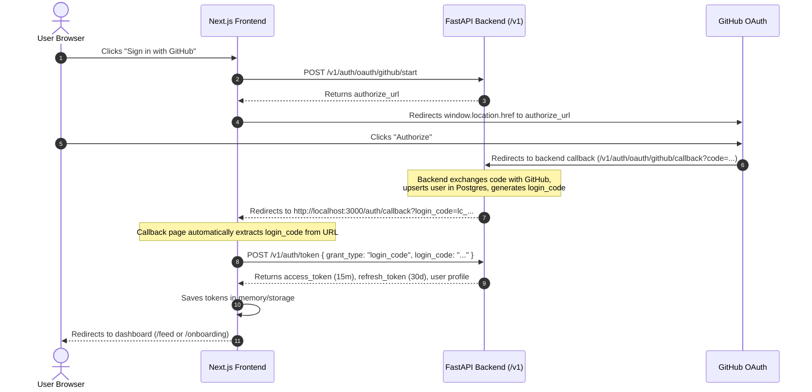

# Village Sqwhere — Backend API Documentation for Frontend

This document is the dedicated guide for the frontend team (`apps/web`) to interact with the FastAPI backend (`apps/api`). It is updated with every new feature and change.

---

## 1. Quick Reference

* **Local API Base URL:** `http://localhost:8000/v1`
* **Interactive Swagger UI (Try endpoints live):** `http://localhost:8000/docs`
* **Alternative ReDoc UI:** `http://localhost:8000/redoc`

---

## 2. Global Conventions

### The Response Envelope
All successful responses are wrapped in a top-level `data` key:

* **Single Item:**
  ```json
  {
    "data": {
      "id": "0193f2a0-0c1e-7b2a-9f10-0000000000a1",
      "username": "ada-obi"
    }
  }
  ```
* **Lists:**
  ```json
  {
    "data": [
      { "slug": "backend-engineer", "name": "Backend & Systems Engineer" }
    ]
  }
  ```

### Authentication Header
Endpoints requiring authentication expect standard HTTP Bearer authentication:
```http
Authorization: Bearer <access_token>
```
If the token is missing, invalid, or expired, the API returns HTTP `401 Unauthorized`.

---

## 3. Currently Implemented Endpoints

### 🩺 System

#### `GET /v1/health`
Health check endpoint to verify backend service liveness.

* **Authentication:** None
* **Success Response (200 OK):**
  ```json
  {
    "status": "ok",
    "version": "1.0.0"
  }
  ```

---

### 🔍 Lookups & Vocabularies

#### `GET /v1/roles`
Fetches all active platform engineering roles (e.g. for registration, role pickers, or idea collaborator requirements).

* **Authentication:** None
* **Success Response (200 OK):**
  ```json
  {
    "data": [
      {
        "slug": "frontend-engineer",
        "name": "Frontend Engineer"
      },
      {
        "slug": "backend-engineer",
        "name": "Backend & Systems Engineer"
      },
      {
        "slug": "ai-ml-engineer",
        "name": "AI / ML Engineer"
      }
    ]
  }
  ```
* **Frontend Note:** Use `slug` when sending requests to the API, and use `name` when displaying to users.

#### `GET /v1/technologies`
Search or browse active technologies, frameworks, and tools.

* **Authentication:** None
* **Query Parameters:**
  * `q` *(optional, string, 1–40 chars)*: Case-insensitive prefix search (e.g., `?q=py` returns Python, PyTorch).
  * `limit` *(optional, integer, 1–50, default: 20)*: Maximum number of results to return.
* **Success Response (200 OK):**
  ```json
  {
    "data": [
      {
        "slug": "python",
        "name": "Python"
      },
      {
        "slug": "pytorch",
        "name": "PyTorch"
      }
    ]
  }
  ```

---

### 🔐 Authentication

#### `POST /v1/auth/oauth/{provider}/start`
Initiates the OAuth + PKCE sign-in flow for GitHub or Bitbucket.

* **Authentication:** None
* **Path Parameters:**
  * `provider`: `github` or `bitbucket`
* **Request Body:**
  ```json
  {
    "intent": "login",
    "redirect_uri": "http://localhost:3000/auth/callback",
    "code_challenge": "E9Melhoa2OwvFrEMTJguCHaoeK1t8URWbuGJSstw-cM",
    "code_challenge_method": "S256"
  }
  ```
* **Success Response (200 OK):**
  ```json
  {
    "data": {
      "authorize_url": "https://github.com/login/oauth/authorize?client_id=...&redirect_uri=...&state=...",
      "expires_at": "2026-11-06T18:30:00Z"
    }
  }
  ```
* **Frontend Flow:** Redirect the user's browser to `authorize_url`.

#### `GET /v1/auth/oauth/{provider}/callback`
Handles the redirect back from GitHub or Bitbucket.

* **Authentication:** None
* **Path Parameters:**
  * `provider`: `github` or `bitbucket`
* **Query Parameters:**
  * `code`: One-time authorization code from the provider.
  * `state`: The CSRF state generated in `start`.
* **Behavior:** 
  * In production with GitHub credentials: exchanges code with GitHub, upserts user profile in Postgres, and redirects.
  * In development mode: generates a local test login code.
  * **Response:** HTTP `302 Found` redirecting the browser to `http://localhost:3000/auth/callback?login_code=lc_...`

#### `POST /v1/auth/token`
Exchanges a `login_code` (from the OAuth redirect) OR a `refresh_token` (to renew an expired session) for an active JWT `access_token` and rotated `refresh_token`.

* **Authentication:** None
* **Request Body Variant 1 — Initial Login:**
  ```json
  {
    "grant_type": "login_code",
    "login_code": "lc_your_received_login_code",
    "code_verifier": "dBjftJeZ4CVP-mB92K27uhbUJU1p1r_wW1gFWFOEjXk",
    "device_name": "Chrome on macOS"
  }
  ```
* **Request Body Variant 2 — Refreshing an Expired Access Token:**
  ```json
  {
    "grant_type": "refresh_token",
    "refresh_token": "rt_your_current_refresh_token"
  }
  ```
* **Success Response (200 OK):**
  ```json
  {
    "data": {
      "access_token": "eyJhbGciOi...",
      "token_type": "Bearer",
      "expires_in": 900,
      "refresh_token": "rt_...",
      "refresh_expires_at": "2026-12-06T18:00:00Z",
      "is_new_user": false,
      "user": {
        "id": "0193f2a0-0c1e-7b2a-9f10-0000000000a1",
        "username": "ada-obi",
        "display_name": "Ada Obi",
        "avatar_url": "https://avatars.githubusercontent.com/u/1001",
        "bio": "Backend engineer",
        "is_verified": false,
        "platform_role": "member",
        "roles": [],
        "technologies": [],
        "identities": [
          {
            "provider": "github",
            "provider_username": "ada-obi",
            "linked_at": "2026-11-06T18:00:00Z"
          }
        ],
        "created_at": "2026-11-06T18:00:00Z"
      }
    }
  }
  ```

#### `POST /v1/auth/logout`
Revokes the refresh token and signs out the session.

* **Authentication:** None
* **Request Body:**
  ```json
  {
    "refresh_token": "rt_..."
  }
  ```
* **Success Response (204 No Content):** Empty body.

---

### 👤 Current User (`/v1/me`)

#### `GET /v1/me`
Fetches the full profile of the currently signed-in user.

* **Authentication:** Bearer token required (`Authorization: Bearer <access_token>`)
* **Success Response (200 OK):**
  ```json
  {
    "data": {
      "id": "0193f2a0-0c1e-7b2a-9f10-0000000000a1",
      "username": "ada-obi",
      "display_name": "Ada Obi",
      "first_name": "Ada",
      "last_name": "Obi",
      "email": "ada@example.com",
      "email_verified": true,
      "avatar_url": "https://avatars.githubusercontent.com/u/1001",
      "bio": "Backend engineer in Lagos",
      "is_verified": true,
      "verified_at": "2026-11-06T18:00:00Z",
      "platform_role": "member",
      "roles": [
        {
          "slug": "backend-engineer",
          "name": "Backend & Systems Engineer",
          "is_primary": true,
          "verified_at": "2026-11-06T18:00:00Z",
          "verification": {
            "attempts_used": 1,
            "attempts_remaining": 2,
            "latest_status": "passed"
          }
        }
      ],
      "technologies": [
        { "slug": "python", "name": "Python" },
        { "slug": "postgresql", "name": "PostgreSQL" }
      ],
      "feed_topics": [],
      "identities": [
        {
          "provider": "github",
          "provider_username": "ada-obi",
          "linked_at": "2026-11-06T18:00:00Z"
        }
      ],
      "created_at": "2026-11-06T18:00:00Z"
    }
  }
  ```

#### `PATCH /v1/me`
Updates editable fields on the user's profile.

* **Authentication:** Bearer token required (`Authorization: Bearer <access_token>`)
* **Request Body:** *(All fields are optional; send only fields to update)*
  ```json
  {
    "display_name": "Ada O.",
    "bio": "Updated bio description",
    "first_name": "Ada",
    "last_name": "Obi",
    "email": "new-email@example.com"
  }
  ```
* **Success Response (200 OK):** Returns the full updated user profile wrapped in `{"data": { ... }}`.

---

## 4. Frontend Integration Guide: Authentication & Dev Simulation

### How the Sign-In Flow Works for End Users (100% Automated)
In production and regular use, **the user never touches or sees a `login_code`**. The frontend coordinates the handshake automatically:



### Is Dev Simulation Mode Industry Standard?
**Yes, absolutely.** In modern software development (e.g. Stripe, GitHub, Google, Vercel), this pattern is known as **Auth Stubbing / Mock Provider Bypass**. 

Running real third-party OAuth on every local developer machine introduces severe bottlenecks:
1. **Third-Party Rate Limits & 2FA:** Automated CI test suites and local testing can trip GitHub anti-bot systems or 2FA prompts.
2. **Offline Development:** Engineers working offline or in low-connectivity settings cannot sign in with real GitHub.
3. **Multi-User Personas:** Testing interactions between two developers (e.g. Idea Creator Ada vs Collaborator Tunde) would otherwise require managing multiple real GitHub accounts.

With our simulation mode, frontend engineers can switch personas and sign in instantly without touching external servers.

---

### How the Frontend Implements Dev Mode vs Live Mode

The frontend can easily support both modes using a simple environment variable or a "Quick Dev Login" button on the login screen during development (`NODE_ENV === "development"`):

#### Option A: Normal Sign-in (Live GitHub or Standard Redirect)
1. Generate PKCE pair (`code_verifier` and `code_challenge`). Store `code_verifier` in `sessionStorage`.
2. Frontend calls `POST /v1/auth/oauth/github/start` passing `code_challenge`.
3. Redirects browser to `authorize_url`.
4. User authorises on GitHub.
5. Browser lands back on `/auth/callback?login_code=lc_...`.
6. Frontend retrieves `code_verifier` from `sessionStorage` and calls `POST /v1/auth/token` with `{ grant_type: "login_code", login_code, code_verifier }`.

#### Ready-to-use PKCE Helper for Frontend (`apps/web`):
The frontend can drop this standard helper directly into its codebase (uses native Web Crypto API, 0 external packages required):

```typescript
// pkce.ts
export async function generatePKCE() {
  // 1. Generate random code_verifier (43-128 chars)
  const array = new Uint8Array(32);
  window.crypto.getRandomValues(array);
  const code_verifier = btoa(String.fromCharCode(...array))
    .replace(/\+/g, "-")
    .replace(/\//g, "_")
    .replace(/=+$/, "");

  // 2. Hash it with SHA-256 to create code_challenge
  const encoder = new TextEncoder();
  const data = encoder.encode(code_verifier);
  const digest = await window.crypto.subtle.digest("SHA-256", data);
  const code_challenge = btoa(String.fromCharCode(...new Uint8Array(digest)))
    .replace(/\+/g, "-")
    .replace(/\//g, "_")
    .replace(/=+$/, "");

  // Save verifier in sessionStorage to verify during token exchange
  sessionStorage.setItem("pkce_verifier", code_verifier);

  return { code_challenge, code_verifier };
}
```

#### Option B: Instant Dev Bypass (No GitHub Required)
During local development, the frontend can bypass the external redirect entirely:
```typescript
// Example: Dev-only instant login helper (apps/web)
async function devLogin(developerHandle: string = "developer_samuel") {
  const response = await fetch("http://localhost:8000/v1/auth/token", {
    method: "POST",
    headers: { "Content-Type": "application/json" },
    body: JSON.stringify({
      grant_type: "login_code",
      login_code: `lc_gh_${developerHandle}`,
    }),
  });
  
  const { data } = await response.json();
  // data contains: access_token, refresh_token, and user profile!
  saveAuthSession(data);
}
```

---

### Silent Token Refreshing (Staying Logged In)
* Access tokens expire every **15 minutes** (`900 seconds`).
* Refresh tokens remain valid for **30 days**.
* The frontend HTTP client (e.g., Axios interceptor or custom `fetch` wrapper) should intercept HTTP `401 Unauthorized` responses and silently call:
  ```http
  POST /v1/auth/token
  Content-Type: application/json

  {
    "grant_type": "refresh_token",
    "refresh_token": "<stored_refresh_token>"
  }
  ```
* Save the new `access_token` and the new rotated `refresh_token`, then retry the original failed request. The user experiences zero interruption.


