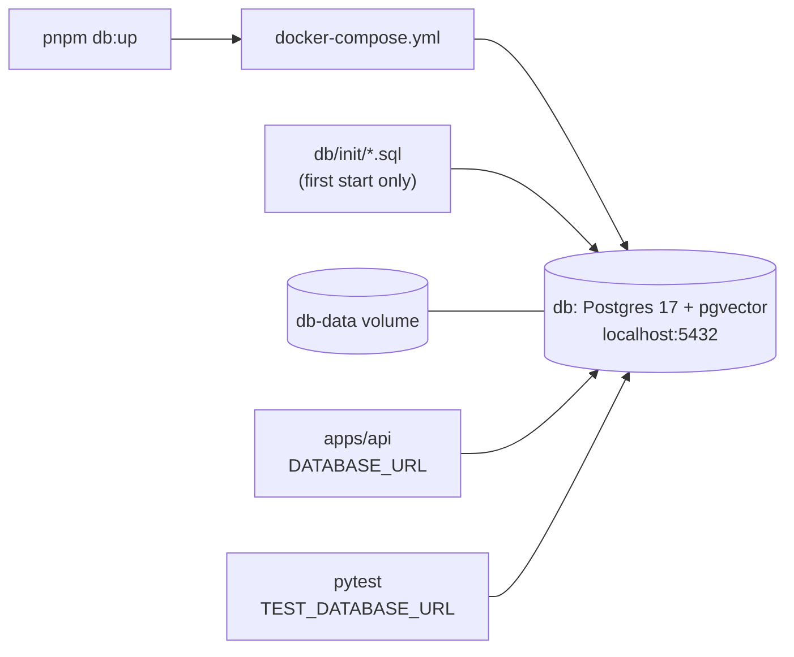
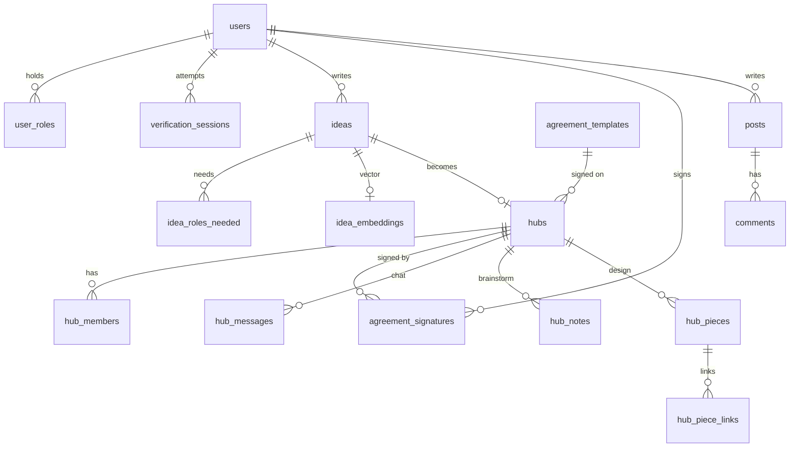

# infra

The database Village Sqwhere runs on: PostgreSQL 17 with
[pgvector](https://github.com/pgvector/pgvector), in Docker, and the SQL scripts that build its
schema.

```text
infra/
  docker-compose.yml   one service: db (pgvector/pgvector:0.8.7-pg17) on localhost:5432
  db/init/             001 to 018: run once, in order, on an empty database
```



## The schema at a glance

The tables behind the main flow, from `db/init/002-schema.sql` and the scripts after it
(33 tables in all):



The database guards the rules the API depends on, so a bug in the API cannot break them:

```sql
-- a hub's terms can never change once it exists (003-hub-terms.sql)
UPDATE hubs SET terms = '{"ownership_model": "owner_majority"}' WHERE id = '...';
-- ERROR:  hub terms are immutable; members signed them
```

## Local database

`docker-compose.yml` runs PostgreSQL 17 with the [pgvector](https://github.com/pgvector/pgvector)
extension, which the API uses for AI idea matching.

```bash
pnpm db:up      # start Postgres on localhost:5432
pnpm db:down    # stop it (data is kept in the db-data volume)
```

Scripts in `db/init/` run only when the volume is first created. To start from an empty
database, run `docker compose -f infra/docker-compose.yml down -v`, then `pnpm db:up`.

### The init scripts

They run in file name order, once, on an empty database:

| Script | What it holds |
|---|---|
| `001-extensions.sql` | The pgvector extension. |
| `002-schema.sql` | The tables, constraints and triggers. |
| `003-hub-terms.sql` | `hubs.terms`: the deal a hub owner sets for their hub, for example `{"ownership_model": "equal_split"}`. It must be a JSON object, it is set when the hub is created and the database refuses any later change. Each signature in `agreement_signatures` gets the hub's own terms copied into `terms_snapshot`, whatever the client sent, so every member signs exactly the same terms. |
| `004-test-agreement.sql` | One published agreement template, version 1, titled `TEST AGREEMENT (NOT LEGAL TEXT)`. Hubs can only be created on a published template, so this lets us build and test hubs. Running it twice is safe. |
| `005-verification-phases.sql` | The `verification_phase` type (`codebase_analysis`, `technical_defence`, `report_generation`) and `verification_sessions.current_phase`, which tracks where an attempt is in the AI verification. |
| `006-verification-analysis-retries.sql` | `verification_sessions.analysis_attempts` (a count, 0 at first) and `verification_sessions.last_error`. The worker counts each analysis start and retries a failed one until `VERIFICATION_MAX_ANALYSIS_ATTEMPTS` is reached. |
| `007-verification-interviews.sql` | The technical defence interview: the `interview_status` type (`active`, `completed`, `incomplete`, `abandoned`), `verification_interviews` (one per attempt, with the welcome and closing messages) and `verification_interview_turns` (one row per question, with the answer, the acknowledgement and the security flags). |
| `008-verification-interview-incomplete.sql` | Adds `incomplete` to `interview_status` if it is missing. On an empty database it changes nothing, because `007` already creates it. Running it twice is safe. |
| `009-verification-interview-conversation.sql` | Adds `welcome_message` and `closing_message` to `verification_interviews` and `acknowledgement` to `verification_interview_turns`, if they are missing. On an empty database it changes nothing, because `007` already creates them. Running it twice is safe. |
| `010-sectors.sql` | `sectors` (the ten areas onboarding asks about, such as `fintech` and `health`) and `user_sectors` (each developer's chosen set). Running it twice is safe, so a database made before it can run it once by hand. |
| `011-demo-account.sql` | `users.is_demo`, which marks every account in the read-only demo: the shared account "Try the demo" signs in as, and the made-up developers whose content it shows. Running it twice is safe. |
| `012-join-request-cooldown.sql` | `hub_members.declines_in_a_row` and `hub_members.can_ask_again_at`: how long a developer the owner turned down waits before asking that hub again (48 hours, or 30 days after five declines in a row). Running it twice is safe. |
| `013-hub-decline-kind.sql` | The `hub_decline_kind` type and `hub_members.decline_kind`: whether a `declined` row was an invitation the developer declined, a request the owner turned down or a request the developer withdrew. Rows declined before it have none. Running it twice is safe. |
| `014-user-country.sql` | `users.country_code`: the country a developer names on their profile, two capital letters such as `NG`, empty until they choose. The API allows only the 54 African countries. Running it twice is safe. |
| `015-verification-language.sql` | `verification_sessions.language` (`en` or `fr`, default `en`): the language the AI interview and the report use for an attempt. It is set when the attempt starts and never changes. Running it twice is safe. |
| `016-hub-phases.sql` | The `hub_phase` type, `hubs.phase` and `hubs.team_confirmed_at` (both empty until the owner confirms the team), and `hub_phase_moves`, an append-only log of every phase change. Running it twice is safe. |
| `017-hub-notes.sql` | `hub_notes`, the brainstorm sticky notes of a hub: 1 to 280 characters, removed softly with `deleted_at`. Running it twice is safe. |
| `018-hub-design.sql` | `hub_pieces` and `hub_piece_links`, the design sketch of a hub: pieces with a name and a summary, and labelled links from one piece to another, removed softly with `deleted_at`. Running it twice is safe. |
| `019-hub-build.sql` | The build tab of a hub: who holds a piece (`hub_pieces.claimed_by` and `claimed_at`), the public GitHub address the owner pastes (`hubs.repository_url`, with `commits_refreshed_at`), and `hub_commits`, a copy of the repository's latest commits that every refresh replaces, so its rows are really deleted. Running it twice is safe. |
| `020-hub-agreement-v2.sql` | The hub agreement, version 2, published: the text every new hub is created on, in English and then in French. Version 1 stays for the hubs that signed it. Running it twice is safe. |
| `022-demo-hubs-agreement-v2.sql` | Moves the demo's hubs, and the made-up signatures in them, from version 1 of the agreement to version 2, so the demo stops showing the test text. Only hubs owned and signed by demo accounts (`users.is_demo`); nothing is deleted. It needs 020 first and stops with an error without it. Running it twice is safe. |
| `026-demo-signature-dates.sql` | Dates each demo signature the moment its member joined, so a hub page does not say "You signed" on the day the demo was seeded, after ten days of work. Only signatures made by demo accounts (`users.is_demo`) in hubs owned by demo accounts, and only when they are later than the joining; nothing is deleted. Running it twice is safe. |

**An existing local database does not get 003 to 009 by itself.** Rebuild it, which deletes
your local data:

```bash
docker compose -f infra/docker-compose.yml down -v
pnpm db:up
```

**New hubs use the agreement in `020-hub-agreement-v2.sql`.** Published templates cannot be
edited (the database refuses it), so a change to the text is always a new version in a new
script. `004-test-agreement.sql` holds version 1, a test text: it stays because hubs created
on it keep pointing at it, and no new hub takes it. The one exception is the demo:
`022-demo-hubs-agreement-v2.sql` moves the demo accounts' hubs to version 2, because their
signatures are made up (`docs/decisions/2026-11-15-demo-hubs-on-agreement-v2.md`).

The local credentials (`village` / `village`) are for development only. They match
`DATABASE_URL` in the root `.env.example`.

CI uses the same image and credentials, and applies the same `db/init/` scripts in the same
order before the API tests (see the `api` job in `.github/workflows/ci.yml`). A new init
script therefore runs in CI too, and it must work on an empty database.

## Deployment (Systalink)

ACODev 2026 requires the app to run on Systalink's platform (platform.systalink.com).
The deployment setup is still to be written: hosting for `apps/web` and `apps/api`, a
managed Postgres with pgvector, and environment variables. Add it here, under
`infra/systalink/`, once the team has platform access.
