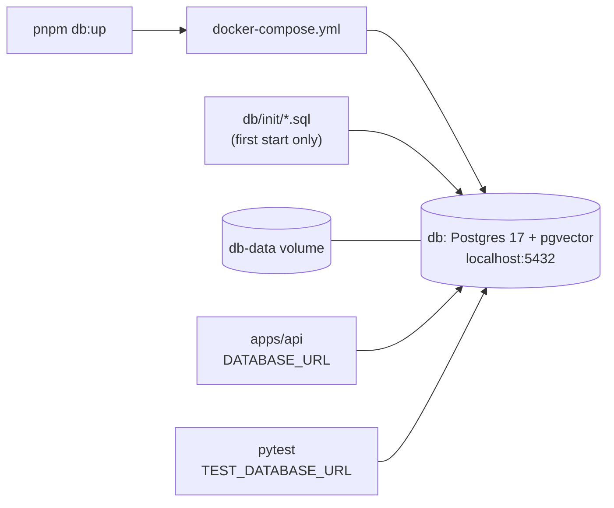
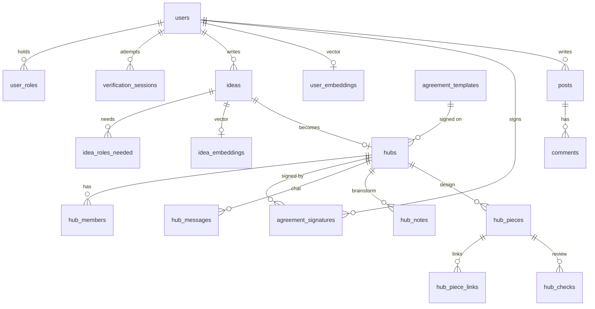
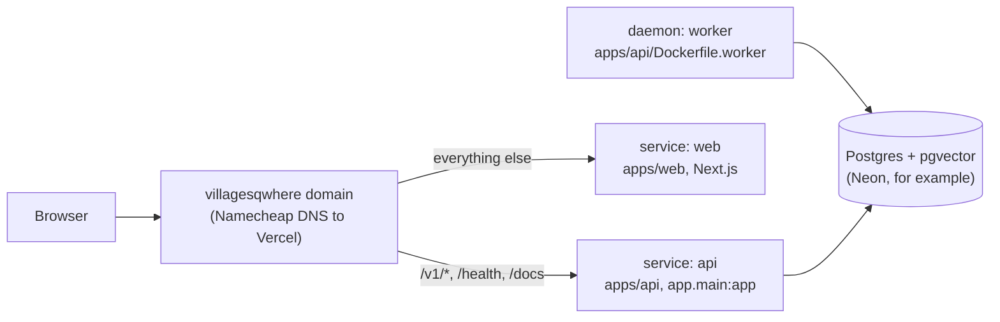

# infra

The database Village Sqwhere runs on: PostgreSQL 17 with
[pgvector](https://github.com/pgvector/pgvector), in Docker, and the SQL scripts that build its
schema.

```text
infra/
  docker-compose.yml   one service: db (pgvector/pgvector:0.8.7-pg17) on localhost:5432
  db/init/             001 to 018: run once, in order, on an empty database
```



## The schema at a glance

The tables behind the main flow, from `db/init/002-schema.sql` and the scripts after it
(39 tables in all):



The database guards the rules the API depends on, so a bug in the API cannot break them:

```sql
-- a hub's terms can never change once it exists (003-hub-terms.sql)
UPDATE hubs SET terms = '{"ownership_model": "owner_majority"}' WHERE id = '...';
-- ERROR:  hub terms are immutable; members signed them
```

## Local database

`docker-compose.yml` runs PostgreSQL 17 with the [pgvector](https://github.com/pgvector/pgvector)
extension, which the API uses for AI idea matching.

```bash
pnpm db:up      # start Postgres on localhost:5432
pnpm db:down    # stop it (data is kept in the db-data volume)
```

Scripts in `db/init/` run only when the volume is first created. To start from an empty
database, run `docker compose -f infra/docker-compose.yml down -v`, then `pnpm db:up`.

### The init scripts

They run in file name order, once, on an empty database:

| Script | What it holds |
|---|---|
| `001-extensions.sql` | The pgvector extension. |
| `002-schema.sql` | The tables, constraints and triggers. |
| `003-hub-terms.sql` | `hubs.terms`: the deal a hub owner sets for their hub, for example `{"ownership_model": "equal_split"}`. It must be a JSON object, it is set when the hub is created and the database refuses any later change. Each signature in `agreement_signatures` gets the hub's own terms copied into `terms_snapshot`, whatever the client sent, so every member signs exactly the same terms. |
| `004-test-agreement.sql` | One published agreement template, version 1, titled `TEST AGREEMENT (NOT LEGAL TEXT)`. Hubs can only be created on a published template, so this lets us build and test hubs. Running it twice is safe. |
| `005-verification-phases.sql` | The `verification_phase` type (`codebase_analysis`, `technical_defence`, `report_generation`) and `verification_sessions.current_phase`, which tracks where an attempt is in the AI verification. |
| `006-verification-analysis-retries.sql` | `verification_sessions.analysis_attempts` (a count, 0 at first) and `verification_sessions.last_error`. The worker counts each analysis start and retries a failed one until `VERIFICATION_MAX_ANALYSIS_ATTEMPTS` is reached. |
| `007-verification-interviews.sql` | The technical defence interview: the `interview_status` type (`active`, `completed`, `incomplete`, `abandoned`), `verification_interviews` (one per attempt, with the welcome and closing messages) and `verification_interview_turns` (one row per question, with the answer, the acknowledgement and the security flags). |
| `008-verification-interview-incomplete.sql` | Adds `incomplete` to `interview_status` if it is missing. On an empty database it changes nothing, because `007` already creates it. Running it twice is safe. |
| `009-verification-interview-conversation.sql` | Adds `welcome_message` and `closing_message` to `verification_interviews` and `acknowledgement` to `verification_interview_turns`, if they are missing. On an empty database it changes nothing, because `007` already creates them. Running it twice is safe. |
| `010-sectors.sql` | `sectors` (the ten areas onboarding asks about, such as `fintech` and `health`) and `user_sectors` (each developer's chosen set). Running it twice is safe, so a database made before it can run it once by hand. |
| `011-demo-account.sql` | `users.is_demo`, which marks every account in the read-only demo: the shared account "Try the demo" signs in as, and the made-up developers whose content it shows. Running it twice is safe. |
| `012-join-request-cooldown.sql` | `hub_members.declines_in_a_row` and `hub_members.can_ask_again_at`: how long a developer the owner turned down waits before asking that hub again (48 hours, or 30 days after five declines in a row). Running it twice is safe. |
| `013-hub-decline-kind.sql` | The `hub_decline_kind` type and `hub_members.decline_kind`: whether a `declined` row was an invitation the developer declined, a request the owner turned down or a request the developer withdrew. Rows declined before it have none. Running it twice is safe. |
| `014-user-country.sql` | `users.country_code`: the country a developer names on their profile, two capital letters such as `NG`, empty until they choose. The API allows only the 54 African countries. Running it twice is safe. |
| `015-verification-language.sql` | `verification_sessions.language` (`en` or `fr`, default `en`): the language the AI interview and the report use for an attempt. It is set when the attempt starts and never changes. Running it twice is safe. |
| `016-hub-phases.sql` | The `hub_phase` type, `hubs.phase` and `hubs.team_confirmed_at` (both empty until the owner confirms the team), and `hub_phase_moves`, an append-only log of every phase change. Running it twice is safe. |
| `017-hub-notes.sql` | `hub_notes`, the brainstorm sticky notes of a hub: 1 to 280 characters, removed softly with `deleted_at`. Running it twice is safe. |
| `018-hub-design.sql` | `hub_pieces` and `hub_piece_links`, the design sketch of a hub: pieces with a name and a summary, and labelled links from one piece to another, removed softly with `deleted_at`. Running it twice is safe. |
| `019-hub-build.sql` | The build tab of a hub: who holds a piece (`hub_pieces.claimed_by` and `claimed_at`), the public GitHub address the owner pastes (`hubs.repository_url`, with `commits_refreshed_at`), and `hub_commits`, a copy of the repository's latest commits that every refresh replaces, so its rows are really deleted. Running it twice is safe. |
| `020-hub-agreement-v2.sql` | The hub agreement, version 2, published: the text every new hub is created on, in English and then in French. Version 1 stays for the hubs that signed it. Running it twice is safe. |
| `021-hub-review.sql` | The review checklist of a hub: `hub_checks`, short checks written against a piece and ticked by a teammate, removed softly with `deleted_at` and `deleted_by`, and `hubs.finished_at`, empty until the owner finishes the hub. Running it twice is safe. |
| `022-demo-hubs-agreement-v2.sql` | Moves the demo's hubs, and the made-up signatures in them, from version 1 of the agreement to version 2, so the demo stops showing the test text. Only hubs owned and signed by demo accounts (`users.is_demo`); nothing is deleted. It needs 020 first and stops with an error without it. Running it twice is safe. |
| `023-user-onboarding-done.sql` | `users.onboarding_completed_at`: when a developer finished onboarding, empty until then. The API sets it once and never clears it. Running it twice is safe. |
| `024-user-matching-pause.sql` | `users.matching_paused_at`: set while a developer has paused matching, so owners are not shown them as a match; empty while matching is on. Running it twice is safe. |
| `025-embeddings.sql` | `idea_embeddings` moves to `gemini-embedding-2` and 768 numbers (it removes rows of another model first, since the worker makes them again), and `user_embeddings` is new. Triggers remove a developer's vector when their bio, verified roles, technologies or sectors change. Numbers 021 to 024 belong to other work. Running it twice is safe. |
| `026-demo-signature-dates.sql` | Dates the demo's made-up signatures at the moment each member joined, where the seed had left them at the day it ran. Only signatures of demo accounts (`users.is_demo`) in hubs a demo account owns; nothing is deleted. Running it twice is safe. |
| `027-post-image-bytes.sql` | Post images live in Postgres: `post_attachments.data` holds the bytes, `storage_key` is no longer required, and the size cap drops from 5 MB to 4 MB to fit Vercel's request limit. The table was empty before it, since uploads had not shipped. Running it twice is safe. |
| `028-embeddings-on-openai.sql` | `idea_embeddings` and `user_embeddings` move from `gemini-embedding-2` to OpenAI's `text-embedding-3-small`, still 768 numbers. It removes every vector of another model, since two models cannot be compared and the worker makes them again. Running it twice is safe; if `025` is ever run again, run this one after it. |
| `029-sign-in-state.sql` | Sign-in state every API instance shares: `oauth_states` (the one-time states `/start` issues), `login_codes` (the one-time codes the callback issues) and `revoked_refresh_tokens` (tokens signed out or rotated). A row is found by the SHA-256 of the value, which is never stored, and is of no use after `expires_at`; the API deletes expired rows when it writes a new one. Running it twice is safe. |
| `030-post-search.sql` | A search index on posts (`posts_search_idx`, a partial GIN index on the title and text words, ignoring case and accents). The API searches the same way without it, so applying it only keeps search fast as posts grow. Running it twice is safe. |

**An existing local database does not get 003 to 009 by itself.** Rebuild it, which deletes
your local data:

```bash
docker compose -f infra/docker-compose.yml down -v
pnpm db:up
```

**New hubs use the agreement in `020-hub-agreement-v2.sql`.** Published templates cannot be
edited (the database refuses it), so a change to the text is always a new version in a new
script. `004-test-agreement.sql` holds version 1, a test text: it stays because hubs created
on it keep pointing at it, and no new hub takes it. The one exception is the demo:
`022-demo-hubs-agreement-v2.sql` moves the demo accounts' hubs to version 2, because their
signatures are made up (`docs/decisions/2026-11-15-demo-hubs-on-agreement-v2.md`).

The local credentials (`village` / `village`) are for development only. They match
`DATABASE_URL` in the root `.env.example`.

CI uses the same image and credentials, and applies the same `db/init/` scripts in the same
order before the API tests (see the `api` job in `.github/workflows/ci.yml`). A new init
script therefore runs in CI too, and it must work on an empty database.

## Deployment (Vercel)

The whole app deploys as one Vercel project, from [`vercel.json`](../vercel.json) at the
repository root: the web app, the API and the verification worker, on one domain.



Because the web app and the API share one domain, there is no cross-origin call: the browser
reaches the API at `https://<domain>/v1/...`.

### Set it up

1. **Create the project** on the AI UniPod's Vercel team, importing this repository. Leave the
   root directory at the repository root and the framework on what Vercel detects from
   `vercel.json` (Services).
2. **Add a Postgres database with pgvector**, for example Neon from the Vercel Marketplace,
   in Frankfurt (`eu-central-1`). `vercel.json` runs the functions in `fra1`, next to it:
   each query crosses from the function to the database, so a page that makes 20 queries
   waits for 20 round trips. From `iad1` (Washington), the default, each one took about
   0.1 to 0.25 seconds. If the database moves, move `regions` with it.
3. **Build the schema once**, from your computer, with the direct connection string:

   ```bash
   for f in infra/db/init/*.sql; do psql "$DATABASE_URL" -v ON_ERROR_STOP=1 -f "$f" || break; done
   ```

   A script added later does not reach this database by itself. Run it by hand before the
   code that needs it deploys: without `029-sign-in-state.sql`, sign-in answers `500`.

4. **Set the environment variables** (Production, and Preview if wanted):

   | Variable | Value |
   |---|---|
   | `DATABASE_URL` | With Neon connected through Vercel, nothing to add: the API uses Neon's `DATABASE_URL_UNPOOLED` (the direct address) first and turns `sslmode` into `ssl`, because asyncpg rejects `sslmode` and breaks on transaction pooling. With another host, give the direct URL. |
   | `JWT_SECRET_KEY` | A new random value of 32 characters or more, never the local one |
   | `NEXT_PUBLIC_API_URL`, `FRONTEND_URL`, `CORS_ORIGINS` | `https://<domain>` |
   | `GITHUB_CLIENT_ID`, `GITHUB_CLIENT_SECRET` | A GitHub OAuth app for the real domain, with the callback `https://<domain>/v1/auth/oauth/github/callback` |
   | `GROQ_API_KEY`, `GEMINI_API_KEY` and the model names | As in `.env.example` |
   | `OPENAI_API_KEY` | For the worker: the vectors the match score reads. Without it the score stays partial |
   | `DEMO_ENABLED` | `true` to offer "Try the demo"; then run `python -m app.demo_seed` once against the database |

5. **Deploy**, then open `https://<deployment>/health`: it answers `{"status":"ok", ...}`.
6. **Add the domain** under the project's Domains settings, then at Namecheap (Domain List,
   Manage, Advanced DNS) add the records Vercel shows: usually an `A` record for `@` and a
   `CNAME` for `www`. Update the four URL variables above if they still name the
   `vercel.app` address, and redeploy.

   **Use the address people end up on.** When the domain redirects one name to the other (the
   apex to `www`, for example), put that final address in `NEXT_PUBLIC_API_URL`,
   `FRONTEND_URL`, `CORS_ORIGINS` and the GitHub callback. An address on the other name makes
   every API call cross-site: `CORS_ORIGINS` matches one exact address, and a redirect on a
   call from the browser breaks it. `NEXT_PUBLIC_API_URL` is fixed when the site is built, so
   change it, then redeploy without the build cache.

### Check that sign-in works

Each check is an effect you can see, and none needs a secret.

1. `https://<domain>/health` answers `{"status":"ok", ...}`. A 500 with
   `FUNCTION_INVOCATION_FAILED` means the API did not start: look for a missing
   `JWT_SECRET_KEY` first.
2. On `/en/sign-in`, the browser's network panel shows the call to
   `/v1/auth/oauth/github/start` going to the site's own address, not `localhost:8000`.
3. The GitHub button leads to GitHub's approval screen for the app. "redirect_uri is not
   associated with this application" means the callback address does not match the one
   registered in the OAuth app.
4. After you approve, the browser comes back to `/en/auth/callback?login_code=...` and then
   lands on `/en/onboarding`. `?error=INVALID_STATE` means the sign-in took more than 10
   minutes or its link was used twice: start again. Any API instance can finish a sign-in
   another started, because the state is in the database (`029-sign-in-state.sql`).
5. A reload keeps you signed in, and `GET /v1/me` answers 200.
6. "Try the demo" opens the feed. It does not use GitHub, so it works while sign-in is still
   being set up.

### Known limits on Vercel

| Limit | Effect | Plan |
|---|---|---|
| The interview runs over a WebSocket | A function's maximum duration caps one interview | Raise the API function's duration if interviews are cut short |
| The API logs every SQL statement (`echo=True` in `app/database.py`) | Noisy, costly logs | Turn it off outside development |
